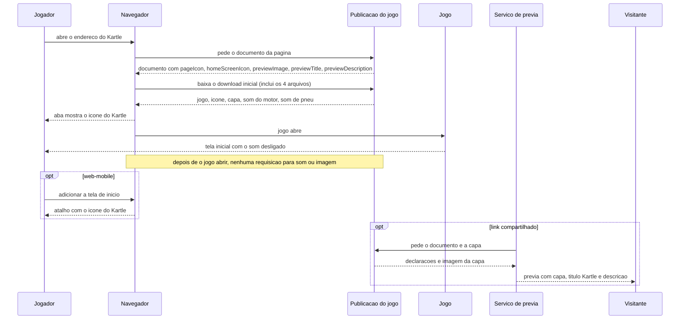

# FLOW-0001 — Abertura da página, entrega dos arquivos e prévia do link

Como o ícone, a capa e os dois sons chegam: o navegador do Jogador recebe o documento da página com as
declarações e, dentro do download inicial, os 4 arquivos; a aba mostra o ícone; o jogo abre com o som
desligado. Em separado, um serviço de prévia lê o mesmo documento e a capa para montar a prévia que o
Visitante vê. Realiza [FEAT-0001](../features/FEAT-0001-icone-do-jogo.md),
[FEAT-0002](../features/FEAT-0002-capa-na-previa-do-link.md) e a parte de entrega de
[FEAT-0005](../features/FEAT-0005-requisitos-transversais.md).

Rede: o passo de abertura precisa da rede uma vez, para o download inicial; **depois de o jogo abrir, o
fluxo roda sem rede** e nenhuma requisição é feita para som ou imagem desta feature (D-FS-08, NFR-0003). Não
há servidor de aplicação: a publicação entrega arquivos estáticos. Nenhum evento externo que mude estado
entra neste fluxo; as leituras do serviço de prévia são leituras puras e não precisam de deduplicação
(D-FS-03).

## Passos

| Passo | Ator | Ação | Resultado | Fonte |
|---|---|---|---|---|
| 1 | Jogador | Abre o endereço do Kartle em `web-desktop` ou `web-mobile` | O navegador pede o documento da página | US-0001, Pré-condições |
| 2 | Publicação | Entrega o documento com as cinco declarações de [API-0001](../api/API-0001-declaracoes-da-pagina-do-jogo.md) | O mesmo documento nos dois canais | AC-US-0002-01, AC-US-0002-03, AC-US-0002-04 |
| 3 | Navegador | Baixa o download inicial, que inclui o ícone, a capa, o som do motor e o som de pneu na forma entregue | 4 de 4 arquivos dentro do download inicial, abaixo dos limites de [RULE-0003](../rules/RULE-0003-arquivos-da-feature-peso-e-licenca.md) | NFR-0001, NFR-0003 |
| 4 | Navegador | Desenha o ícone declarado em `pageIcon` na aba | A aba mostra o ícone do Kartle | AC-US-0001-01, AC-US-0001-02 |
| 5 | Jogo | Abre com `soundOn` falso e mostra o som desligado no controle de som | Nenhum som toca; a capa não aparece em nenhuma tela | AC-US-0003-08, AC-US-0002-07 |
| 6 | Jogo | Depois de aberto, não pede som nem imagem desta feature à rede | 0 requisições; com a rede desligada, tudo continua igual | NFR-0003 |
| 7 | Jogador (`web-mobile`) | Usa "adicionar à tela de início" | O atalho mostra o ícone declarado em `homeScreenIcon` | AC-US-0001-03 |
| 8 | Serviço de prévia | Lê o documento e a imagem de `previewImage`, fora do jogo | A prévia mostra a capa, "Kartle" e a descrição ao Visitante | AC-US-0002-01, AC-US-0002-03, AC-US-0002-04 |

## Casos de erro e de borda

| Caso | Onde | Comportamento |
|---|---|---|
| Sem rede, ou tempo esgotado, antes de o download inicial terminar | passos 2 e 3 | O jogo não abre; nenhum requisito desta feature muda esse comportamento |
| Imagem do ícone ausente ou ilegível | passo 4 | A aba fica sem o ícone do Kartle; o jogo abre igual |
| Arquivo de som ausente ou ilegível no download inicial | passo 3 | O jogo abre; `engineSoundAvailable` ou `tireSoundAvailable` falso; nenhuma nova tentativa pela rede |
| Navegador sem "adicionar à tela de início" | passo 7 | O passo não acontece; os demais valem |
| Serviço de prévia não baixa a imagem, ou não monta prévia | passo 8 | Prévia sem imagem, ou só o endereço; título e descrição continuam declarados |
| Documento pedido de novo, em duplicata ou fora de ordem (recarga, vários serviços de prévia) | passos 2 e 8 | Leitura pura: mesmas declarações, nenhum estado muda; na recarga o jogo abre de novo com o som desligado |
| Rede desligada depois de o jogo abrir | passo 6 | Sem efeito: ícone já na aba, sons já carregados |
| Sensor ausente ou permissão negada (`web-mobile`) | qualquer | Toque com estado visível (I4); o fluxo não muda |
