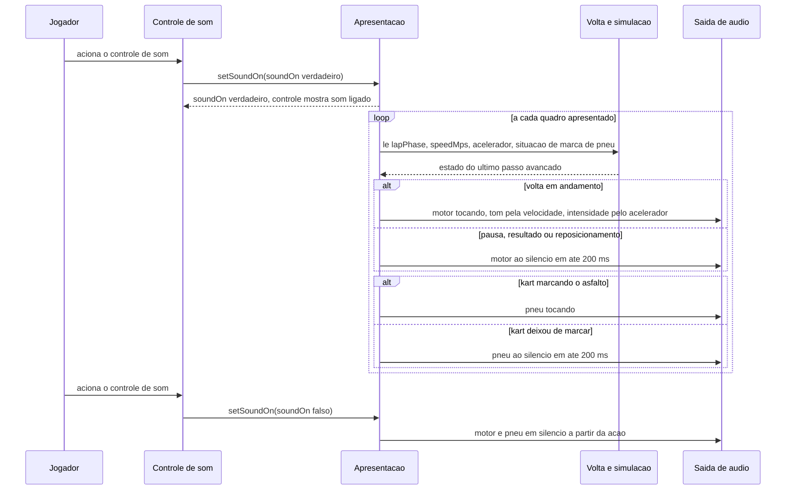

# FLOW-0002 — Som do motor e som de pneu durante a volta

Como o som acompanha a volta: o Jogador liga o som no controle; a cada quadro apresentado a apresentação lê
o estado da volta, a telemetria e a situação de marca de pneu do último passo avançado e pede à saída de
áudio o motor e o pneu; quando a volta deixa de estar em andamento, o motor silencia. Realiza
[FEAT-0003](../features/FEAT-0003-som-do-motor-gravado.md) e
[FEAT-0004](../features/FEAT-0004-som-de-pneu.md), pelas regras de
[RULE-0001](../rules/RULE-0001-estado-do-som-e-som-do-motor.md) e
[RULE-0002](../rules/RULE-0002-som-de-pneu.md).

Rede: **o fluxo inteiro roda sem rede** — os sons vieram no download inicial (D-FS-08, NFR-0003). Nenhum
evento externo entra neste fluxo: só a ação do Jogador na página e o estado da própria simulação; não há o
que deduplicar entre aparelhos (D-FS-03). A apresentação só lê a simulação; nada é escrito de volta (I2,
D-FS-05).

## Passos

| Passo | Ator | Ação | Resultado | Fonte |
|---|---|---|---|---|
| 1 | Jogador | Aciona o controle de som, com o som desligado | `setSoundOn` com `soundOn` verdadeiro ([API-0002](../api/API-0002-estado-e-comando-do-som.md)); o controle mostra o som ligado | AC-US-0003-09 |
| 2 | Apresentação | A cada quadro apresentado, lê `lapPhase`, `speedMps`, o comando de aceleração e a situação de marca de pneu do último passo avançado | Leitura pura; a simulação não muda | NFR-0009 |
| 3 | Apresentação | Com a volta em andamento, pede o motor tocando em até 50 ms e sem silêncio maior que 50 ms | `ENGINE_PLAYING`; `engineGainNorm` maior que 0 | AC-US-0003-01 |
| 4 | Apresentação | Ajusta o tom pela velocidade e a intensidade pelo acelerador | `enginePitchRatio` maior a 20 m/s que a 5 m/s; `engineGainNorm` maior com o acelerador pressionado | AC-US-0003-02, AC-US-0003-03 |
| 5 | Apresentação | Com o kart marcando o asfalto, pede o pneu tocando | `TIRE_PLAYING`; `tireGainNorm` maior que 0 | AC-US-0004-01 |
| 6 | Apresentação | Quando o kart deixa de marcar, leva o pneu ao silêncio em até 200 ms | `TIRE_SILENT`; `tireGainNorm` 0 | AC-US-0004-02 |
| 7 | Apresentação | Quando a volta deixa de estar em andamento por pausa, resultado ou reposicionamento, leva o motor ao silêncio em até 200 ms | `ENGINE_SILENT`; `engineGainNorm` 0 | AC-US-0003-04, AC-US-0003-05, AC-US-0003-06 |
| 8 | Apresentação | Com a volta de novo em andamento, volta ao passo 3 | Motor tocando de novo | US-0003, caso anormal "Volta retomada depois de pausa ou reposicionamento" |
| 9 | Jogador | Aciona o controle de som, com o som ligado | `setSoundOn` com `soundOn` falso; motor e pneu em silêncio a partir da ação; o controle mostra o som desligado | AC-US-0003-07, AC-US-0004-05 |

## Casos de erro e de borda

| Caso | Onde | Comportamento |
|---|---|---|
| Som nunca ligado | passo 1 não acontece | `soundOn` continua falso; nenhum som desta feature toca; nenhum outro evento liga o som |
| Som ligado no meio de uma volta ou de um deslize | passo 1 | Valem os passos 3 a 5 a partir da ação |
| Ação repetida, ou pedido para o estado em que o som já está | passos 1 e 9 | Sem efeito: `setSoundOn` é idempotente |
| Nenhum passo avançado entre dois quadros | passo 2 | Os valores não mudam: vale o último passo avançado, e o quadro sem passo novo não é simulação suspensa nem parada. Suspensa ou parada é `lapPhase` `PAUSED` ou `ENDED` ([RULE-0002](../rules/RULE-0002-som-de-pneu.md)); só então o kart deixa de marcar |
| Vários passos avançados entre dois quadros | passo 2 | Vale o último; nenhum passo intermediário é estimado |
| Mesmo passo lido duas vezes, ou leitura fora de ordem | passo 2 | O estado é função do último passo avançado (`simStepCount`); nada é reiniciado |
| Deslizes curtos em sequência | passos 5 e 6 | Se o kart volta a marcar antes do silêncio, o pneu continua tocando |
| Arquivo de som ausente, ilegível, ou navegador sem áudio | passos 3 e 5 | O som correspondente não toca; a volta, o tempo e os setores não mudam |
| Tempo esgotado ao carregar um som na abertura | antes do passo 1 | Tratado como arquivo ausente; nenhuma nova tentativa pela rede depois de o jogo abrir |
| Rede desligada | qualquer | Sem efeito |
| Perda de foco que pausa a volta | passo 7 | Motor ao silêncio em até 200 ms, pela pausa; `soundOn` não muda |
| Recarga ou abandono da página | qualquer | O som para com a página; na reabertura `soundOn` é falso. Nenhum estado de tentativa ou de resultado muda por este fluxo |
| Roda na zebra durante o fluxo | qualquer | O som da zebra segue as regras de `pista-kart-park`, sem mudança |
| Sensor ausente ou permissão negada (`web-mobile`) | qualquer | Toque com estado visível (I4); o fluxo não muda |
