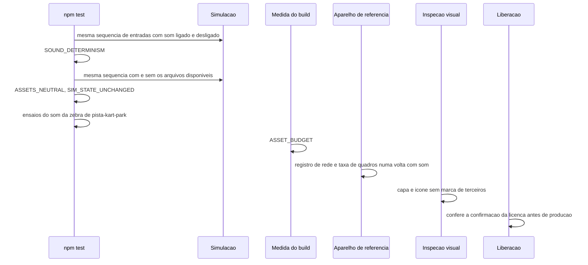

# FLOW-0003 — Verificação da feature

Como a evidência dos requisitos transversais é produzida, em cada ponto de observação que os requisitos
nomeiam (I9): a saída de `npm test`, a medida do build, o registro de rede do navegador, o teste registrado
no aparelho, a inspeção visual e o registro de liberação. Realiza
[FEAT-0005](../features/FEAT-0005-requisitos-transversais.md). `npm test` e a medida do build rodam
localmente, **sem rede** e sem relógio de parede: todo tempo é tempo simulado (D-FS-08). Nenhum evento
externo entra neste fluxo (D-FS-03).

## Passos

| Passo | Ator | Ação | Registro | Fonte |
|---|---|---|---|---|
| 1 | `npm test` | Roda a mesma sequência de entradas, do mesmo estado inicial, avançada por `STEP`, com o som ligado e com o som desligado, e compara tempo total e setores | `SOUND_DETERMINISM` | NFR-0004 |
| 2 | `npm test` | Roda a mesma sequência com e sem os sons e as imagens desta feature disponíveis e compara tempo total e setores | `ASSETS_NEUTRAL` | NFR-0009 |
| 3 | `npm test` | Compara o estado da simulação depois da sequência, campo a campo, com a linha de base anterior à feature | `SIM_STATE_UNCHANGED` | NFR-0009 |
| 4 | `npm test` | Roda os ensaios de `pista-kart-park` para os critérios 09 a 12 de US-0005 daquele conjunto | saída dos ensaios daquela feature | NFR-0007 |
| 5 | Medida do build | No build que entrega a feature, soma o download inicial e os 4 arquivos, confere os 4 no download inicial, a largura da capa, a ausência de arquivo de som da zebra e a lista de dependências de execução | `ASSET_BUDGET` ([API-0003](../api/API-0003-registros-de-verificacao.md)) | NFR-0001, NFR-0002, NFR-0003, NFR-0006, NFR-0007 |
| 6 | Aparelho, em cada canal | Registra as requisições de rede do navegador do momento em que o jogo abre até o fim de uma volta completa com o som ligado e ao menos um deslize | 0 requisições para som ou imagem desta feature | NFR-0003 |
| 7 | Aparelho, em cada canal | Com a rede desligada depois de o jogo abrir, faz uma volta completa com o som ligado e ao menos um deslize | 0 sons desta feature em falta | NFR-0003 |
| 8 | Notebook e celular de referência de RNF03 | Mede os quadros por segundo numa volta completa com o som ligado, o motor tocando e ao menos um deslize com som de pneu | teste registrado no aparelho nomeado: 60 fps e 30 fps | NFR-0005 |
| 9 | Inspeção visual | Olha a capa e o ícone na forma entregue | registro com data e nome de quem inspecionou: 0 marcas, 0 logotipos, 0 textos de terceiros | NFR-0008 |
| 10 | Liberação | Antes de promover para produção, confere a confirmação da licença em `DOMAIN.md` ([RULE-0003](../rules/RULE-0003-arquivos-da-feature-peso-e-licenca.md)) | registro de liberação comparado com a data da confirmação | NFR-0010 |

## Casos de erro e de borda

| Caso | Onde | Comportamento |
|---|---|---|
| Diferença de tempo ou de setor | passos 1 e 2 | `FAIL` com `TIME_DIFFERS` |
| A sequência de entradas não completa uma volta | passos 1 e 2 | `FAIL` com `LAP_NOT_COMPLETED`; a verificação não vale como aprovação |
| Linha de base ausente | passos 3 e 5 | `FAIL` com `BASELINE_MISSING` |
| Registro ausente da saída | passos 1 a 5 | Falha da verificação, nunca aprovação |
| Verificação repetida sobre o mesmo build | qualquer | Mesmo registro; nada se acumula |
| Execução só em desktop para o limite de celular | passo 8 | Não vale como evidência (I9) |
| Aba em segundo plano ou pausa durante a medida | passo 8 | A medida vale para a volta completa em corrida; refaz-se a medida |
| Licença não confirmada | passo 10 | Staging segue; a promoção para produção espera |
| Sensor ausente ou permissão negada (`web-mobile`) | passos 6 a 8 | Toque com estado visível (I4); as medidas valem igual |
