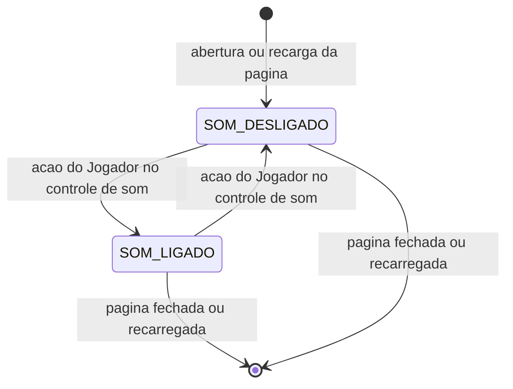
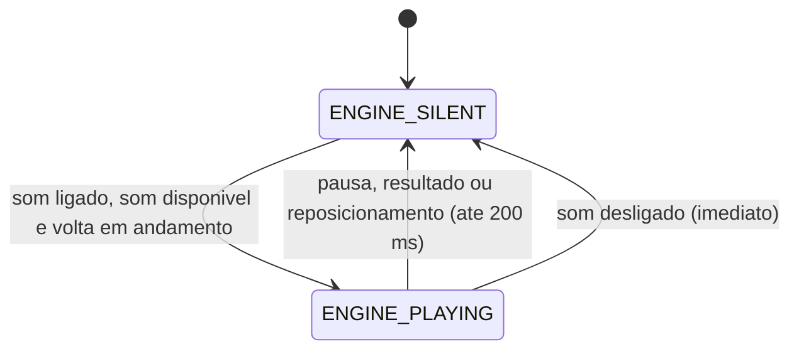

# RULE-0001 — Estado do som e som do motor

Decide quando o som do jogo está ligado e quando, com que tom e com que intensidade o som do motor toca.
Fontes: os critérios de US-0003 (`SEED/US-3`); som é apresentação (`SEED/RD-01`, I2); os sons servem como
estão (`DOMAIN/DEC-02`, decisão do dono do produto de 2026-11-10); sem controle de volume (`SEED/FE-05`).
Tudo aqui é decidido pela apresentação a partir do que a simulação e a volta informam; nada aqui decide
validade, tempo ou pontuação, e nada é escrito de volta na simulação (D-FS-05).

## Estado do som

`SOM_DESLIGADO` é `soundOn` falso; `SOM_LIGADO` é `soundOn` verdadeiro.

| Evento | Estado antes | Estado depois | Fonte |
|---|---|---|---|
| Abertura ou recarga da página | qualquer | `soundOn` falso | AC-US-0003-08; US-0003, caso anormal "Recarga da página" |
| Ação do Jogador no controle de som, pedindo ligar | falso | verdadeiro | AC-US-0003-09 |
| Ação do Jogador no controle de som, pedindo desligar | verdadeiro | falso | US-0003, caso anormal "Som desligado no meio de uma volta" |
| Pedido para o estado em que o som já está | igual | igual, sem efeito | idempotência (abaixo) |
| Início, pausa, retomada, fim de volta, reposicionamento, troca de pista, perda de foco | qualquer | inalterado | AC-US-0003-09: só a ação do Jogador liga o som |

O estado do som não é guardado no navegador: a feature não persiste dado novo (requisitos, `01-context.md`,
família "Retenção de dados").

## Volta em andamento

A volta está em andamento quando `lapPhase` de `getLapState` (`race-lap-validation`) é `RUNNING` e nenhum
reposicionamento está em execução. Deixa de estar em andamento por:

| Saída | Como é lida | Fonte |
|---|---|---|
| Pausa | `lapPhase` passa de `RUNNING` a `PAUSED` | AC-US-0003-04 |
| Resultado | `lapPhase` passa de `RUNNING` a `ENDED` | AC-US-0003-05 |
| Reposicionamento | um pedido `repositionKart` é aceito | AC-US-0003-06 |

Antes de a volta começar (`COUNTDOWN`, ou nenhuma volta aceita) a volta não está em andamento.

## Tabela de decisão — estado do motor

Avaliada a cada quadro apresentado, sobre o estado corrente; a primeira linha que vale decide.

| # | `soundOn` | `engineSoundAvailable` | Volta | `engineSoundState` | Prazo | Fonte |
|---|---|---|---|---|---|---|
| 1 | falso | qualquer | qualquer | `ENGINE_SILENT` | silêncio a partir da ação que desliga | AC-US-0003-07 |
| 2 | verdadeiro | falso | qualquer | `ENGINE_SILENT` | — | US-0003, caso anormal "Arquivo de som ausente, ilegível, ou navegador sem áudio" |
| 3 | verdadeiro | verdadeiro | em andamento | `ENGINE_PLAYING` | som tocando em até 50 ms depois de a linha passar a valer; nenhum silêncio maior que 50 ms enquanto valer | AC-US-0003-01 |
| 4 | verdadeiro | verdadeiro | deixou de estar em andamento por pausa, resultado ou reposicionamento | `ENGINE_SILENT` | silêncio em até 200 ms | AC-US-0003-04, AC-US-0003-05, AC-US-0003-06 |
| 5 | verdadeiro | verdadeiro | ainda não esteve em andamento (`COUNTDOWN`, nenhuma volta aceita) | `ENGINE_SILENT` | — | AC-US-0003-01: a condição do motor é a volta em andamento |

Reposicionamento: aceito o pedido `repositionKart`, o motor vai a `ENGINE_SILENT` e chega ao silêncio em
até 200 ms. Só volta a `ENGINE_PLAYING` depois de ter chegado ao silêncio e com `lapPhase` `RUNNING`; a
partir daí valem os critérios 01 a 03 (US-0003, caso anormal "Volta retomada depois de pausa ou
reposicionamento"). Os requisitos não fixam duração mínima do silêncio, e esta regra não fixa nenhuma.

Durante o prazo de até 200 ms o ganho pode descer gradualmente; o que se exige é `engineGainNorm` igual a 0
ao fim do prazo. Com o som desligado não há prazo: o ganho é 0 a partir da ação.

## Tom e intensidade

Valem só em `ENGINE_PLAYING`. As entradas são lidas do último passo avançado: `speedMps` de
`getHandlingTelemetry` e o comando de aceleração do `Input` (`dirigibilidade`).

| Grandeza | Exigência | Fonte |
|---|---|---|
| Tom (`enginePitchRatio`) | Com o mesmo acelerador, o valor a 20 m/s é estritamente maior que a 5 m/s | AC-US-0003-02 |
| Intensidade (`engineGainNorm`) | Na mesma velocidade, o valor com o acelerador pressionado é estritamente maior que com o acelerador solto | AC-US-0003-03 |
| Intensidade mínima | Maior que 0 em `ENGINE_PLAYING`, inclusive com o kart parado e o acelerador solto | AC-US-0003-01; US-0003, caso anormal "Kart parado com a volta em andamento" |
| Origem do som | A forma entregue de `docs/sfx/engine-loop.mp3`, repetida sem silêncio maior que 50 ms na emenda; nenhum tom sintetizado de motor | AC-US-0003-10, AC-US-0003-01 |

A função que leva a velocidade ao tom e o acelerador à intensidade é do D-Spec, dentro destas
desigualdades. Não há controle de volume (`SEED/FE-05`).

## Idempotência e ordem

- Transições do estado do som: idempotentes sob repetição. Pedir o estado em que o som já está não muda
  nada; não há chave nem contador de sequência, porque o pedido carrega o estado final e não um
  "alternar".
- Estado do motor: função do estado corrente (`soundOn`, `engineSoundAvailable`, `lapPhase`, pedido de
  reposicionamento aceito). Reavaliar o mesmo estado dá o mesmo resultado; nenhuma transição depende de
  quantas vezes foi avaliada.
- Tom e intensidade: função do último passo avançado, identificado por `simStepCount` (contador de
  sequência da simulação, nomeado e não redefinido). O mesmo `simStepCount` lido duas vezes dá os mesmos
  valores; vários passos entre dois quadros usam o último.
- Nenhuma destas decisões é lida pela simulação: o tempo da volta e os setores são os mesmos com o som
  ligado, desligado ou indisponível (NFR-0004, NFR-0009).
