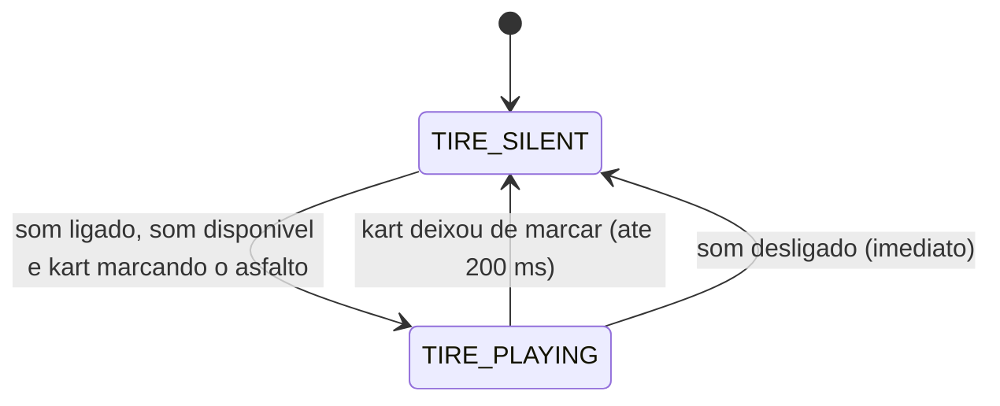

# RULE-0002 — Som de pneu

Decide quando o som de pneu toca. Fontes: os critérios de US-0004 (`SEED/US-4`); o pneu canta na mesma
situação em que o kart deixa marca de pneu (`SEED/RD-02`, decisão desta feature registrada no seed); som é
apresentação (`SEED/RD-01`, I2); os sons servem como estão (`DOMAIN/DEC-02`, 2026-11-10); som de grama fora
do escopo (`SEED/FE-02`); som da zebra inalterado (`SEED/RD-03`). A apresentação não calcula deslize,
aderência nem velocidade: segue a situação de marca de pneu, que é de `modelo-kart-01` e não é redefinida
aqui (D-FS-05).

## Kart marcando o asfalto

O kart está marcando o asfalto quando as três condições valem:

| Condição | Como é lida |
|---|---|
| O último passo avançado está na situação de marca de pneu | A mesma situação em que a cena desenha um trecho novo de marca de pneu (`modelo-kart-01`) |
| A marca é no asfalto | A marca desenhada nesse passo fica sobre o asfalto da pista |
| A simulação não está suspensa nem parada | `lapPhase` de `getLapState` não é `PAUSED` (pausa, simulação suspensa) nem `ENDED` (resultado, simulação parada). Um quadro sem passo novo não é suspensão nem parada: vale o último passo avançado e nada muda |

O kart deixa de marcar no primeiro passo avançado fora da situação de marca de pneu no asfalto, ou no
instante em que `lapPhase` passa a `PAUSED` ou a `ENDED`. Esta é a única definição de simulação suspensa
ou parada do conjunto; `simStepCount` não entra nela.

## Tabela de decisão — estado do som de pneu

Avaliada a cada quadro apresentado; a primeira linha que vale decide.

| # | `soundOn` | `tireSoundAvailable` | Kart | `tireSoundState` | Prazo | Fonte |
|---|---|---|---|---|---|---|
| 1 | falso | qualquer | qualquer | `TIRE_SILENT` | silêncio a partir da ação que desliga | AC-US-0004-05 |
| 2 | verdadeiro | falso | qualquer | `TIRE_SILENT` | — | US-0004, caso anormal "Arquivo de som ausente, ilegível, ou navegador sem áudio" |
| 3 | verdadeiro | verdadeiro | marcando o asfalto | `TIRE_PLAYING` | som tocando enquanto a linha valer | AC-US-0004-01 |
| 4 | verdadeiro | verdadeiro | deixou de marcar o asfalto | `TIRE_SILENT` | silêncio em até 200 ms depois de deixar de marcar | AC-US-0004-02 |
| 5 | verdadeiro | verdadeiro | parado | `TIRE_SILENT` | — | AC-US-0004-03 |
| 6 | verdadeiro | verdadeiro | rodando sem deslizar, sem marca de pneu no asfalto | `TIRE_SILENT` | — | AC-US-0004-04 |
| 7 | verdadeiro | verdadeiro | deslizando fora do asfalto, sem marca no asfalto | `TIRE_SILENT` | — | US-0004, caso anormal "Kart deslizando fora do asfalto" |

Durante o prazo de até 200 ms o ganho pode descer gradualmente; o que se exige é `tireGainNorm` igual a 0
ao fim do prazo, contado do instante em que o kart deixa de marcar. Se o kart volta a marcar antes do
silêncio, vale a linha 3 e o som continua (US-0004, caso anormal "Deslizes curtos em sequência"). Com o som
desligado não há prazo: o ganho é 0 a partir da ação.

Pausa, resultado e reposicionamento não têm linha própria: na pausa (`PAUSED`) e no resultado (`ENDED`) a
simulação está suspensa ou parada, o kart deixa de marcar e vale a linha 4; no reposicionamento o kart
deixa de marcar no primeiro passo avançado fora da situação de marca de pneu no asfalto, e vale a mesma
linha (US-0004, caso anormal "Pausa, resultado ou reposicionamento durante um deslize").

## Origem e intensidade

| Item | Exigência | Fonte |
|---|---|---|
| Origem do som | A forma entregue de `docs/sfx/tire-screech.mp3` | AC-US-0004-06 |
| Intensidade (`tireGainNorm`) | Maior que 0 em `TIRE_PLAYING`; 0 em `TIRE_SILENT` ao fim do prazo. Os requisitos não pedem que varie com o deslize, e esta regra não pede | AC-US-0004-01, AC-US-0004-02 |
| Som da zebra | Não é tocado, trocado nem silenciado por esta regra; com roda na zebra e marca no asfalto, os dois sons podem tocar juntos | NFR-0007; US-0004, caso anormal "Kart sobre a zebra" |

## Idempotência e ordem

- O estado do som de pneu é função do estado corrente: `soundOn`, `tireSoundAvailable`, `lapPhase` e o
  último passo avançado. Reavaliar o mesmo estado dá o mesmo resultado; um quadro sem passo novo reavalia o
  mesmo estado.
- Contador de sequência: `simStepCount` (nomeado e não redefinido). O mesmo `simStepCount` lido duas vezes
  não reinicia o som nem conta um segundo deslize; vários passos entre dois quadros usam o último, e nenhum
  passo intermediário é estimado.
- Nenhuma transição é escrita de volta na simulação nem lida por ela (NFR-0009).
