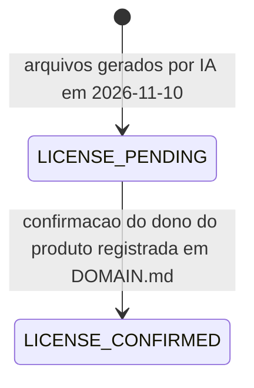

# RULE-0003 — Arquivos da feature

Decide que arquivos a feature entrega, de onde vêm, quanto podem pesar, como chegam ao navegador e quando
podem ir para produção. Fontes: os critérios de origem das quatro histórias; `SEED/NF-01` (RNF02),
`SEED/NF-02`, `SEED/NF-03` (RNF08), `SEED/RE-02`, `SEED/RE-03`, `SEED/RE-04`, `SEED/FE-03`; as decisões do
dono do produto de 2026-11-10 `DOMAIN/DEC-02` (os sons servem como estão) e `DOMAIN/DEC-03` (licença).

## Os quatro arquivos

| `assetRole` | Arquivo de origem | Exigência própria | Onde é usado | Fonte |
|---|---|---|---|---|
| `ICON_IMAGE` | `docs/art/icon.png` | Sem texto | Aba do navegador; atalho da tela de início | AC-US-0001-04, AC-US-0001-05 |
| `COVER_IMAGE` | `docs/art/cover.png` | Largura de 1200 px ou mais na forma entregue; sem texto dentro da imagem; nenhuma tela do jogo a mostra | Imagem de prévia de link | AC-US-0002-02, AC-US-0002-05, AC-US-0002-06 |
| `ENGINE_LOOP` | `docs/sfx/engine-loop.mp3` | Repetida sem silêncio maior que 50 ms | Som do motor | AC-US-0003-10 |
| `TIRE_SCREECH` | `docs/sfx/tire-screech.mp3` | — | Som de pneu | AC-US-0004-06 |

São exatamente 4. O som da zebra não tem arquivo: continua sintetizado (NFR-0007).

## Forma entregue

A forma entregue de cada arquivo é derivada do arquivo de origem só por redimensionamento, conversão de
formato ou compressão — é o que o glossário dos requisitos chama "na forma em que são entregues ao
navegador". Nenhum conteúdo é acrescentado: nenhum texto, marca ou logotipo nas imagens (NFR-0008); nenhum
outro som misturado nas gravações. Os sons não são trocados por outra gravação: o dono do produto os ouviu e
servem como estão (`DOMAIN/DEC-02`). O formato e as dimensões da forma entregue são do D-Spec, dentro desta
regra e dos limites abaixo.

## Limites de peso e de entrega

| Limite | Valor | Como é medido | Fonte |
|---|---|---|---|
| Download inicial, com os 4 arquivos incluídos | menor que 3 MB comprimidos | Soma em bytes comprimidos de tudo o que o navegador baixa para o jogo abrir, no build que entrega a feature (`initialDownloadBytes`) | NFR-0001 (RNF02) |
| Soma dos 4 arquivos | no máximo 300.000 bytes | Soma dos bytes de cada arquivo na forma entregue (`featureAssetBytes`) | NFR-0002 |
| Arquivos dentro do download inicial | 4 de 4 | Lista do que o navegador baixa para o jogo abrir, comparada com os 4 arquivos (`assetsInInitialDownloadCount`) | NFR-0003 |
| Requisições para som ou imagem desta feature depois de o jogo abrir | 0 | Registro de rede do navegador até o fim de uma volta completa com o som ligado e ao menos um deslize | NFR-0003 (RNF08) |
| Arquivos de som da zebra entregues | 0 | Lista dos arquivos de som entregues (`curbSoundFileCount`) | NFR-0007 |
| Dependências de execução novas | 0 | Lista de dependências de execução do projeto antes e depois (`newRuntimeDependencyCount`) | NFR-0006 |

Linha de base: o download inicial sem a feature somava 186.291 bytes comprimidos em 2026-11-06 (NFR-0001).

A capa também vem dentro do download inicial (NFR-0003, 4 de 4), embora nenhuma tela do jogo a mostre
(AC-US-0002-07): o navegador a recebe ao abrir o jogo e a apresentação não a desenha. A busca da capa por um
serviço de prévia acontece fora do jogo e não conta como requisição do jogo depois de aberto.

## Tabela de decisão — promoção para produção

| `licenseStatus` | Ambiente | Decisão | Fonte |
|---|---|---|---|
| `LICENSE_PENDING` | staging | Permitida: staging pode usar os 4 arquivos | NFR-0010; `DOMAIN/DEC-03` |
| `LICENSE_PENDING` | produção | Bloqueada: nenhuma promoção com algum dos 4 arquivos | NFR-0010 |
| `LICENSE_CONFIRMED` | staging | Permitida | NFR-0010 |
| `LICENSE_CONFIRMED` | produção | Permitida, se os demais requisitos estiverem atendidos | NFR-0010 |

- `LICENSE_CONFIRMED` vale só com a confirmação do dono do produto, nos termos do plano do Higgsfield,
  registrada em `DOMAIN.md` com a sua data. Quem confere é a etapa de deploy, comparando o registro de
  liberação com essa data.
- A licença bloqueia só a promoção para produção: especificação, código e staging seguem.
- O que muda se os termos não permitirem o uso num jogo publicado não é decidido pelos requisitos nem por
  esta regra; nesse caso o estado continua `LICENSE_PENDING`.
- A transição é idempotente sob repetição: registrar de novo a mesma confirmação não muda nada. Não há
  contador de sequência; não existe transição de volta especificada.
