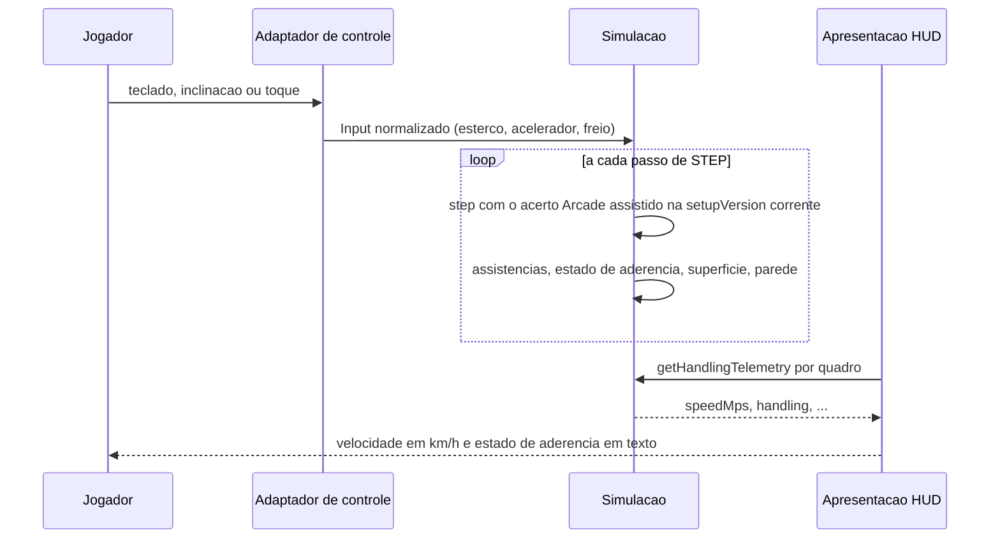

# FLOW-0001 — Passo de simulação com o Arcade assistido e exibição no HUD

Como o `Input` do Jogador chega à simulação, como o acerto Arcade assistido o transforma em estado e como o
HUD o exibe, em `web-desktop` e `web-mobile`. Realiza
[FEAT-0001](../features/FEAT-0001-resposta-do-volante.md) a
[FEAT-0004](../features/FEAT-0004-aceleracao-velocidade-grama-parede-e-hud.md). Roda sem rede: nenhuma
requisição entre o `Input` e o HUD (D-FS-08, RNF08). Nenhum evento externo entra neste fluxo, logo não há
deduplicação a declarar (D-FS-03).

## Passos

| Passo | Ator | Ação | Estado | Fonte |
|---|---|---|---|---|
| 1 | Jogador | Esterça, acelera ou freia pelo teclado (`web-desktop`), pela inclinação e toque (`web-mobile`) ou só pelo toque (sensor ausente ou negado) | volta em andamento | US-0001 a US-0004, Canais |
| 2 | Adaptador de controle | Entrega o `Input` normalizado: esterço −1 a 1 (binário no teclado e no toque, proporcional na inclinação), acelerador 0 a 1; valor fora da faixa saturado (I4); nenhuma regra de pilotagem no adaptador (I2) | | NFR-0003, NFR-0005; US-0001, caso anormal "Esterço fora da faixa" |
| 3 | Simulação | Avança um passo de `STEP` com o acerto Arcade assistido na `setupVersion` corrente; as assistências e os parâmetros do acerto decidem resposta do volante, aderência, recuperação, aceleração, perda na grama e na parede | `simStepCount` + 1 | NFR-0005, NFR-0006; [RULE-0001](../rules/RULE-0001-estado-de-aderencia-e-condicao-de-forcar.md) |
| 4 | Simulação | Avalia a condição de forçar e a recuperação e calcula `handling`, `sideslipRad`, `yawRateRadPerS`, `headingRad`, a posição, `surface` e `wallContact`; o comando de drift não muda nenhum deles | | [RULE-0001](../rules/RULE-0001-estado-de-aderencia-e-condicao-de-forcar.md), [API-0001](../api/API-0001-telemetria-de-dirigibilidade.md) |
| 5 | Apresentação | Lê `getHandlingTelemetry` em cada quadro entre o sinal verde e o fim da volta | | AC-US-0004-06 |
| 6 | Apresentação | Exibe a velocidade convertida para km/h e o texto do estado de aderência ([SCR-0001](../screens/SCR-0001-hud-de-velocidade-e-aderencia.md)); nenhum indicador de carga de drift, turbo ou impulso, combo ou pontuação de drift | | AC-US-0004-06, AC-US-0003-09 |

A sequência de `Input` por passo é a única entrada da simulação: a mesma sequência produz o mesmo estado,
seja ela gerada por teclado, inclinação ou toque (NFR-0003, NFR-0001).

## Alternativas, erros e eventos fora de ordem

| Situação | Tratamento |
|---|---|
| Sensor de inclinação ausente ou permissão negada antes da volta (`web-mobile`) | O adaptador recai para toque com estado visível (I4); o `Input` passa a binário; nenhum limite muda |
| Esterço fora de −1 a 1 ou acelerador fora de 0 a 1 | Saturado na faixa de `Input` pelo adaptador; os limites valem para o valor saturado |
| Pausa, perda de foco da aba, perda do sensor durante a volta | A simulação fica suspensa; `simStepCount` não avança; o HUD mantém o último valor exibido; os limites são de tempo simulado e não contam a suspensão |
| Taxa de quadros baixa | A resposta é função dos passos de `STEP`, não dos quadros; o HUD lê o estado corrente a cada quadro renderizado |
| `getHandlingTelemetry` antes de existir estado | `NO_STATE`; o HUD não exibe valor de telemetria até a primeira leitura válida |
| Grama ou parede | A velocidade é reduzida pela simulação ([RULE-0002](../rules/RULE-0002-ensaios-e-limiares.md)); a validade da volta é regra de `race-lap-validation`, inalterada (NFR-0008) |
| Comando de drift mantido (tecla de drift ou controle de drift do toque) | Chega à simulação no mesmo campo de `Input`, com a mesma faixa (I8); a simulação o ignora: nenhum efeito no estado, sem carga, mini-turbo nem impulso, e a velocidade não passa da estabilizada ([RULE-0001](../rules/RULE-0001-estado-de-aderencia-e-condicao-de-forcar.md)); o HUD não exibe indicador de drift ou turbo |
| Rede indisponível | Sem efeito: nenhuma requisição neste fluxo (D-FS-08) |
| Replay reproduzido no lugar do Jogador | O `Input` por passo vem do replay; o fluxo é o mesmo a partir do passo 3 ([FLOW-0003](FLOW-0003-leitura-de-replay-e-comparacao.md)) |
