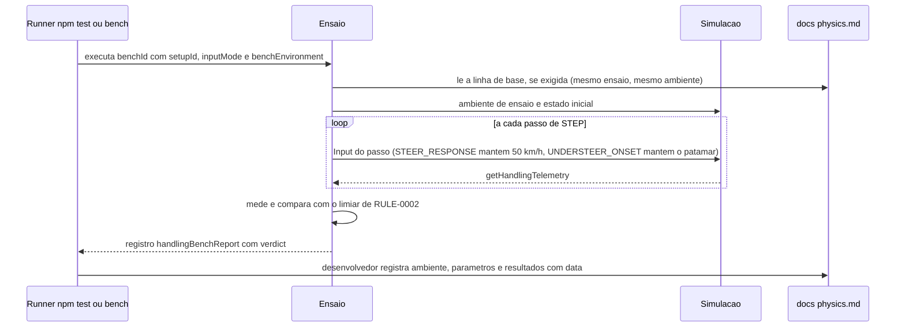

# FLOW-0002 — Ensaio determinístico e volta do piloto de teste

Como um ensaio de [RULE-0002](../rules/RULE-0002-ensaios-e-limiares.md) é executado por `npm test`,
`npm run bench:handling` ou do bench de física, em que ambiente roda (pista de teste ou pista sintética),
como a linha de base entra no veredito e como a saída é registrada em `docs/physics.md`. Realiza
[FEAT-0005](../features/FEAT-0005-determinismo-piloto-de-teste-e-versao.md) e
[FEAT-0006](../features/FEAT-0006-requisitos-transversais.md). Roda sem rede e sem DOM (D-FS-08, NFR-0005).
Não recebe evento externo (D-FS-03).

## Passos

| Passo | Ator | Ação | Estado | Fonte |
|---|---|---|---|---|
| 1 | Runner | Executa o ensaio com `setupId`, `setupVersion` corrente, `inputMode` (`BINARY` e, para US-0001 a US-0004, também `PROPORTIONAL`) e o ambiente que [RULE-0002](../rules/RULE-0002-ensaios-e-limiares.md) declara (`benchEnvironment`) | | NFR-0003; `SEED/RD-06` |
| 2 | Ensaio | Lê a linha de base de `docs/physics.md` quando o ensaio a exige (`UNDERSTEER_ONSET`, `STEP_COST`); só conta como linha de base a entrada do mesmo ensaio, no mesmo ambiente e na mesma geometria (`arcRadiusM`) | `baselineAvailable` | NFR-0004; US-0002, caso anormal |
| 3 | Ensaio | Coloca a simulação no ambiente e no estado inicial que [RULE-0002](../rules/RULE-0002-ensaios-e-limiares.md) declara para o ensaio (tabela Ensaios, colunas Ambiente e Estado inicial): pista de teste (reta ou arco de raio 18 m) ou pista sintética (largada da volta do piloto de teste; entrada na grama; contato com a parede); a velocidade inicial é a de cada ensaio nessa tabela | `simStepCount` 0 | [RULE-0002](../rules/RULE-0002-ensaios-e-limiares.md) |
| 4 | Ensaio e simulação | Aplica o `Input` do passo e avança `STEP`; lê a telemetria ([API-0001](../api/API-0001-telemetria-de-dirigibilidade.md)). No `STEER_RESPONSE`, o acelerador de cada passo é o que mantém a velocidade em 50 km/h, no modo `speedHoldMode` reportado. No `UNDERSTEER_ONSET`, a velocidade é mantida no valor do patamar corrente pela duração do patamar e sobe `entrySpeedStepMps` para o patamar seguinte; a varredura termina no primeiro passo fora da faixa, e o patamar interrompido pela saída é medido só nos passos na faixa, até ela (`DOMAIN/DEC-14`) | `simStepCount` + 1 por passo | I9; `DOMAIN/REF-03`; AC-US-0002-03, AC-US-0002-06; `DOMAIN/DEC-14` via AC-US-0002-03 e AC-US-0002-06 |
| 5 | Ensaio | Mede (tempos em passos de `STEP` convertidos em ms; velocidades em m/s, apresentadas também em km/h; derrapagem em rad; geometria em m) e compara com o limiar; o regime da taxa de guinada é medido na janela estacionária `settleWindowMs`; no `UNDERSTEER_ONSET`, a maior sequência de `understeer` consecutivo é medida dentro de cada patamar completo acima de 50 km/h (`maxUndersteerMsBySpeed`) e comparada entre patamares; no `REFERENCE_CORNER` com `throttleCondition` `THROTTLE_ZERO`, a maior sequência de `understeer` consecutivo (`maxUndersteerMs`) é contada só nos passos na faixa de asfalto, até a primeira saída da faixa (`DOMAIN/DEC-14` via AC-US-0002-01) | | [RULE-0002](../rules/RULE-0002-ensaios-e-limiares.md), [API-0003](../api/API-0003-saida-dos-ensaios.md) |
| 6 | Ensaio | Emite o registro de [API-0003](../api/API-0003-saida-dos-ensaios.md) com `benchEnvironment`, `verdict` e, em `FAIL`, `failReason` | | AC-US-0001-06, AC-US-0002-05, AC-US-0003-07, AC-US-0004-07, AC-US-0005-02, AC-US-0005-03 |
| 7 | Ensaio `DETERMINISM` | Repete cada ensaio e a volta do piloto de teste pelo menos 2 vezes e compara estados e tempos passo a passo | | AC-US-0005-01, NFR-0001 |
| 8 | Desenvolvedor | Registra em `docs/physics.md`, com data e `setupVersion`, o ambiente, os parâmetros e os resultados ao lado da linha de base, para o Arcade assistido e para o Realista | | NFR-0004, NFR-0007 |

A volta do piloto de teste (`TEST_PILOT_LAP`) usa a sequência binária de comandos na pista sintética (raios
mínimos de curva 24 m e 25 m, grampo de 4 m), com a largada, os setores e a validação de
`race-lap-validation` inalterados (NFR-0008); reporta `lapTimeMs`, `sectorMs`, `offAsphaltStepCount` e
`meanStepCostUs`. É o único ensaio desta feature na pista sintética além dos que precisam de grama ou
parede (`SEED/RD-06`).

## Alternativas, erros e eventos fora de ordem

| Situação | Tratamento |
|---|---|
| Linha de base ausente, ou registrada em outro ambiente ou outro arco | `FAIL` com `BASELINE_MISSING`; o critério não é julgado até a linha de base ser registrada no mesmo ensaio; nada é extrapolado |
| Velocidade não mantida no `STEER_RESPONSE` (`speedMinMps`/`speedMaxMps` fora da faixa) | `FAIL` com `SPEED_NOT_HELD`; os tempos medidos não valem como veredito (US-0001, caso anormal) |
| Kart sai da faixa de asfalto do arco em `REFERENCE_CORNER` com `throttleCondition` `THROTTLE_FULL` | `FAIL` com `OFF_ASPHALT`, em qualquer velocidade, com `offAsphaltFirstStep` e posição (AC-US-0002-02; US-0002, caso anormal) |
| Kart sai da faixa de asfalto do arco em `REFERENCE_CORNER` com `throttleCondition` `THROTTLE_ZERO` | A saída não reprova o ensaio — permanecer na faixa enquanto o kart desacelera não é exigido (`DOMAIN/DEC-13` via AC-US-0002-01) —, e a primeira saída fecha a janela de medição de `maxUndersteerMs`: contado só nos passos na faixa de asfalto até ela; os passos depois da saída não entram na medição, porque escorregar na grama não é sair de frente (`DOMAIN/DEC-14` via AC-US-0002-01); `offAsphaltStepCount`, `offAsphaltFirstStep` e posição reportados sem reprovar (US-0002, caso anormal) |
| Kart sai da faixa de asfalto do arco em `UNDERSTEER_ONSET` (novo acerto) | A saída encerra a varredura e a velocidade do kart nesse passo decide ([RULE-0002](../rules/RULE-0002-ensaios-e-limiares.md), "Fim da varredura de início do subesterço"): abaixo de 50 km/h, `FAIL` com `OFF_ASPHALT`; acima de 50 km/h com pelo menos dois patamares completos acima de 50 km/h medidos antes, fim natural da varredura, sem reprovar pela saída, e o veredito é o de V1 ≥ 1,15 × V0 e o da não diminuição entre patamares, com `v1Mps` reportado: a menor velocidade de patamar completo com `understeer` por mais de 200 ms consecutivos ou, quando nenhum patamar completo o teve, a velocidade mantida do patamar interrompido pela saída — medido só nos passos na faixa, até ela (`DOMAIN/DEC-14`) —, inclusive quando esse patamar é o primeiro em que `understeer` passa de 200 ms consecutivos ([RULE-0002](../rules/RULE-0002-ensaios-e-limiares.md), "Fim da varredura de início do subesterço"); no caso de `DOMAIN/DEC-12` (nenhum patamar, completo ou interrompido, com `understeer` por mais de 200 ms consecutivos) nunca sair de frente até sair da faixa cumpre o critério e a saída serializada apresenta o motivo "sem início de subesterço até a saída da faixa" (AC-US-0002-03, AC-US-0002-05; `DOMAIN/DEC-12`, `DOMAIN/REF-05`, `DOMAIN/DEC-14`); acima de 50 km/h antes do segundo patamar completo acima de 50 km/h, `FAIL` com `MEASUREMENT_MISSING` (falta de medida), único caso desse motivo. Em todos os casos, `offAsphaltFirstStep` e posição; neste ensaio nenhum critério de subesterço é medido fora do asfalto, porque a varredura termina na saída e o patamar interrompido é medido só até ela (AC-US-0002-06; `DOMAIN/DEC-14` via AC-US-0002-06; US-0002, caso anormal) |
| Kart sai da faixa da reta da pista de teste em `STEER_RESPONSE` | Não altera o veredito, que depende só dos tempos medidos de subida e de queda com a velocidade mantida (`SPEED_NOT_HELD` se ela sai da faixa tolerada); não há `failReason` nem campo de saída da faixa nesse registro ([RULE-0002](../rules/RULE-0002-ensaios-e-limiares.md), Ambientes de ensaio; AC-US-0001-05, `DOMAIN/DEC-09`) |
| Kart sai da faixa durante `REAR_RECOVERY` | `offAsphaltStepCount` > 0: `FAIL` com `OFF_ASPHALT`, com `offAsphaltFirstStep` e posição; a recuperação é medida no asfalto da pista de teste |
| Piloto de teste sai do asfalto | `FAIL` com `OFF_ASPHALT`, com `offAsphaltFirstStep` e posição; a feature não é entregue com esse resultado |
| Tempo do piloto de teste acima de 25 s | `FAIL` com `THRESHOLD_EXCEEDED`; nenhum afrouxamento do limite |
| Recuperação que não volta a `grip` em 400 ms | `REAR_RECOVERY` `FAIL` com `THRESHOLD_EXCEEDED` e o tempo até o primeiro `grip`; os passos além de 400 ms entram em `NORMAL_DRIVING` como condução normal (US-0003, caso anormal) |
| Duas execuções com tempos ou estados diferentes | `FAIL` com `NON_DETERMINISTIC`; defeito, nunca tolerância |
| `understeer` durante `STEER_RESPONSE` | Contado em `understeerStepCount`; não altera o veredito (AC-US-0001-05) |
| Ensaio com `inputMode` `PROPORTIONAL` aprovado e `BINARY` reprovado, ou o inverso | O critério não é atendido: exige `PASS` nas duas formas (NFR-0003) |
| Acelerador solto antes de 60 km/h em `ACCELERATION` | O ensaio não ocorre assim: o acelerador é mantido cheio por definição; soltar interrompe o ensaio sem exigência de tempo (US-0004, caso anormal) |
| Nenhum contato em `WALL_CONTACT` | `FAIL`: o ensaio exige ao menos um contato com velocidade maior que 0 |
| Contato com a parede a velocidade 0 | Não há contato novo a julgar; não entra em `contacts` (US-0004, caso anormal) |
| Ensaio com o Realista | Mesmos ensaios e ambientes; veredito é identidade com a linha de base do Realista, não os limiares do Arcade (NFR-0007) |
| Custo por passo medido em máquina ou runtime diferente da linha de base | Não comparável; `STEP_COST` só é julgado contra a linha de base da mesma máquina e runtime (NFR-0002) |
| Rodada de acerto reprovada pelo dono do produto em staging (`DOMAIN/DEC-10`) | Os presets são iterados dentro do pipeline; a rodada seguinte é nova `setupVersion` ([RULE-0003](../rules/RULE-0003-versao-do-acerto-e-comparabilidade.md)) e todos os ensaios desta tabela são executados de novo contra os mesmos limiares e nos mesmos ambientes, com nova entrada datada em `docs/physics.md` (NFR-0004) |
| Rede indisponível | Sem efeito |
