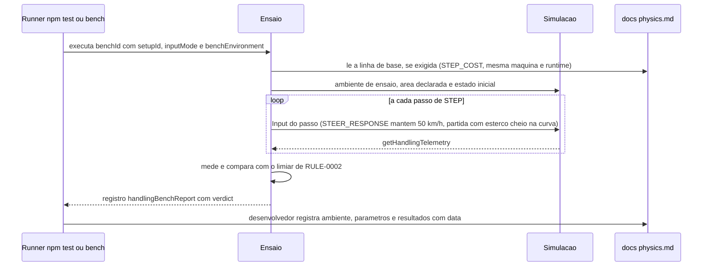

# FLOW-0002 — Ensaio determinístico e volta do piloto de teste

Como um ensaio de [RULE-0002](../rules/RULE-0002-ensaios-e-limiares.md) é executado por `npm test`,
`npm run bench:handling` ou pelo bench de física, em que ambiente roda (pista de teste aberta ou pista
sintética), como a linha de base entra no registro e como a saída é registrada em `docs/physics.md`.
Realiza [FEAT-0005](../features/FEAT-0005-determinismo-piloto-de-teste-e-versao.md) e
[FEAT-0006](../features/FEAT-0006-requisitos-transversais.md). Roda sem rede e sem DOM (D-FS-08,
NFR-0005). Não recebe evento externo (D-FS-03).

## Passos

| Passo | Ator | Ação | Estado | Fonte |
|---|---|---|---|---|
| 1 | Runner | Executa o ensaio com `setupId`, `setupVersion` corrente, `inputMode` (`BINARY` e, para US-0001 a US-0004, também `PROPORTIONAL`) e o ambiente que [RULE-0002](../rules/RULE-0002-ensaios-e-limiares.md) declara (`benchEnvironment`) | | NFR-0003; `SEED/RD-06` |
| 2 | Ensaio | Lê a linha de base de `docs/physics.md` quando o veredito a exige (`STEP_COST`, mesma máquina e runtime); nos demais ensaios a linha de base só é registrada ao lado do resultado (NFR-0004) | `baselineAvailable` | NFR-0002, NFR-0004 |
| 3 | Ensaio | Coloca a simulação no ambiente e no estado inicial que [RULE-0002](../rules/RULE-0002-ensaios-e-limiares.md) declara (tabela Ensaios): na pista de teste aberta, a área de asfalto declarada (`testAreaRadiusM`) e a partida em linha reta na velocidade do ensaio; na pista sintética, a largada da volta do piloto de teste, a entrada na grama ou a trajetória até a parede | `simStepCount` 0 | [RULE-0002](../rules/RULE-0002-ensaios-e-limiares.md) |
| 4 | Ensaio e simulação | Aplica o `Input` do passo e avança `STEP`; lê a telemetria ([API-0001](../api/API-0001-telemetria-de-dirigibilidade.md)). No `STEER_RESPONSE`, o acelerador de cada passo é o que mantém a velocidade em 50 km/h, no modo `speedHoldMode` reportado. Em `CORNER_RADIUS` e `CORNER_TURN`, o esterço cheio do lado ensaiado e o acelerador do ensaio (cheio ou 0) são aplicados no passo da partida e mantidos. No `REAR_RECOVERY`, o kart é forçado até a traseira soltar ou até a duração máxima do forçar, e então o esterço vai a 0. No `DRIFT_INERT`, a mesma sequência é aplicada duas vezes, com e sem o comando de drift mantido | `simStepCount` + 1 por passo | I9; `DOMAIN/REF-03`; AC-US-0002-07, AC-US-0002-08, AC-US-0002-09, AC-US-0003-03, AC-US-0003-08 |
| 5 | Ensaio | Mede (tempos em passos de `STEP` convertidos em ms; velocidades em m/s, apresentadas também em km/h; ângulos em rad, o giro apresentado também em graus; posição e raio em m) e compara com o limiar: o regime da taxa de guinada na janela `settleWindowMs`; o raio da trajetória na janela `radiusWindowMs` centrada nos 3 s; o giro e o instante do meio giro até 2 s ou até a parada; a maior velocidade observada contra `topSpeedMps` | | [RULE-0002](../rules/RULE-0002-ensaios-e-limiares.md), [API-0003](../api/API-0003-saida-dos-ensaios.md) |
| 6 | Ensaio | Emite o registro de [API-0003](../api/API-0003-saida-dos-ensaios.md) com `benchEnvironment`, `verdict` e, em `FAIL`, `failReason` | | AC-US-0001-06, AC-US-0002-05, AC-US-0003-07, AC-US-0004-07, AC-US-0005-02, AC-US-0005-03 |
| 7 | Ensaio `DETERMINISM` | Repete cada ensaio e a volta do piloto de teste pelo menos 2 vezes e compara estados e tempos passo a passo | | AC-US-0005-01, NFR-0001 |
| 8 | Desenvolvedor | Registra em `docs/physics.md`, com data e `setupVersion`, o ambiente, os parâmetros e os resultados ao lado da linha de base, para o Arcade assistido e para o Realista | | NFR-0004, NFR-0007 |

A volta do piloto de teste usa a sequência binária de comandos na pista sintética (raios mínimos de curva
24 m e 25 m, grampo de 4 m), com a largada, os setores e a validação de `race-lap-validation` inalterados
(NFR-0008). A mesma execução alimenta `TEST_PILOT_LAP` (`lapTimeMs`, `sectorMs`, `offAsphaltStepCount`),
`NORMAL_DRIVING` (todos os passos da volta) e `STEP_COST` (`meanStepCostUs`). Além dela, só `GRASS_LOSS`
e `WALL_CONTACT` rodam na pista sintética, por precisarem de grama e parede (`SEED/RD-06`).

## Alternativas, erros e eventos fora de ordem

| Situação | Tratamento |
|---|---|
| Linha de base do custo por passo ausente, ou registrada em outra máquina ou runtime | `STEP_COST` `FAIL` com `BASELINE_MISSING`; o critério não é julgado até a linha de base ser registrada; nada é extrapolado |
| Velocidade não mantida no `STEER_RESPONSE` (`speedMinMps`/`speedMaxMps` fora da faixa) | `FAIL` com `SPEED_NOT_HELD`; os tempos medidos não valem como veredito (US-0001, caso anormal) |
| Kart sai da área de asfalto declarada em qualquer ensaio na pista de teste aberta | `FAIL` com `TEST_AREA_EXCEEDED`, com `offAsphaltFirstStep` e posição: a medição é inválida, falha do ambiente de ensaio, nunca aprovação (US-0002, caso anormal "Kart fora da área do ensaio") |
| Velocidade chega a 0 antes de 3 s em `CORNER_RADIUS` | `FAIL` com `MEASUREMENT_MISSING` e `stoppedAtStep`: com o kart parado o raio não é definido (US-0002, caso anormal) |
| Velocidade chega a 0 antes de 2 s em `CORNER_TURN` | O giro conta até a parada; abaixo de π rad (180°), `FAIL` com `THRESHOLD_EXCEEDED`, com `stoppedAtStep` e o giro atingido (US-0002, caso anormal) |
| `understeer`, `oversteer` ou `sliding` durante `CORNER_RADIUS` ou `CORNER_TURN` | Não altera o veredito, que é só o do raio ou do giro; `handlingAt3s` é informativo (US-0002, casos anormais) |
| `understeer` durante `STEER_RESPONSE` | Contado em `understeerStepCount`; não altera o veredito (AC-US-0001-05) |
| Traseira não solta no `REAR_RECOVERY` | `rearReleased` falso e `forcingMs` reportados; sem reprovação (US-0003, caso anormal) |
| Recuperação que não volta a `grip` em 400 ms | `REAR_RECOVERY` `FAIL` com `THRESHOLD_EXCEEDED` e o tempo até o primeiro `grip` (US-0003, caso anormal) |
| Estados diferentes entre as execuções com e sem o comando de drift | `DRIFT_INERT` `FAIL` com `THRESHOLD_EXCEEDED` e `firstDifferingStep` (AC-US-0003-08) |
| Velocidade acima da estabilizada num ensaio que partiu de velocidade igual ou menor | `SPEED_CAP` `FAIL` com `THRESHOLD_EXCEEDED`, com `maxObservedBenchId`; sem `TOP_SPEED` na mesma execução, `MEASUREMENT_MISSING` (AC-US-0003-10) |
| `CORNER_RADIUS` partindo de 70 km/h acima da velocidade estabilizada | Fora de `SPEED_CAP`: a velocidade de partida é imposta e o kart pode perder velocidade (US-0002, caso anormal "Partida acima da velocidade estabilizada") |
| Piloto de teste sai do asfalto | `TEST_PILOT_LAP` `FAIL` com `OFF_ASPHALT`, com `offAsphaltFirstStep` e posição; a feature não é entregue com esse resultado |
| Tempo do piloto de teste acima de 25 s | `FAIL` com `THRESHOLD_EXCEEDED`; nenhum afrouxamento do limite |
| Duas execuções com tempos ou estados diferentes | `FAIL` com `NON_DETERMINISTIC`; defeito, nunca tolerância |
| Ensaio com `inputMode` `PROPORTIONAL` aprovado e `BINARY` reprovado, ou o inverso | O critério não é atendido: exige `PASS` nas duas formas (NFR-0003) |
| Acelerador solto antes de 60 km/h em `ACCELERATION` | O ensaio não ocorre assim: o acelerador é mantido cheio por definição; soltar interrompe o ensaio sem exigência de tempo (US-0004, caso anormal) |
| Nenhum contato em `WALL_CONTACT` | `FAIL` com `MEASUREMENT_MISSING` (falta de medida): o ensaio exige ao menos um contato com velocidade maior que 0, e `contacts` vazio não tem par a julgar |
| Contato com a parede a velocidade 0 | Não há contato novo a julgar; não entra em `contacts` (US-0004, caso anormal) |
| Ensaio com o Realista | Mesmos ensaios e ambientes; veredito é identidade com a linha de base do Realista, não os limiares do Arcade (NFR-0007) |
| Custo por passo medido em máquina ou runtime diferente da linha de base | Não comparável; `STEP_COST` só é julgado contra a linha de base da mesma máquina e runtime (NFR-0002) |
| Rodada de acerto reprovada pelo dono do produto em staging (`DOMAIN/DEC-10`) | Os presets são iterados dentro do pipeline; a rodada seguinte é nova `setupVersion` ([RULE-0003](../rules/RULE-0003-versao-do-acerto-e-comparabilidade.md)) e todos os ensaios desta tabela são executados de novo contra os mesmos limiares e nos mesmos ambientes, com nova entrada datada em `docs/physics.md` (NFR-0004) |
| Rede indisponível | Sem efeito |
