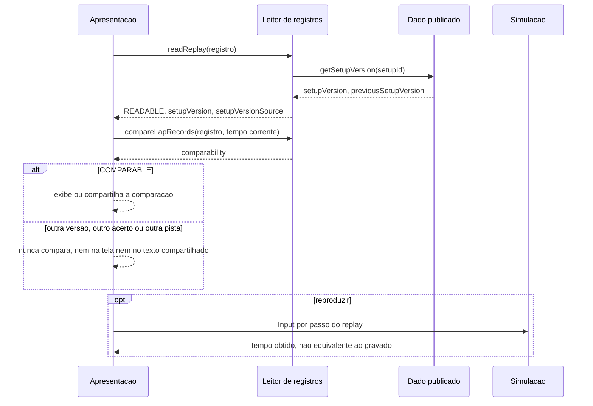

# FLOW-0003 — Leitura de replay e comparação de tempos entre versões do acerto

Como um replay ou um resultado gravado é lido, como a sua versão de acerto é resolvida e como uma
comparação entre dois tempos é decidida antes de chegar à tela ou ao texto compartilhado. Realiza
[FEAT-0005](../features/FEAT-0005-determinismo-piloto-de-teste-e-versao.md). Roda sem rede: os registros
estão no navegador ou no repositório (D-FS-08). O replay é dado gravado localmente, não evento externo; a
sua leitura é pura e não há deduplicação a declarar (D-FS-03).

## Passos

| Passo | Ator | Ação | Estado | Fonte |
|---|---|---|---|---|
| 1 | Apresentação | Pede a leitura de um replay ou resultado gravado | | NFR-0009 |
| 2 | Leitor | Lê o registro; com `setupVersion` declarada, `DECLARED`; sem o campo, resolve para `previousSetupVersion` do `setupId` (`ARCADE_ASSISTIDO` quando ausente), `RESOLVED_FROM_ABSENCE` | `replayStatus` `READABLE` | AC-US-0005-04; [RULE-0003](../rules/RULE-0003-versao-do-acerto-e-comparabilidade.md) |
| 3 | Leitor | Lê `getSetupVersion` no dado publicado ([API-0002](../api/API-0002-versao-do-acerto.md)) | | AC-US-0005-04 |
| 4 | Apresentação | Antes de exibir ou compartilhar qualquer comparação, chama `compareLapRecords` | `comparability` | AC-US-0005-05, AC-US-0005-07 |
| 5 | Apresentação | `COMPARABLE`: compara, na tela ou no texto compartilhado; qualquer outro valor: nunca compara, na tela nem no texto compartilhado, sem exibir a `setupVersion` ([SCR-0002](../screens/SCR-0002-resultado-e-texto-compartilhado.md)) | | AC-US-0005-05, AC-US-0005-07 |
| 6 | Simulação (opcional) | Reproduz o replay passo a passo com o acerto corrente: o contrato de passo não mudou (AC-US-0005-06); o tempo obtido não é o gravado e não é apresentado como equivalente | | US-0005, caso anormal; NFR-0006 |

## Alternativas, erros e eventos fora de ordem

| Situação | Tratamento |
|---|---|
| Registro corrompido ou ausente | `UNREADABLE`; nenhuma comparação; nada é descartado |
| Formato de replay desconhecido | `UNSUPPORTED_FORMAT`; mantido intacto e reportado (I4, I5) |
| Registro sem `trackId` ou `trackVersion` | `INCOMPLETE_RECORD`; nenhuma comparação é exibida |
| Replay da versão anterior reproduzido com o acerto novo | Reproduzido; tempo obtido diferente do gravado; `SETUP_VERSION_DIFFERS` entre o gravado e o obtido; nenhum resultado apresentado como equivalente, na tela nem no texto compartilhado; um comando de drift gravado no replay não tem efeito ([RULE-0001](../rules/RULE-0001-estado-de-aderencia-e-condicao-de-forcar.md)) |
| Replay do Realista | `setupId` `REALISTA_ALUGUEL_4T` com `setupVersion` inalterada; comparável com outros do Realista na mesma pista (NFR-0007) |
| Leitura repetida do mesmo registro | Mesmo resultado; leitura pura |
| Pausa, perda de foco ou perda do sensor durante a reprodução | A sequência de `Input` por passo é a mesma com ou sem suspensão; o tempo é de tempo simulado (I8) |
| Sensor ausente ou permissão negada (`web-mobile`) | Sem efeito: a leitura e a comparação não usam o sensor |
| Rede indisponível | Sem efeito |
