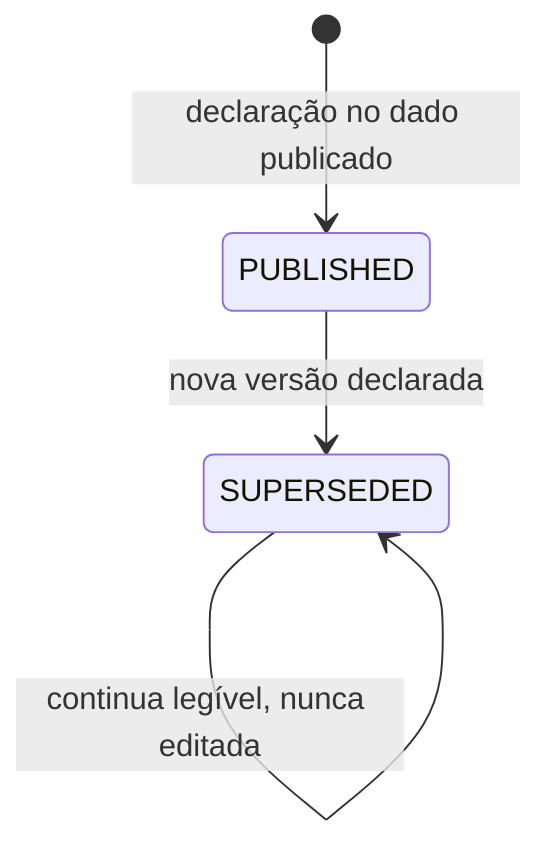

# RULE-0003 — Versão do acerto e comparabilidade

Decide o que identifica a versão de um acerto, como um tempo, um replay ou um resultado é ligado a ela e
quando dois tempos podem ser comparados. Fontes: `SEED/RD-04` e `SEED/IM-I3I5` (via NFR-0009 e US-0005),
I3 e I5. Decidido na simulação e no leitor de dado publicado, nunca na renderização (I2).

## Identidade

| Campo | O que identifica | Fonte |
|---|---|---|
| `setupId` | O acerto: `ARCADE_ASSISTIDO` ou `REALISTA_ALUGUEL_4T` | NFR-0007, NFR-0009 |
| `setupVersion` | A versão corrente do acerto, declarada no dado publicado; o novo Arcade assistido tem valor diferente do anterior à feature | AC-US-0005-04 |
| `previousSetupVersion` | A versão do Arcade assistido anterior à feature, mantida legível e nunca editada no lugar | NFR-0009 (I3, I5) |
| `trackId`, `trackVersion` | A pista; não mudam nesta feature | NFR-0008 |

O Realista — aluguel 4T mantém a sua `setupVersion` anterior: nenhum parâmetro muda (NFR-0007).

Cada rodada de presets do ciclo de acerto em staging (`DOMAIN/DEC-10`, via US-0005, caso anormal "Rodada
de acerto reprovada") que altera um parâmetro do Arcade assistido é uma nova `setupVersion`: a rodada
reprovada passa a `SUPERSEDED` e não é editada no lugar; um replay gravado numa rodada não é comparável com
um tempo da seguinte (`SETUP_VERSION_DIFFERS`).

## Estados da versão de um acerto

| Transição | O que a dispara | Idempotência e contador |
|---|---|---|
| `[*]` para `PUBLISHED` | Entrega de uma versão do acerto no dado publicado | Ocorre uma vez por versão; declarar de novo o mesmo identificador não cria versão nova (idempotente). Sem contador de sequência: a ordem é a do identificador declarado como `previousSetupVersion` pela versão seguinte |
| `PUBLISHED` para `SUPERSEDED` | Declaração da versão seguinte | Uma vez; a versão substituída não muda de conteúdo (I3) |

Não existe transição de volta: uma versão publicada nunca é editada no lugar nem removida.

## Tabela de decisão — comparabilidade de dois tempos, replays ou resultados

| `trackId` e `trackVersion` iguais | `setupId` igual | `setupVersion` igual | `comparability` | Efeito | Fonte |
|---|---|---|---|---|---|
| sim | sim | sim | `COMPARABLE` | Podem ser comparados (diferença, melhor tempo, ordenação), na tela e no texto compartilhado | AC-US-0005-05, AC-US-0005-07 |
| sim | sim | não | `SETUP_VERSION_DIFFERS` | Nunca comparados, na tela nem no texto compartilhado: nenhuma diferença, melhor tempo ou ordenação entre os dois; a `setupVersion` não é exibida | AC-US-0005-05, AC-US-0005-07 |
| sim | não | qualquer | `SETUP_DIFFERS` | Nunca comparados, na tela nem no texto compartilhado | AC-US-0005-05, AC-US-0005-07 |
| não | qualquer | qualquer | `TRACK_DIFFERS` | Nunca comparados, na tela nem no texto compartilhado (já era regra do dado de pista, I1) | AC-US-0005-05, AC-US-0005-07 |

A comparação é avaliada antes de qualquer exibição ou texto compartilhado; a tela (AC-US-0005-05) e o texto
compartilhado (AC-US-0005-07) só recebem o resultado
([SCR-0002](../screens/SCR-0002-resultado-e-texto-compartilhado.md)).

## Leitura de registros da versão anterior

| Registro lido | Tratamento | Fonte |
|---|---|---|
| Replay ou resultado que declara `setupVersion` | Lido; `setupVersionSource` `DECLARED` | AC-US-0005-04 |
| Replay ou resultado gravado antes da feature, sem `setupVersion` | Lido sem erro; `setupVersion` resolvida para `previousSetupVersion` do seu `setupId` (ausente: `ARCADE_ASSISTIDO`, o padrão anterior à feature); `setupVersionSource` `RESOLVED_FROM_ABSENCE` | NFR-0009 (I5) |
| Replay da versão anterior reproduzido com o acerto corrente | Reproduzido passo a passo (o contrato de passo não mudou, NFR-0006); o tempo obtido não é o tempo gravado e nenhum resultado é apresentado como equivalente ao original, na tela nem no texto compartilhado; um comando de drift gravado não tem efeito ([RULE-0001](RULE-0001-estado-de-aderencia-e-condicao-de-forcar.md), Sem drift e sem turbo) | US-0005, caso anormal "Replay da versão anterior"; US-0003, caso anormal "Replay gravado com drift na versão anterior do acerto" |
| Replay em formato desconhecido | `UNSUPPORTED_FORMAT`: mantido intacto e reportado, nunca descartado (I4) | NFR-0009 |

## Determinismo

A mesma sequência de `Input` por passo, no mesmo estado inicial, na mesma pista e na mesma `setupVersion`,
produz o mesmo estado por passo, o mesmo tempo total e os mesmos quatro tempos de setor em 100 % das
execuções (AC-US-0005-01, NFR-0001). Duas execuções com tempos diferentes são defeito de determinismo,
nunca tolerância. O contrato de passo (`STEP`, solver de 480 Hz, campos e faixas de `Input`) é o mesmo antes
e depois da feature (AC-US-0005-06, NFR-0006).
