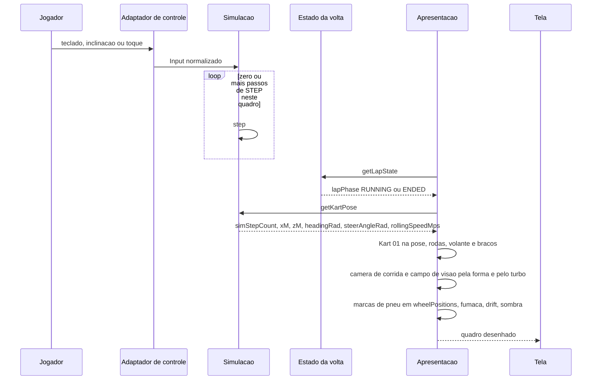

# FLOW-0001 — Quadro de exibição em corrida com o Kart 01

Como cada quadro em corrida — do sinal verde até o quadro anterior à próxima visão geral, inclusive com a
volta encerrada (`ENDED`) e o painel de resultado exibido — é desenhado em `web-desktop` e `web-mobile`: a
simulação avança com o `Input` do Jogador; a apresentação lê o estado do kart, põe o Kart 01 na pose da
simulação com as rodas, o volante e os braços, posiciona a câmera de corrida, prende os efeitos ao kart e
desenha a sombra. Realiza
[FEAT-0001](../features/FEAT-0001-kart-01-na-pista.md),
[FEAT-0002](../features/FEAT-0002-kart-reage-aos-comandos.md),
[FEAT-0003](../features/FEAT-0003-camera-de-jogo.md),
[FEAT-0004](../features/FEAT-0004-desempenho-do-kart-01.md) e
[FEAT-0005](../features/FEAT-0005-efeitos-presos-ao-kart.md). Roda sem rede: nenhuma requisição entre o
`Input` e o quadro (D-FS-08, RNF08). Nenhum evento externo entra neste fluxo, logo não há deduplicação a
declarar (D-FS-03). A apresentação não escreve nada na simulação (I2, NFR-0005).

## Passos

| Passo | Ator | Ação | Estado | Fonte |
|---|---|---|---|---|
| 1 | Jogador | Esterça, acelera ou freia pelo teclado (`web-desktop`), pela inclinação e toque (`web-mobile`) ou só pelo toque (sensor ausente ou negado); o kart continua pilotável depois do fim da volta | `lapPhase` `RUNNING` ou `ENDED` | US-0002, Canais; AC-US-0003-13 |
| 2 | Adaptador de controle | Entrega o `Input` normalizado, limitado à faixa (I4); nada desta feature muda o adaptador | | US-0002, caso anormal "Esterço fora da faixa no `Input`" |
| 3 | Simulação | Avança zero ou mais passos de `STEP` desde o quadro anterior, sem nada desta feature | `simStepCount` + n | NFR-0005, NFR-0006 |
| 4 | Apresentação | Lê `getLapState` (`race-lap-validation`) e decide o modo da câmera: `RACE_CHASE`, tanto em `RUNNING` quanto em `ENDED` ([RULE-0002](../rules/RULE-0002-camera-de-jogo.md)) | `cameraMode` `RACE_CHASE` | AC-US-0003-01, AC-US-0003-13 |
| 5 | Apresentação | Lê `getKartPose` ([API-0001](../api/API-0001-estado-do-kart-para-exibicao.md)): o estado do último passo concluído | | AC-US-0002-05, AC-US-0002-06 |
| 6 | Apresentação | Põe o ponto de referência do Kart 01 em `xM`, `zM`, com as rodas no chão, apontado em `headingRad` ([RULE-0003](../rules/RULE-0003-posicao-animacao-e-efeitos-do-kart-01.md)) | | AC-US-0002-05, AC-US-0002-06 |
| 7 | Apresentação | Esterça as rodas dianteiras por `steerAngleRad`; gira as quatro rodas pela taxa de rolamento vezes o tempo simulado desde o quadro anterior; gira o volante com o esterço; mantém as mãos do piloto no aro | giro acumulado por `simStepCount` | AC-US-0002-01 a AC-US-0002-04 |
| 8 | Apresentação | Posiciona a câmera na pose de corrida (1,38 m de altura, 3,05 m atrás, mira 3,2 m à frente a 0,30 m), presa ao rumo, com o campo de visão da forma da área de jogo e do turbo; publica-a em `getCameraView` ([API-0003](../api/API-0003-camera-da-cena-exibida.md)) | | AC-US-0003-01 a AC-US-0003-07, AC-US-0003-09 |
| 9 | Apresentação | Desenha os trechos novos de marca de pneu nas posições traseiras de `wheelPositions` levadas pela pose do kart; prende a fumaça ao escapamento e a indicação de drift às rodas traseiras exibidas, nas situações em que o jogo já os exibe | trechos de marca por `simStepCount` | AC-US-0005-01 a AC-US-0005-03 |
| 10 | Apresentação | Desenha a sombra do kart no chão e o número 01 na placa do para-choque | | AC-US-0001-15, AC-US-0001-16 |
| 11 | Tela | Exibe o quadro; a taxa de quadros medida é a destes quadros, com o Kart 01, a sombra e a câmera de corrida | | AC-US-0004-01, AC-US-0004-02 |

A sequência de `Input` por passo é a única entrada da simulação: os passos 4 a 11 só leem, e a mesma sequência
produz o mesmo estado com ou sem eles (NFR-0005).

## Alternativas, erros e eventos fora de ordem

| Situação | Tratamento |
|---|---|
| Vários passos de `STEP` entre dois quadros | O quadro mostra o último; o giro das rodas soma o tempo simulado de todos eles; um trecho de marca por passo em que o jogo as desenha |
| Quadro sem passo novo | O mesmo estado do quadro anterior; rodas sem giro; nenhum trecho novo de marca |
| Pausa, perda de foco da aba, perda do sensor | A simulação fica suspensa; `simStepCount` não avança; kart, câmera e efeitos parados no último estado ([FEAT-0002](../features/FEAT-0002-kart-reage-aos-comandos.md), [FEAT-0005](../features/FEAT-0005-efeitos-presos-ao-kart.md)) |
| Reposicionamento do kart | No primeiro quadro depois dele, kart, câmera e efeitos na nova posição e no novo rumo; nenhum quadro intermediário; marcas já desenhadas não se movem. Vale igual quando o reposicionamento invalida a volta: a volta passa a `ENDED` e a câmera continua na pose de corrida |
| Troca de orientação ou redimensionamento | No quadro seguinte, a regra de campo de visão da nova forma; pose, modelo e efeitos iguais |
| Turbo ativo | Campo de visão vertical da base da forma mais a diferença do efeito de turbo existente |
| Rodada, derrapagem forte ou marcha à ré | Câmera presa ao rumo; rodas à taxa de rolamento no sentido do movimento |
| `getKartPose` sem estado (`NO_STATE`) | Não ocorre em `RUNNING` nem em `ENDED`; se ocorrer, nenhum kart é desenhado nesse quadro e nada é estimado |
| Volta encerrada (`lapPhase` `ENDED`), válida ou invalidada, inclusive por reposicionamento | O quadro continua "em corrida": a câmera continua na pose de corrida em relação ao kart exibido, sem corte; o painel de resultado de `race-lap-validation` aparece sobre a cena sem mover a câmera; o kart continua pilotável e os passos 1 a 11 continuam iguais em todos os quadros até o anterior à próxima visão geral ([FLOW-0002](FLOW-0002-largada-visao-geral-descida-e-pose-de-corrida.md), passo 9); nenhum quadro mostra a visão geral |
| Sensor de inclinação ausente ou permissão negada (`web-mobile`) | O adaptador recai para toque com estado visível (I4); o fluxo é o mesmo a partir do passo 3 |
| Taxa de quadros baixa | Animação e câmera dependem do passo da simulação, não do número de quadros; o limite de taxa de quadros é o de [FEAT-0004](../features/FEAT-0004-desempenho-do-kart-01.md) |
| Rede indisponível | Sem efeito: nenhuma requisição neste fluxo (D-FS-08) |
