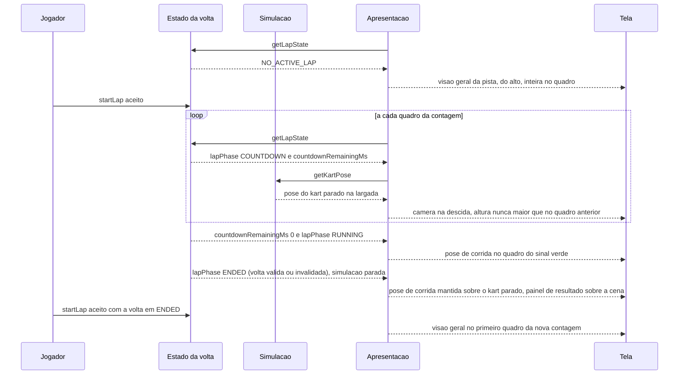

# FLOW-0002 — Largada: visão geral, descida e pose de corrida

Como a câmera vai da visão geral da pista, antes da contagem regressiva, até a pose de corrida, no sinal
verde, em `web-desktop` e `web-mobile` (`DOMAIN/DEC-04`), e como fica na pose de corrida depois do fim da
volta, em relação ao kart parado, com a simulação parada e o painel de resultado exibido, até a próxima visão
geral (`DOMAIN/DEC-06`). Realiza
[FEAT-0003](../features/FEAT-0003-camera-de-jogo.md) e, quanto ao kart exibido antes da largada,
[FEAT-0001](../features/FEAT-0001-kart-01-na-pista.md). A contagem regressiva, o sinal verde, a pausa, a
volta encerrada e o painel de resultado são os de `race-lap-validation`, lidos por `getLapState` e não
redefinidos. Roda sem rede
(D-FS-08). Nenhum evento externo entra neste fluxo; o pedido `startLap` repetido é deduplicado pela própria
volta (`LAP_ALREADY_ACTIVE`, `race-lap-validation`), não por esta feature (D-FS-03).

## Passos

| Passo | Ator | Ação | Estado | Fonte |
|---|---|---|---|---|
| 1 | Apresentação | Com a pista carregada e sem volta ativa (`getLapState` retorna `NO_ACTIVE_LAP`), desenha a visão geral: câmera acima da pista, olhando para baixo, pista inteira no quadro na forma corrente | `cameraMode` `TRACK_OVERVIEW` | AC-US-0003-10 |
| 2 | Apresentação | Se um kart é exibido, é o Kart 01, na posição que a simulação informa | | AC-US-0001-14 |
| 3 | Jogador | Escolhe iniciar a volta; `startLap` é aceito por `race-lap-validation` | `lapPhase` `COUNTDOWN`, `countdownRemainingMs` 3000 | AC-US-0003-11 |
| 4 | Apresentação | No primeiro quadro da contagem, a câmera está na pose da visão geral | `cameraMode` `COUNTDOWN_DESCENT` | AC-US-0003-11 |
| 5 | Apresentação | A cada quadro, calcula a pose só de `countdownRemainingMs` e da pose do kart parado na largada ([RULE-0002](../rules/RULE-0002-camera-de-jogo.md)): a altura acima do chão nunca é maior que no quadro anterior e diminui ao longo da contagem | `countdownRemainingMs` diminui | AC-US-0003-11 |
| 6 | Simulação | `countdownRemainingMs` chega a 0: sinal verde | `lapPhase` `RUNNING` | AC-US-0003-12 |
| 7 | Apresentação | No quadro do sinal verde, a câmera está na pose de corrida: 1,38 m acima do chão, 3,05 m atrás da posição do kart, mirando o ponto 3,2 m à frente e 0,30 m acima do chão; segue [FLOW-0001](FLOW-0001-quadro-de-exibicao-em-corrida.md) | `cameraMode` `RACE_CHASE` | AC-US-0003-12 |
| 8 | Simulação | A volta termina, válida ou invalidada, inclusive por reposicionamento: a simulação para e o kart congela, como hoje (invariante INV-1 de `race-lap-validation`, que esta feature não muda); o painel de resultado de `race-lap-validation` aparece sobre a cena | `lapPhase` `ENDED`; `simStepCount` não avança | AC-US-0003-13; US-0003, caso anormal "Fim da volta, válida ou invalidada, com o painel de resultado exibido" |
| 9 | Apresentação | A câmera continua na pose de corrida em relação ao kart parado, com a simulação parada e o kart congelado (invariante INV-1 de `race-lap-validation`), do quadro em que a volta termina até o quadro anterior à próxima visão geral: o painel não move a câmera e nenhum quadro mostra a visão geral; cada quadro segue [FLOW-0001](FLOW-0001-quadro-de-exibicao-em-corrida.md). Um novo `startLap`, aceito com a volta em `ENDED`, recomeça do passo 3: o primeiro quadro da nova contagem está na pose da visão geral (passo 4), que é a próxima visão geral; o quadro anterior ainda está na pose de corrida | `cameraMode` `RACE_CHASE`, nunca `TRACK_OVERVIEW` | AC-US-0003-13, AC-US-0003-10 |

## Alternativas, erros e eventos fora de ordem

| Situação | Tratamento |
|---|---|
| Pausa ou suspensão durante a contagem (`PAUSED` com `resumePhase` `COUNTDOWN`) | `countdownRemainingMs` não avança e a câmera não desce; ao continuar, a descida retoma do mesmo ponto; no sinal verde vale o passo 7 |
| Pausa em corrida | A câmera fica na pose de corrida em relação ao kart parado |
| Reposicionamento que invalida a volta | A volta passa a `ENDED`, a simulação para e o kart congela; no primeiro quadro depois do reposicionamento, a câmera está na pose de corrida em relação à nova posição e ao novo rumo do kart parado (passo 9); não é corte |
| Troca de orientação, redimensionamento, pausa ou turbo com a volta encerrada | Valem as regras de [FLOW-0001](FLOW-0001-quadro-de-exibicao-em-corrida.md): o quadro continua "em corrida" para a câmera, com a simulação parada e o kart congelado; o estado de turbo lido é o do estado congelado |
| Recarga da página antes da largada, durante a contagem, durante a volta ou depois do fim dela | Sem volta ativa: passo 1; a descida recomeça com a nova contagem |
| `startLap` repetido com a volta ativa | Rejeitado por `race-lap-validation` (`LAP_ALREADY_ACTIVE`); a descida não recomeça |
| Troca de orientação ou redimensionamento durante a visão geral | No quadro seguinte, a pista inteira no quadro da nova forma |
| Troca de orientação ou redimensionamento durante a descida | A pose continua função só de `countdownRemainingMs` e da pose do kart; a altura não aumenta de um quadro para o seguinte; no sinal verde vale a regra de campo de visão da forma corrente |
| Taxa de quadros baixa durante a contagem | A pose depende de `countdownRemainingMs`, não do número de quadros; o quadro do sinal verde está sempre na pose de corrida |
| Dado de pista ilegível ou de esquema não suportado | Nenhuma pista carregada: `getCameraView` retorna `NO_SCENE`; nenhuma cena; a mensagem é de `race-lap-validation` |
| Sensor de inclinação ausente ou permissão negada (`web-mobile`) | Toque com estado visível (I4); a câmera não muda |
| Rede indisponível | Sem efeito: nenhuma requisição neste fluxo (D-FS-08) |
