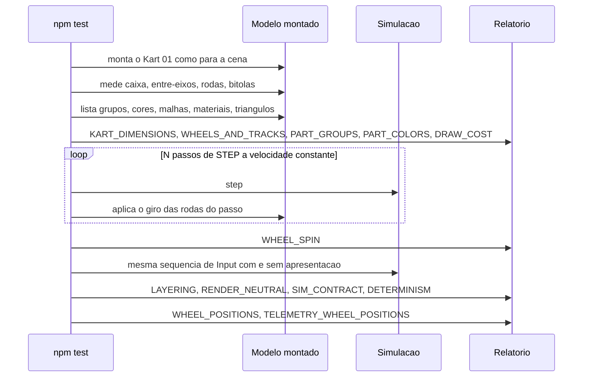

# FLOW-0003 — Verificação do modelo montado e da simulação em `npm test`

Como `npm test` produz a evidência dos critérios que nomeiam a sua saída (I9): monta o Kart 01 como para a
cena do jogo, mede-o, conta o seu custo de desenho, verifica o giro das rodas avançando passos de `STEP`, e
confirma que a simulação, o contrato de passo e `wheelPositions` não mudaram. Realiza a parte verificável em
`npm test` de [FEAT-0001](../features/FEAT-0001-kart-01-na-pista.md),
[FEAT-0002](../features/FEAT-0002-kart-reage-aos-comandos.md),
[FEAT-0004](../features/FEAT-0004-desempenho-do-kart-01.md),
[FEAT-0005](../features/FEAT-0005-efeitos-presos-ao-kart.md) e
[FEAT-0006](../features/FEAT-0006-requisitos-transversais.md). Roda localmente, sem rede (D-FS-08), sem
canal de jogo e sem relógio de parede: todo tempo é tempo simulado. Nenhum evento externo entra neste fluxo
(D-FS-03).

## Passos

| Passo | Ator | Ação | Registro | Fonte |
|---|---|---|---|---|
| 1 | `npm test` | Monta o Kart 01 com o piloto como para a cena do jogo, com o agrupamento por material aplicado | | US-0001, Pré-condições |
| 2 | `npm test` | Mede a caixa envolvente dos 15 grupos de peças e o entre-eixos e compara com [RULE-0001](../rules/RULE-0001-medidas-grupos-e-cores-do-kart-01.md) | `KART_DIMENSIONS` | AC-US-0001-01 a AC-US-0001-03 |
| 3 | `npm test` | Mede os quatro diâmetros e as duas bitolas, ao centímetro | `WHEELS_AND_TRACKS` | AC-US-0001-04 a AC-US-0001-07 |
| 4 | `npm test` | Lista os grupos nomeados, a sua geometria visível e o grupo que os contém | `PART_GROUPS` | AC-US-0001-08, AC-US-0001-09 |
| 5 | `npm test` | Lê as cores do kart, do `chassi`, da placa do para-choque e do macacão | `PART_COLORS` | AC-US-0001-10 a AC-US-0001-13 |
| 6 | `npm test` | Conta malhas, materiais por malha e triângulos do kart com o piloto | `DRAW_COST` | NFR-0004 |
| 7 | `npm test` | Avança N passos de `STEP` com velocidade de rolamento conhecida e constante, aplicando a cada passo o giro de [RULE-0003](../rules/RULE-0003-posicao-animacao-e-efeitos-do-kart-01.md); repete com 0 m/s | `WHEEL_SPIN` | AC-US-0002-02 |
| 8 | `npm test` | Verifica as importações da camada de simulação | `LAYERING` | NFR-0005 |
| 9 | `npm test` | Roda a mesma sequência de `Input` por N passos com a apresentação desta feature e sem renderização e compara o estado | `RENDER_NEUTRAL` | NFR-0005 |
| 10 | `npm test` | Compara `STEP`, campos e faixas de `Input` e as medidas da simulação com a linha de base anterior à feature | `SIM_CONTRACT` | NFR-0006 |
| 11 | `npm test` | Compara estado e tempo de volta, para a mesma sequência de `Input`, com a linha de base | `DETERMINISM` | NFR-0006 |
| 12 | `npm test` | Compara `wheelPositions` após N passos com a linha de base e, passo a passo, com as posições de roda da telemetria | `WHEEL_POSITIONS`, `TELEMETRY_WHEEL_POSITIONS` | NFR-0007 |
| 13 | `npm test` | Emite um registro por verificação com `verdict` e, no `FAIL`, `checkFailReason` ([API-0002](../api/API-0002-relatorio-do-modelo-montado.md)) | todos | I9 |

## Alternativas, erros e eventos fora de ordem

| Situação | Tratamento |
|---|---|
| Medida, grupo, cor ou custo fora da regra | Registro com `FAIL` e a razão de [RULE-0001](../rules/RULE-0001-medidas-grupos-e-cores-do-kart-01.md); o modelo é corrigido, nunca o limite |
| Giro diferente do esperado ou com sinal oposto ao movimento | `WHEEL_SPIN` com `FAIL` e `SPIN_MISMATCH` |
| Linha de base anterior à feature ausente | `SIM_CONTRACT`, `DETERMINISM` ou `WHEEL_POSITIONS` com `FAIL` e `BASELINE_MISSING`; nada é comparado |
| Execução repetida | Registros idênticos; nenhuma verificação altera o jogo ou a simulação |
| Taxa de quadros | Não é verificada aqui: é medida em teste registrado nos aparelhos de referência ([FEAT-0004](../features/FEAT-0004-desempenho-do-kart-01.md)) |
| Rede indisponível | Sem efeito (D-FS-08) |
