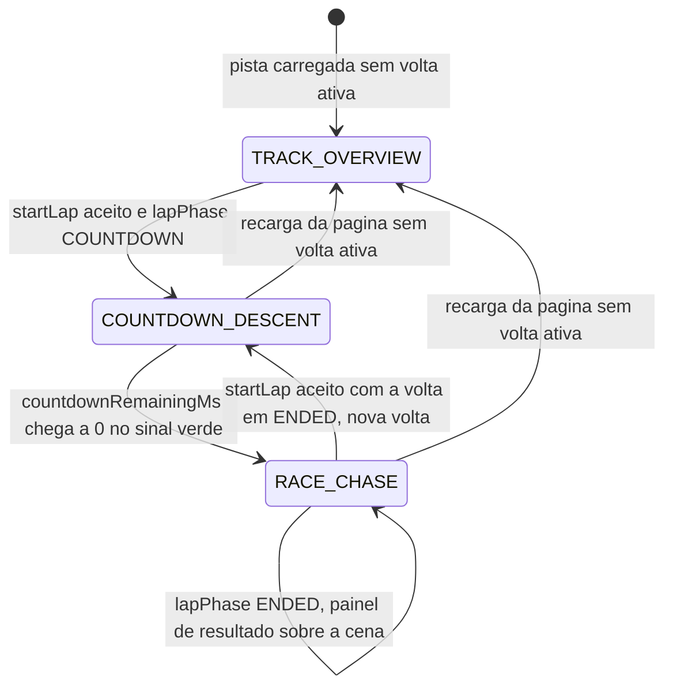

# RULE-0002 — Câmera de jogo

Decide em que modo a câmera está, onde fica, para onde mira e com que campo de visão, em cada quadro. Fontes:
a câmera de jogo da ficha "Kart 01 — Kartle", decisão do dono do produto de 2026-10-22 (`SEED/RD-04`, via
US-0003); o campo de visão em retrato (`DOMAIN/DEC-03`); a visão geral e a descida durante a contagem
(`DOMAIN/DEC-04`); a permanência na pose de corrida depois do fim da volta, com o painel de resultado
exibido (`DOMAIN/DEC-06`, via AC-US-0003-13). A câmera é decidida na camada de aplicação a partir do
estado que a simulação e a volta informam; ela não decide nada da simulação (I2). O resultado é lido em
[API-0003](../api/API-0003-camera-da-cena-exibida.md).

## Entradas

| Entrada | De onde vem |
|---|---|
| `lapPhase`, `resumePhase`, `countdownRemainingMs`; sem volta ativa (`NO_ACTIVE_LAP`) | Contrato de estado da volta de `race-lap-validation` (`getLapState`), nomeado e não redefinido |
| `xM`, `zM`, `headingRad`, `simStepCount` | [API-0001](../api/API-0001-estado-do-kart-para-exibicao.md) |
| Largura e altura da área de jogo | A tela, em cada quadro |
| Estado de turbo e a diferença de campo de visão vertical que o efeito de turbo existente produz para ele | O efeito de turbo já existente, sem mudança de magnitude |

## Modos

| `cameraMode` | Estado da volta | Fonte |
|---|---|---|
| `TRACK_OVERVIEW` | Sem volta ativa (`NO_ACTIVE_LAP`); nunca com `lapPhase` `ENDED` | AC-US-0003-10, AC-US-0003-13 |
| `COUNTDOWN_DESCENT` | `lapPhase` `COUNTDOWN`, ou `PAUSED` com `resumePhase` `COUNTDOWN` | AC-US-0003-11, AC-US-0003-12 |
| `RACE_CHASE` | `lapPhase` `RUNNING`, `PAUSED` com `resumePhase` `RUNNING`, ou `ENDED` (volta encerrada, válida ou invalidada, inclusive por reposicionamento, com o painel de resultado exibido) | AC-US-0003-01 a AC-US-0003-09, AC-US-0003-13 |

`ENDED` é `RACE_CHASE`, nunca `TRACK_OVERVIEW`: do quadro em que a volta termina, válida ou invalidada,
inclusive por reposicionamento, com o painel de resultado de `race-lap-validation` sobre a cena, até o
quadro anterior à próxima visão geral da pista, a câmera continua na pose de corrida em relação ao kart
exibido, que continua pilotável; "em corrida", para a câmera, vai do sinal verde até a próxima visão geral
e não termina em `ENDED` (AC-US-0003-13; US-0003, caso anormal "Fim da volta, válida ou invalidada, com o
painel de resultado exibido"; `DOMAIN/DEC-06`). A visão geral existe só antes da contagem regressiva
(AC-US-0003-10): depois de `ENDED`, a próxima visão geral é a pose da visão geral no primeiro quadro da
contagem de uma nova volta — que `race-lap-validation` inicia direto de `ENDED` (`startLap` aceito com a
volta em `ENDED`, `lapPhase` `COUNTDOWN`) — ou o modo `TRACK_OVERVIEW` depois de uma recarga sem volta
ativa. O que o Jogador faz para chegar a ela não é fixado pelos requisitos (changelog deles, rodada 3) nem
por esta regra. A pausa não muda o modo: congela a câmera no modo da fase a que a volta retorna.

| Transição | Disparo | Idempotência e contador de sequência |
|---|---|---|
| `[*]` para `TRACK_OVERVIEW` | Pista carregada e cena desenhada, sem volta ativa | Idempotente: reavaliar o mesmo estado da volta dá o mesmo modo. Sem contador |
| `TRACK_OVERVIEW` para `COUNTDOWN_DESCENT` | `startLap` aceito (`lapPhase` `COUNTDOWN`, `countdownRemainingMs` 3000) | Ocorre uma vez por volta: um `startLap` repetido com volta ativa é rejeitado por `race-lap-validation` (`LAP_ALREADY_ACTIVE`) e não reinicia a descida. Contador: `countdownRemainingMs`, que só diminui |
| `COUNTDOWN_DESCENT` para `RACE_CHASE` | `countdownRemainingMs` chega a 0 (sinal verde, `lapPhase` `RUNNING`) | Ocorre uma vez por volta. Contador: `simStepCount` da pose do kart, a partir do sinal verde |
| `RACE_CHASE` permanece `RACE_CHASE` | `lapPhase` passa a `ENDED` (conclusão ou invalidação, inclusive por reposicionamento); o painel de resultado aparece sobre a cena | Não é transição de modo: a câmera continua função só da pose do kart exibido, sem corte; o fim da volta ocorre uma vez por volta e eventos posteriores são ignorados pela volta encerrada. Contador: `simStepCount` da pose do kart, que continua a avançar enquanto o kart é pilotado |
| `RACE_CHASE` para `COUNTDOWN_DESCENT` | `startLap` aceito com a volta em `ENDED` (nova volta: `lapPhase` `COUNTDOWN`, `countdownRemainingMs` 3000); o primeiro quadro da contagem está na pose da visão geral, que é a próxima visão geral; o quadro anterior ainda está na pose de corrida | Ocorre uma vez por volta nova; um `startLap` com volta ativa é rejeitado (`LAP_ALREADY_ACTIVE`). Contador: `countdownRemainingMs`, que só diminui |
| Qualquer modo para `TRACK_OVERVIEW` | Recarga da página, antes da largada, durante a volta ou depois do fim dela: a volta em curso é abandonada e não há volta ativa | Idempotente; a descida recomeça com a próxima contagem |
| Pausa e retomada | `lapPhase` `PAUSED` e `resumeLap` | Não é transição de modo: os contadores não avançam e a câmera fica parada; idempotente sob repetição |

## Pose por modo

| `cameraMode` | Posição da câmera | Ponto de mira | Fonte |
|---|---|---|---|
| `RACE_CHASE` | 3,05 m atrás da posição do kart, medidos no chão ao longo do rumo, no sentido oposto a ele; 1,38 m acima do chão; o mesmo com a volta encerrada (`ENDED`), com o painel de resultado exibido | 3,2 m à frente da posição do kart, ao longo do rumo; 0,30 m acima do chão | AC-US-0003-01, AC-US-0003-02, AC-US-0003-03, AC-US-0003-13 |
| `COUNTDOWN_DESCENT` | No primeiro quadro da contagem, a da visão geral; depois, função só de `countdownRemainingMs` e da pose do kart; altura acima do chão nunca maior que no quadro anterior e menor no fim que no início; em `countdownRemainingMs` 0, a de `RACE_CHASE` | Em `countdownRemainingMs` 0, a de `RACE_CHASE` | AC-US-0003-11, AC-US-0003-12; US-0003, caso anormal "Pausa ou suspensão durante a contagem regressiva" |
| `TRACK_OVERVIEW` | Acima da pista, olhando para baixo, com a pista inteira dentro do quadro na forma corrente | Na pista | AC-US-0003-10 |

Em `RACE_CHASE`, a pose é função só da pose do kart exibido no quadro: entre dois quadros consecutivos, a
direção horizontal de mira muda exatamente o quanto muda `headingRad`, sem suavização nem atraso
(AC-US-0003-07). O rumo, e não a direção do movimento, decide "atrás" e "à frente": numa rodada, numa
derrapagem forte ou em marcha à ré, a câmera continua atrás do kart em relação ao rumo (US-0003, casos
anormais). Não há desvio por parede ou borda (US-0003, caso anormal "Kart junto a uma parede ou a uma
borda"). Um reposicionamento muda a pose na mesma medida que muda a posição e o rumo do kart, e por isso não é
corte — também quando o reposicionamento invalida a volta: a volta passa a `ENDED` e, no primeiro quadro
depois dele, a câmera está na pose de corrida em relação à nova posição e ao novo rumo (AC-US-0003-13;
US-0003, caso anormal "Reposicionamento do kart em corrida").

A pose de corrida e o campo de visão escolhido dentro dos pisos desta regra têm de manter o kart inteiro, com
o piloto, dentro do quadro em todos os quadros de uma curva de 90° a 50 km/h, em paisagem e em retrato
(AC-US-0003-08); em retrato, um campo de visão vertical acima do piso que deixe o kart sair do quadro não
atende a regra.

## Forma da área de jogo

| Largura e altura | `viewShape` | Fonte |
|---|---|---|
| Largura ≥ altura | `LANDSCAPE` | glossário dos requisitos, "Paisagem"; AC-US-0003-04 |
| Altura > largura | `PORTRAIT` | glossário dos requisitos, "Retrato"; AC-US-0003-05 |

A forma é reavaliada em cada quadro, nos dois canais: uma janela de `web-desktop` mais alta que larga é
retrato.

## Tabela de decisão — campo de visão em `RACE_CHASE`

| `viewShape` | Turbo | Campo de visão vertical | Campo de visão horizontal | Fonte |
|---|---|---|---|---|
| `LANDSCAPE` | inativo | 62°, a qualquer velocidade | o que resulta de 62° e da razão largura ÷ altura | AC-US-0003-04 |
| `PORTRAIT` | inativo | pelo menos 62° | pelo menos 60° | AC-US-0003-05, AC-US-0003-06 (`DOMAIN/DEC-03`) |
| qualquer | ativo | o campo de visão vertical sem turbo da mesma forma, somado à diferença que o efeito de turbo já existente produz para o mesmo estado de turbo | o que resulta do vertical e da razão largura ÷ altura | AC-US-0003-09 |

A tabela vale em todos os quadros de `RACE_CHASE`, inclusive com a volta encerrada e o painel de resultado
exibido (AC-US-0003-13; US-0003, caso anormal "Fim da volta, válida ou invalidada, com o painel de resultado
exibido"). Numa troca de orientação ou redimensionamento, vale no quadro seguinte a linha da nova forma, e o
turbo, se ativo, parte da base da nova forma; a pose não muda (US-0003, casos anormais). Em `COUNTDOWN_DESCENT` e
`TRACK_OVERVIEW` o campo de visão não é fixado, salvo que a visão geral mostra a pista inteira e que, no
quadro do sinal verde, já vale a linha sem turbo da forma corrente.
