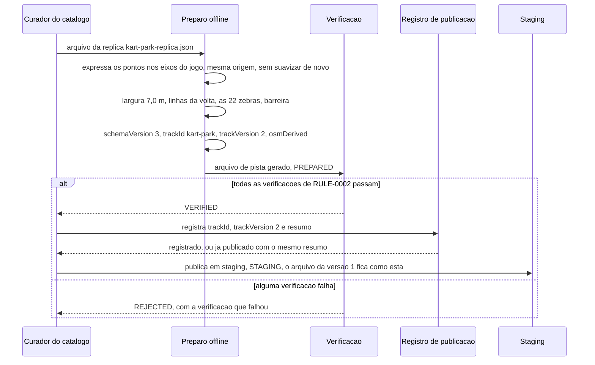

# FLOW-0003 — Preparo offline, verificação e publicação do arquivo de pista da Kart Park

Como o Curador do catálogo transforma o arquivo da réplica não oficial no arquivo de pista da Kart Park
versão 2 que o jogo lê, como o arquivo é verificado e como é publicado sem tocar na versão 1. Realiza o
lado de dado de [FEAT-0002](../features/FEAT-0002-forma-largura-e-versao-do-arquivo-de-pista.md),
[FEAT-0003](../features/FEAT-0003-setores-chegada-marcadores-e-validacao.md),
[FEAT-0004](../features/FEAT-0004-barreira-nos-trechos-quase-encostados.md) e
[FEAT-0005](../features/FEAT-0005-zebra-com-efeito.md), e a publicação de
[FEAT-0007](../features/FEAT-0007-requisitos-transversais.md). É offline e fica fora do cliente (I10): o
jogo não executa nenhum passo deste fluxo e não precisa de rede para ler o resultado dele (D-FS-08). O
evento externo é a publicação de uma versão: ela é deduplicada no registro de publicação, por `trackId`,
`trackVersion` e resumo do arquivo ([RULE-0005](../rules/RULE-0005-versao-e-publicacao-da-pista.md),
D-FS-03).

## Passos

| Passo | Ator | Ação | Estado | Fonte |
|---|---|---|---|---|
| 1 | Curador do catálogo | Toma o arquivo da réplica (`replica/kart-park-replica.json`, formato `kartle-pista`), sem alterá-lo | | US-0002, Pré-condições |
| 2 | Preparo offline | Expressa os pontos da réplica em metros nos eixos do jogo, com a mesma origem: (*x*, *y*) da réplica vira (`xM` = *x*, `zM` = −*y*); começa a `centerline` no ponto 0 da réplica, a linha de largada | | AC-US-0002-04, AC-US-0002-06 |
| 3 | Preparo offline | Não suaviza de novo a linha: todo ponto gerado fica a no máximo 0,10 m da linha central da réplica | | AC-US-0002-06 |
| 4 | Preparo offline | Declara `widthM` 7,0 em todo ponto | | AC-US-0002-05 |
| 5 | Preparo offline | Declara a largada e a chegada no ponto 0, os três limites de setor nos pontos de [RULE-0002](../rules/RULE-0002-geometria-e-verificacoes-do-arquivo-de-pista.md), em retas da réplica, e os marcadores a no máximo 25 m, como linhas transversais | | AC-US-0003-02, AC-US-0003-04, AC-US-0003-12 |
| 6 | Preparo offline | Copia as 22 zebras da réplica, uma a uma, com o lado e as distâncias de volta declarados; nenhuma cruza a largada, e nenhuma é dividida; declara a largura de cada uma | | AC-US-0005-01, AC-US-0005-02, AC-US-0005-13 |
| 7 | Preparo offline | Declara a barreira entre os trechos quase encostados (≈ 369–406 m e ≈ 595–624 m), na grama | | AC-US-0004-01 |
| 8 | Preparo offline | Declara `schemaVersion` 3, `trackId` `kart-park`, `trackVersion` 2, `direction` `COUNTER_CLOCKWISE` e `osmDerived` verdadeiro; não copia nome, comprimento oficial nem recorde | `publicationState` `PREPARED` | NFR-0006, AC-US-0006-09 |
| 9 | Verificação | Executa todas as verificações de [RULE-0002](../rules/RULE-0002-geometria-e-verificacoes-do-arquivo-de-pista.md) sobre o arquivo gerado e o da réplica, de forma determinística | `VERIFIED` se todas passam, `REJECTED` se alguma falha | AC-US-0002-01 a AC-US-0005-13, NFR-0001 |
| 10 | Curador do catálogo | Com a versão em `VERIFIED`, registra `trackId`, `trackVersion` 2 e o resumo criptográfico do arquivo | `VERIFIED` | NFR-0006 |
| 11 | Curador do catálogo | Publica em staging, como arquivo novo ao lado do da versão 1, que não é editado, renomeado nem apagado; a promoção para produção espera a decisão sobre a licença Esri | `STAGING` | NFR-0012, NFR-0014 |

## Alternativas, erros e eventos fora de ordem

| Situação | Tratamento |
|---|---|
| Uma verificação falha (ponto 0, distância à réplica, comprimento, sentido, largura, bordas, setores, retas dos setores, marcadores, zebras, barreira, tamanho) | O arquivo não é publicado; a correção é feita no preparo, e o arquivo corrigido passa de novo por todas as verificações |
| Preparo que suaviza de novo a linha da réplica e afasta algum ponto mais de 0,10 m dela | A verificação de distância à réplica reprova |
| Conversão com outro mapeamento de eixos | O circuito gira no sentido horário e se afasta da réplica; as verificações de sentido e de distância à réplica reprovam |
| Publicar de novo o mesmo arquivo com o mesmo `trackVersion` | Sem efeito: o registro já tem o mesmo resumo |
| Publicar conteúdo diferente com um `trackVersion` já registrado (1 ou 2) | Recusado; a mudança exige `trackVersion` maior ([RULE-0005](../rules/RULE-0005-versao-e-publicacao-da-pista.md)) |
| Edição, renomeação ou remoção do arquivo da versão 1 | Recusada: o resumo do arquivo da versão 1 tem de continuar o registrado na publicação dela (NFR-0014) |
| Promoção para produção sem a decisão sobre a licença Esri registrada em `DOMAIN.md` | Recusada, para qualquer versão; a versão fica em `STAGING` |
| Arquivo da réplica com ponto, largura ou zebra fora do que os requisitos mediram | A verificação correspondente reprova; o arquivo da réplica não é corrigido por este fluxo, e uma réplica nova é decisão do dono do produto |
