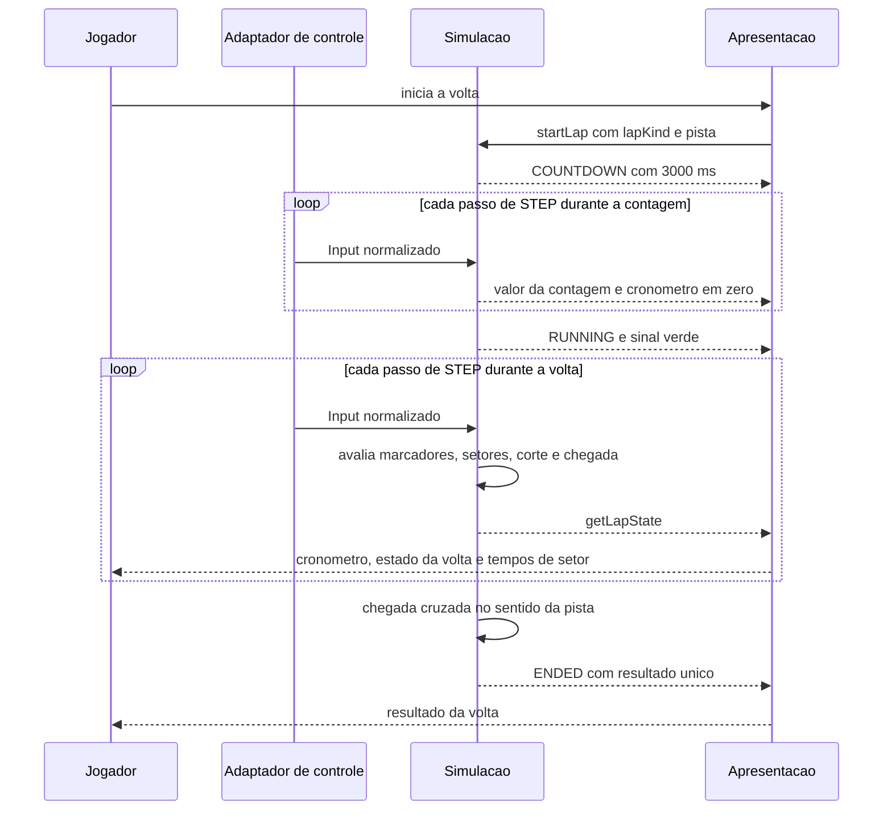

# FLOW-0001 — Volta completa, da contagem ao resultado

Fluxo nominal e alternativas de uma volta oficial ou de reconhecimento, igual em `web-desktop` e
`web-mobile`. O treino, com voltas seguidas e uma única contagem, segue
[FLOW-0005](FLOW-0005-treino-com-voltas-seguidas.md). Realiza
[FEAT-0001](../features/FEAT-0001-contagem-regressiva-e-largada.md),
[FEAT-0002](../features/FEAT-0002-conclusao-da-volta-tempos-e-setores.md) e
[FEAT-0004](../features/FEAT-0004-marcadores-e-sentido-da-pista.md). O fluxo roda inteiro sem rede (D-FS-08,
NFR-0004).

## Passos

| Passo | Ator | Ação | Estado antes e depois | Fonte |
|---|---|---|---|---|
| 1 | Apresentação | Pede `startLap` com `lapKind` `OFFICIAL` ou `RECON`, `trackId` e `trackVersion` | nenhuma volta ou `ENDED` para `COUNTDOWN` | AC-US-0001-01 |
| 2 | Simulação | Conta 3000 ms de passos; o kart fica parado; a aceleração é ignorada | `countdownRemainingMs` de 3000 a 0 | AC-US-0001-05, AC-US-0001-06 |
| 3 | Apresentação | Exibe cada valor da contagem e o cronômetro em zero | `COUNTDOWN` | AC-US-0001-02, AC-US-0001-04 |
| 4 | Simulação | Dá o sinal verde: `RUNNING`, `stepCount` 0 | `COUNTDOWN` para `RUNNING` | AC-US-0001-05 |
| 5 | Simulação | A cada passo, avança `elapsedMs`, conta marcadores em ordem, completa setores ao cruzar cada limite, mede a saída de pista | `RUNNING` | AC-US-0002-09, AC-US-0004-02 |
| 6 | Apresentação | Exibe o tempo de cada setor ao completá-lo e o estado da volta em todos os quadros | `RUNNING` | AC-US-0002-09, AC-US-0009-01 |
| 7 | Simulação | Cruza a chegada no sentido da pista com todos os marcadores em ordem: interpola o instante, fecha o quarto setor, produz o resultado. Em volta oficial, o kart para: a partir deste passo a sua posição não muda; nenhuma volta seguinte começa | `RUNNING` para `ENDED`, `VALID` | AC-US-0002-01, AC-US-0002-07; AC-US-0010-21, AC-US-0010-22 |
| 8 | Apresentação | Exibe a volta válida, o tempo total e os quatro tempos de setor ([SCR-0003](../screens/SCR-0003-resultado-da-volta.md)) | `ENDED` | AC-US-0002-02, AC-US-0002-03 |

## Alternativas, erros e eventos fora de ordem

| Situação | Onde no fluxo | Tratamento |
|---|---|---|
| Chegada no sentido da pista sem todos os marcadores em ordem | passo 7 | `INVALID` com `MISSED_MARKER`; `ENDED`; sem tempo oficial ([FLOW-0002](FLOW-0002-invalidacao-e-fim-da-volta.md)) |
| Chegada na contramão | passos 5 a 7 | Ignorada; a volta continua em andamento; nenhum resultado (AC-US-0005-01) |
| Chegada cruzada de novo depois do passo 7 | depois do passo 8 | Ignorada: a deduplicação ocorre na simulação (fase `ENDED`); 1 resultado (AC-US-0002-12; I7) |
| `startLap` repetido durante a volta | passos 1 a 7 | Rejeitado com `LAP_ALREADY_ACTIVE`; a volta não reinicia |
| Pausa, perda de foco ou perda do sensor | passos 2 a 6 | Ver [FLOW-0003](FLOW-0003-pausa-e-retomada.md) |
| Corte ou reposicionamento oficial | passo 5 | Ver [FLOW-0002](FLOW-0002-invalidacao-e-fim-da-volta.md) |
| Recarregar ou abandonar a página | passos 1 a 7 | A volta não chega à chegada: nenhum resultado. O consumo de tentativa é da etapa 5 |
| Queda de taxa de quadros | passos 2 a 7 | O tempo continua função dos passos de simulação; sem efeito no resultado |
| Rede indisponível | todos | Sem efeito: nenhum passo usa rede |
| Evento externo (comando, sensor, foco) chegando a uma volta `ENDED` | depois do passo 7 | Rejeitado sem efeito (`LAP_ENDED`); nada é reenviado ou persistido por esta feature |
