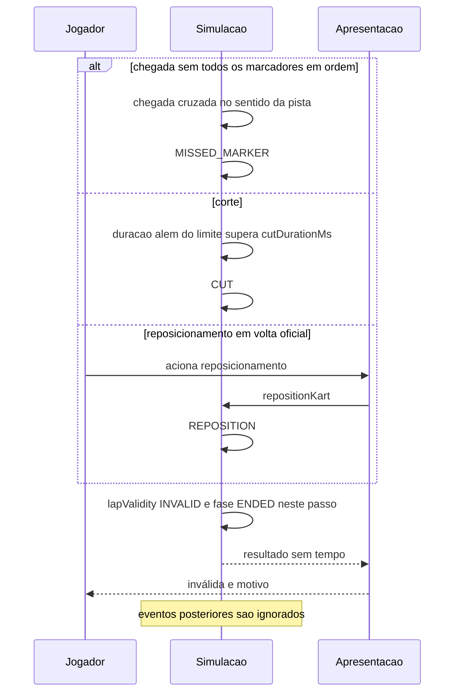

# FLOW-0002 — Invalidação e fim imediato da volta

Como uma volta oficial ou de reconhecimento se torna inválida e termina no passo da invalidação
(`DOMAIN/DEC-06`), nos três motivos. No treino, a volta inválida não termina na invalidação: segue até a
próxima chegada no sentido da pista, que inicia a volta seguinte (`DOMAIN/DEC-12`; tabela "Motivos e tipos
de volta" e [FLOW-0005](FLOW-0005-treino-com-voltas-seguidas.md)). Realiza [FEAT-0004](../features/FEAT-0004-marcadores-e-sentido-da-pista.md),
[FEAT-0005](../features/FEAT-0005-corte-e-grama.md) e
[FEAT-0006](../features/FEAT-0006-reposicionamento-e-tipos-de-volta.md). Igual nos dois canais; sem rede
(D-FS-08).

## Passos

| Passo | Ator | Ação | Estado | Fonte |
|---|---|---|---|---|
| 1 | Simulação | Detecta um dos três eventos num passo em `RUNNING` | `RUNNING` | AC-US-0004-01, AC-US-0006-01, AC-US-0007-01 |
| 2 | Simulação | Fixa `lapValidity` `INVALID` e `invalidReason` do evento | `VALID` para `INVALID` | [RULE-0001](../rules/RULE-0001-validade-da-volta.md) |
| 3 | Simulação | Termina a volta nesse passo: `ENDED`; nenhum tempo de volta nem de setor é acrescentado depois; em volta oficial o kart para e nenhuma volta seguinte começa | `RUNNING` para `ENDED` | AC-US-0004-07, AC-US-0006-06, AC-US-0007-03; AC-US-0010-21, AC-US-0010-22 |
| 4 | Simulação | Produz o resultado: sem `lapMs` e sem `sectorMs`; `official` igual a `false` | `ENDED` | AC-US-0004-03 |
| 5 | Apresentação | Exibe "inválida" e o motivo ([RULE-0006](../rules/RULE-0006-mensagens-de-estado-e-motivo.md)) | `ENDED` | AC-US-0006-05, AC-US-0009-03 |
| 6 | Simulação | Ignora qualquer evento posterior: chegada, marcador, saída de pista, novo reposicionamento | `ENDED` | I7 |

## Motivos e tipos de volta

| Evento | Volta oficial | Reconhecimento | Treino |
|---|---|---|---|
| Chegada sem todos os marcadores em ordem | passos 1 a 6 com `MISSED_MARKER` | passos 1 a 6 com `MISSED_MARKER` | resultado `INVALID` com `MISSED_MARKER` e tempo total; a volta seguinte começa no mesmo instante, sem parar o kart (AC-US-0010-10) |
| Corte | passos 1 a 6 com `CUT` | passos 1 a 6 com `CUT` | `INVALID` com `CUT` no passo; "inválida", "corte" a partir do quadro seguinte; a volta segue em `RUNNING`, o kart não para e ela termina na próxima chegada no sentido da pista, com resultado `INVALID`, `CUT` e tempo total (AC-US-0010-07 a AC-US-0010-09) |
| Reposicionamento | passos 1 a 6 com `REPOSITION` | não invalida: o kart é recolocado e a volta continua em andamento (AC-US-0007-04) | não invalida nem revalida: o kart é recolocado e o estado da volta não muda (AC-US-0010-19) |

## Alternativas, erros e eventos fora de ordem

| Situação | Tratamento |
|---|---|
| Duas invalidações possíveis na mesma volta (corte e depois chegada sem marcadores) | Vale a primeira na ordem dos passos; o motivo é o dela. No treino a volta segue com `CUT` até a chegada |
| Chegada cruzada de novo depois da invalidação | Fora do treino, ignorada; nenhum segundo resultado (I7); a deduplicação ocorre na simulação pela fase `ENDED`. No treino, o novo cruzamento encerra a volta seguinte, com resultado próprio |
| Reposicionamento repetido em volta oficial | O primeiro invalida; os seguintes retornam `LAP_ENDED` |
| Reposicionamento durante a contagem ou a pausa | `NOT_RUNNING`; sem efeito na validade |
| Pausa durante a saída de pista | Nenhum passo avança; o tempo em pausa não conta para os limites de corte |
| Recarregar ou abandonar | Nenhum resultado |
| Rede indisponível | Sem efeito |
