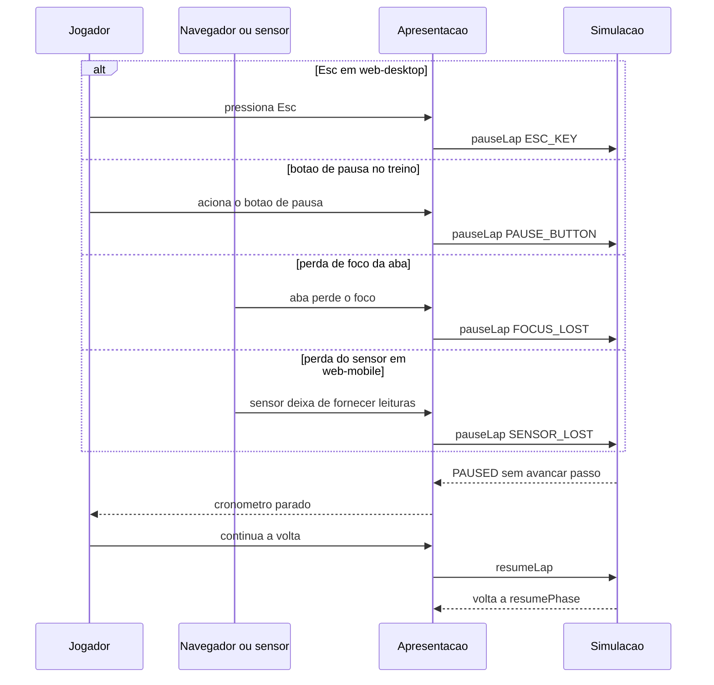

# FLOW-0003 — Pausa, perda de foco, perda do sensor e retomada

Como a volta é suspensa e continuada (`DOMAIN/DEC-08`). Realiza
[FEAT-0003](../features/FEAT-0003-tempo-independente-do-aparelho-e-pausa.md) e, no treino,
[FEAT-0010](../features/FEAT-0010-voltas-seguidas-no-treino.md). Sem rede (D-FS-08).

## Passos

| Passo | Ator | Ação | Estado | Fonte |
|---|---|---|---|---|
| 1 | Navegador, sensor ou Jogador | Dispara a pausa (Esc só em `web-desktop`; foco da aba nos dois canais; sensor só em `web-mobile`; no treino, botão de pausa nos dois canais) | `COUNTDOWN` ou `RUNNING` | AC-US-0003-05 a AC-US-0003-07; AC-US-0010-15 |
| 2 | Apresentação | Envia `pauseLap` com a causa, sem ação do Jogador nos casos de foco e sensor | | [API-0002](../api/API-0002-comandos-da-volta.md) |
| 3 | Simulação | Entra em `PAUSED` com `resumePhase`; nenhum passo de `STEP` avança; nenhum contador muda | para `PAUSED` | AC-US-0003-08 |
| 4 | Apresentação | Mostra o cronômetro parado no valor do instante da pausa | `PAUSED` | AC-US-0003-05, AC-US-0003-06 |
| 5 | Jogador | Continua a volta | `PAUSED` | AC-US-0003-05 |
| 6 | Simulação | Volta a `resumePhase`; o tempo da volta é o do instante da pausa; a volta segue oficial; voltar a `RUNNING` não passa por contagem, também no treino | `PAUSED` para a fase anterior | AC-US-0003-08, AC-US-0003-09; AC-US-0010-04, AC-US-0010-15 |
| 7 | Apresentação | Exibe "válida em andamento" (ou o estado do instante da pausa) | | AC-US-0003-09 |

O resultado de uma volta pausada e continuada é igual ao de uma volta sem pausa, com as mesmas entradas
(AC-US-0003-10). O meio pelo qual o Jogador continua não é decidido pelos requisitos.

## Alternativas, erros e eventos fora de ordem

| Situação | Tratamento |
|---|---|
| Foco e sensor perdidos ao mesmo tempo (`web-mobile`) | Uma única pausa; o segundo `pauseLap` retorna `ALREADY_PAUSED`, sem efeito |
| `pauseLap` repetido | `ALREADY_PAUSED`: sem efeito, `resumePhase` e `pauseCause` não mudam. A deduplicação ocorre na simulação, pelo estado `lapPhase` (`PAUSED`), seja qual for a origem do evento (Esc, foco da aba ou sensor) |
| `resumeLap` sem pausa | `NOT_PAUSED`: sem efeito |
| Foco da aba volta enquanto pausada | Continua pausada, no mesmo valor do cronômetro, até o Jogador continuar |
| Pausa durante a contagem | Simulação suspensa; o cronômetro segue em zero; retoma em `COUNTDOWN` |
| Pausa durante saída de pista | `offTrackMs` não muda; o tempo em pausa não conta |
| Pausas repetidas na mesma volta | Cada uma suspende e retoma; a volta segue oficial |
| Pausa com a volta `ENDED` | `LAP_ENDED`: sem efeito |
| Botão de pausa fora do treino | Não é exibido; um `pauseLap` com `PAUSE_BUTTON` que chegue à simulação retorna `NOT_TRAINING`, sem efeito |
| Encerrar o treino durante a pausa | `endTraining` aceito: `ENDED`; a volta em andamento não recebe resultado ([FLOW-0005](FLOW-0005-treino-com-voltas-seguidas.md)) |
| Recarregar ou abandonar durante a pausa | Nenhum resultado; consumo de tentativa é da etapa 5, fora do escopo |
| Sensor ausente ou permissão negada antes da volta (`web-mobile`) | Não há pausa por sensor: o controle recai para toque com estado visível |
| Rede indisponível | Sem efeito |
