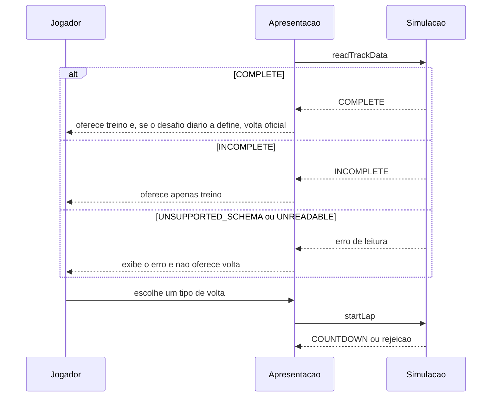

# FLOW-0004 — Início da volta, dado de pista e controle

Como a leitura do dado da pista decide o que pode ser iniciado, e como o controle é escolhido em
`web-mobile`. Realiza [FEAT-0006](../features/FEAT-0006-reposicionamento-e-tipos-de-volta.md) e
[FEAT-0008](../features/FEAT-0008-dado-de-pista-versionado.md). Sem rede depois do carregamento da página
(D-FS-08).

## Passos

| Passo | Ator | Ação | Resultado | Fonte |
|---|---|---|---|---|
| 1 | Apresentação | Lê o dado da pista | `trackDataStatus` | [API-0003](../api/API-0003-dado-de-pista.md) |
| 2 | Apresentação | Oferece volta conforme [RULE-0005](../rules/RULE-0005-tipos-de-volta-e-reposicionamento.md): `COMPLETE` oferece treino e volta oficial quando o desafio diário a define; `INCOMPLETE` só treino | [SCR-0002](../screens/SCR-0002-inicio-de-volta.md) | AC-US-0008-03, AC-US-0008-04 |
| 3 | Jogador | Escolhe o tipo | | |
| 4 | Apresentação | Em `web-mobile`, verifica o sensor de inclinação; ausente ou com permissão negada, usa o controle por toque e mostra o estado | controle ativo | I4 |
| 5 | Apresentação | Pede `startLap`; com `TRAINING`, inicia um treino de voltas seguidas ([FLOW-0005](FLOW-0005-treino-com-voltas-seguidas.md)) | `COUNTDOWN` ou rejeição | [API-0002](../api/API-0002-comandos-da-volta.md) |
| 6 | Simulação | Rejeita `OFFICIAL` em pista `INCOMPLETE` com `OFFICIAL_NOT_AVAILABLE` | nenhuma volta | AC-US-0008-03 |
| 7 | Simulação | Em pista `INCOMPLETE`, todo resultado é não oficial | | AC-US-0008-05 |

## Alternativas, erros e eventos fora de ordem

| Situação | Tratamento |
|---|---|
| Dado na forma anterior | `INCOMPLETE`: só treino; lido sem erro; não é alterado |
| Dado com versão de esquema desconhecida | `UNSUPPORTED_SCHEMA`: mantido intacto, reportado na tela, nenhuma volta |
| Dado ilegível | `UNREADABLE`: erro na tela, nenhuma volta |
| `startLap` enquanto outra volta está ativa | `LAP_ALREADY_ACTIVE`: sem efeito |
| Pedido de volta oficial em pista `INCOMPLETE` que chega à simulação | `OFFICIAL_NOT_AVAILABLE`; a apresentação não deveria tê-lo emitido |
| Sensor ausente ou permissão negada em `web-mobile` | Controle por toque com estado visível; a contagem e as regras não mudam |
| Recarregar a página antes de iniciar | Nenhuma volta; nada a refazer |
| Rede indisponível | Sem efeito: o dado já está no cliente |
