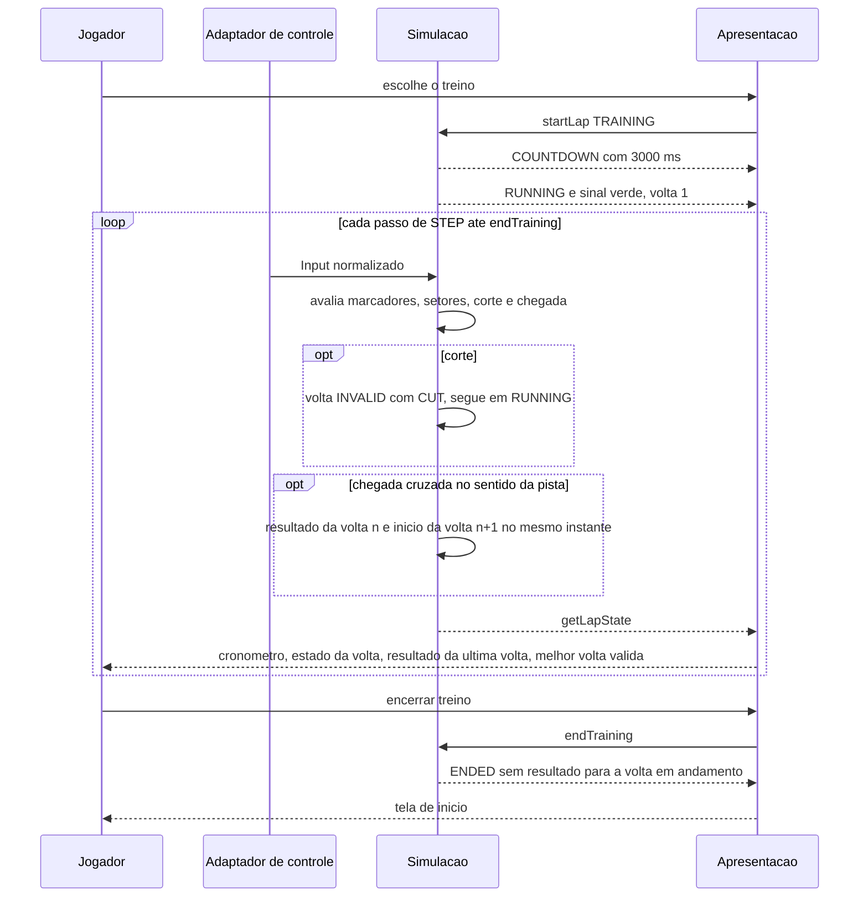

# FLOW-0005 — Treino com voltas seguidas

Do início ao encerramento de um treino, igual em `web-desktop` e `web-mobile`. Realiza
[FEAT-0010](../features/FEAT-0010-voltas-seguidas-no-treino.md), com a contagem de
[FEAT-0001](../features/FEAT-0001-contagem-regressiva-e-largada.md) e as regras de validade de
[FEAT-0004](../features/FEAT-0004-marcadores-e-sentido-da-pista.md),
[FEAT-0005](../features/FEAT-0005-corte-e-grama.md) e
[FEAT-0006](../features/FEAT-0006-reposicionamento-e-tipos-de-volta.md). O fluxo roda inteiro sem rede
(D-FS-08, NFR-0004).

## Passos

| Passo | Ator | Ação | Estado antes e depois | Fonte |
|---|---|---|---|---|
| 1 | Apresentação | Pede `startLap` com `lapKind` `TRAINING` | nenhuma volta ou `ENDED` para `COUNTDOWN`; `lapSequenceCount` 1 | AC-US-0001-01 |
| 2 | Simulação | Conta 3000 ms; o kart fica parado; dá o sinal verde: volta 1 em `RUNNING`, `lapStartMs` 0 | `COUNTDOWN` para `RUNNING` | AC-US-0001-05; AC-US-0010-04 |
| 3 | Simulação | A cada passo avança o tempo, conta marcadores, fecha setores e mede a saída de pista da volta em andamento | `RUNNING` | AC-US-0002-09 |
| 4 | Apresentação | Exibe em todos os quadros o cronômetro da volta, os setores fechados e o estado da volta | `RUNNING` | AC-US-0009-01 |
| 5 | Simulação | Corte: a volta fica `INVALID` com `CUT` no passo da invalidação e segue em `RUNNING`; o kart não para | `VALID` para `INVALID` | AC-US-0010-07 a AC-US-0010-09 |
| 6 | Apresentação | Exibe "inválida" e "corte" a partir do primeiro quadro depois desse passo | `RUNNING` | AC-US-0010-07 |
| 7 | Simulação | Chegada cruzada no sentido da pista: interpola o instante; produz o resultado da volta n (válida, ou inválida com o motivo, por corte já marcado ou por marcador pulado), com `trainingLapMs` e `trainingSectorMs`; inicia a volta n + 1 no mesmo instante, sem motivo de invalidação; o kart não para | `RUNNING` segue; `lapSequenceCount` n para n + 1; `lapStartMs` = instante do cruzamento | AC-US-0010-01, AC-US-0010-03, AC-US-0010-10, AC-US-0010-11, AC-US-0010-20, AC-US-0010-26 |
| 8 | Simulação | Se o resultado é `VALID` e o tempo é menor que `bestValidLapMs`, ou se é o primeiro `VALID`, atualiza `bestValidLapMs` | `RUNNING` | AC-US-0010-12, AC-US-0010-13 |
| 9 | Apresentação | Exibe o resultado da volta n: tempo total, quatro tempos de setor com "—" nos setores sem tempo (nenhuma linha de setores numa pista sem setores), validade com o motivo e "não oficial"; exibe a melhor volta válida; o estado da volta n + 1 é "válida em andamento" | `RUNNING` | AC-US-0010-02, AC-US-0010-11, AC-US-0010-12, AC-US-0010-23 a AC-US-0010-25, AC-US-0010-27 |
| 10 | Simulação | Segue nos passos 3 a 9, sem contagem e sem ação do Jogador, até a pausa ou o encerramento | `RUNNING` | AC-US-0010-04, AC-US-0010-14 |
| 11 | Jogador e apresentação | Aciona "encerrar treino"; a apresentação pede `endTraining` | `COUNTDOWN`, `RUNNING` ou `PAUSED` para `ENDED` | AC-US-0010-16 |
| 12 | Simulação | Encerra o treino: a volta em andamento não recebe resultado; nenhuma volta começa depois | `ENDED` | AC-US-0010-17, AC-US-0010-18 |
| 13 | Apresentação | Volta à tela de início ([SCR-0002](../screens/SCR-0002-inicio-de-volta.md)) | `ENDED` | AC-US-0010-18 |

## Alternativas, erros e eventos fora de ordem

| Situação | Onde no fluxo | Tratamento |
|---|---|---|
| Chegada na contramão | passos 3 a 10 | Ignorada: a volta não termina e nenhuma começa; a seguinte só começa no cruzamento no sentido da pista |
| Chegada cruzada de novo logo depois de uma volta concluída | passo 7 | O novo cruzamento é avaliado no seu próprio passo e encerra a volta seguinte, com resultado próprio. A deduplicação ocorre na simulação: cada cruzamento é avaliado uma única vez, no passo em que ocorre, e encerra no máximo 1 volta (I7) |
| Corte e depois marcador pulado ou novo corte na mesma volta | passos 5 a 7 | O motivo segue "corte"; o resultado carrega só esse motivo |
| Corte que salta um limite de setor | passos 5 a 9 | Os dois setores vizinhos do limite não cruzado aparecem como "—"; o tempo total aparece ([RULE-0003](../rules/RULE-0003-cronometragem-e-interpolacao.md)) |
| Reposicionamento | passos 3 a 10 | O kart é recolocado; validade, motivo e tempo da volta não mudam; o passo seguinte roda sem ação do Jogador |
| Pausa por Esc, perda de foco, perda do sensor ou botão de pausa | passos 2 a 10 | Ver [FLOW-0003](FLOW-0003-pausa-e-retomada.md); ao continuar, a mesma volta segue, sem contagem |
| `endTraining` durante a pausa ou a contagem | passos 2 a 10 | Aceito: `ENDED` sem resultado para a volta em andamento |
| `endTraining` repetido | depois do passo 12 | `LAP_ENDED`: sem efeito |
| `startLap` durante o treino | passos 2 a 10 | `LAP_ALREADY_ACTIVE`: sem efeito |
| Pista sem setores declarados | passos 3 a 9 | Resultado só com tempo total, validade e "não oficial" |
| Pista sem linha de chegada | passos 3 a 10 | Nenhuma volta termina; o que se cronometra não é decidido pelos requisitos |
| Recarregar ou abandonar a página | qualquer passo | A volta em andamento não tem resultado; a melhor volta válida não é guardada por esta feature |
| Queda de taxa de quadros | passos 2 a 10 | O tempo continua função dos passos de simulação; sem efeito nos resultados |
| Rede indisponível | todos | Sem efeito: nenhum passo usa rede |
