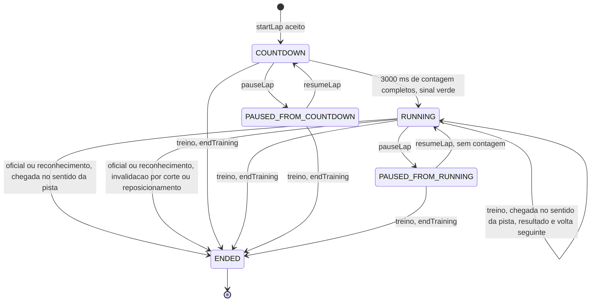

# RULE-0002 — Estados da volta

Modelo de estados da volta, mantido pela simulação. A apresentação lê o estado e nunca o altera (I2).

Uma volta oficial e uma volta de reconhecimento são uma volta só: `startLap`, contagem, volta, encerramento.
Um treino (`lapKind` `TRAINING`) é uma sequência de voltas iniciada por um único `startLap` e precedida de uma
única contagem: cada cruzamento da chegada no sentido da pista encerra a volta em andamento e inicia a
seguinte no mesmo instante, sem sair de `RUNNING`; o treino só é suspenso pela pausa e só termina pelo
comando `endTraining` (`SEED/US-10`, `DOMAIN/DEC-12`; AC-US-0010-01, AC-US-0010-14).

## Enums

| Campo | Valores | Observação |
|---|---|---|
| `lapPhase` | `COUNTDOWN`, `RUNNING`, `PAUSED`, `ENDED` | Fase da volta; no treino, fase do treino inteiro |
| `resumePhase` | `COUNTDOWN`, `RUNNING` | Só em `PAUSED`: fase a que a volta retorna ao continuar |
| `pauseCause` | `ESC_KEY`, `FOCUS_LOST`, `SENSOR_LOST`, `PAUSE_BUTTON` | Causa da pausa; `ESC_KEY` só em `web-desktop`, `SENSOR_LOST` só em `web-mobile`, `PAUSE_BUTTON` só no treino, nos dois canais (AC-US-0010-15) |
| `lapValidity` | `VALID`, `INVALID` | Da volta em andamento; ver [RULE-0001](RULE-0001-validade-da-volta.md) |
| `invalidReason` | `MISSED_MARKER`, `CUT`, `REPOSITION` | Presente só com `lapValidity` `INVALID` |
| `lapKind` | `OFFICIAL`, `RECON`, `TRAINING` | Fixado ao iniciar; não muda |

## Contadores

| Contador | Significado | Avança quando |
|---|---|---|
| `countdownRemainingMs` | Tempo de simulação que falta para o sinal verde; começa em 3000 | A cada passo em `COUNTDOWN` |
| `stepCount` | Passos de `STEP` contados do sinal verde; é o contador de sequência de todas as transições. No treino não recomeça a cada volta | A cada passo em `RUNNING`; nunca em `COUNTDOWN`, `PAUSED` ou `ENDED` |
| `lapSequenceCount` | Posição da volta em andamento na sequência do treino, a partir de 1; 1 fora do treino | Ao iniciar cada volta seguinte do treino |
| `lapStartMs` | Instante de início da volta em andamento, em ms inteiros contados do sinal verde: 0 na primeira volta e fora do treino; nas voltas seguintes do treino, o instante de cruzamento da chegada que encerrou a anterior (AC-US-0010-01) | Ao iniciar cada volta seguinte do treino |
| `elapsedMs` | Tempo da volta em andamento: o tempo de simulação decorrido do sinal verde menos `lapStartMs` (ver [RULE-0003](RULE-0003-cronometragem-e-interpolacao.md)) | Junto com `stepCount` |
| `markersPassedCount` | Marcadores passados em ordem na volta em andamento ([RULE-0001](RULE-0001-validade-da-volta.md)) | Ver RULE-0001; volta a 0 no início de cada volta do treino |
| `offTrackMs` | Duração contínua além da distância dos limites de corte ([RULE-0004](RULE-0004-corte-e-grama.md)) | Ver RULE-0004; mede a saída do kart e não recomeça no início de uma volta do treino |

## Diagrama

`PAUSED_FROM_COUNTDOWN` e `PAUSED_FROM_RUNNING` são o valor `PAUSED` do enum com `resumePhase` `COUNTDOWN` e
`RUNNING`, respectivamente.

## Transições

| De | Para | Disparo | Idempotente sob repetição | Contador de sequência | Fonte |
|---|---|---|---|---|---|
| (nenhuma) ou `ENDED` | `COUNTDOWN` | `startLap` aceito, em qualquer tipo | Não cria segunda volta: com volta ou treino não encerrado, o pedido é rejeitado (`LAP_ALREADY_ACTIVE`) | nenhum (`stepCount` = 0, `lapSequenceCount` = 1, `lapStartMs` = 0) | AC-US-0001-01 |
| `COUNTDOWN` | `RUNNING` | `countdownRemainingMs` chega a 0 | Sim: acontece uma vez por volta oficial ou de reconhecimento e uma vez por treino | `stepCount` passa a contar do passo seguinte | AC-US-0001-05; AC-US-0010-04; `DOMAIN/DEC-05` |
| `COUNTDOWN` ou `RUNNING` | `PAUSED` | Esc, perda de foco, perda do sensor; no treino, também o botão de pausa | Sim: pausar com a volta já em `PAUSED` não faz nada e não troca `resumePhase` | `stepCount` fica congelado | AC-US-0003-05 a AC-US-0003-08; AC-US-0010-15; `DOMAIN/DEC-08` |
| `PAUSED` | `resumePhase` | `resumeLap` | Sim: continuar sem pausa não faz nada. Continuar em `RUNNING` não exibe contagem | `stepCount` retoma do valor congelado | AC-US-0003-09; AC-US-0010-04 |
| `RUNNING` (treino) | `RUNNING` (treino), volta seguinte | Chegada cruzada no sentido da pista: a volta em andamento recebe o seu resultado e a seguinte começa no mesmo instante de cruzamento ([RULE-0001](RULE-0001-validade-da-volta.md)) | Sim: um cruzamento encerra no máximo 1 volta; ele é avaliado uma única vez, no passo em que ocorre | `lapSequenceCount` + 1; `lapStartMs` = instante de cruzamento; `stepCount` segue | AC-US-0010-01, AC-US-0010-10, AC-US-0010-26 |
| `RUNNING` (oficial ou reconhecimento) | `ENDED` | Conclusão ou invalidação ([RULE-0001](RULE-0001-validade-da-volta.md)) | Sim: a volta encerrada ignora novos eventos | `stepCount` do passo de encerramento | AC-US-0005-03; AC-US-0010-21; `DOMAIN/DEC-06` |
| `COUNTDOWN`, `RUNNING` ou `PAUSED` (treino) | `ENDED` | `endTraining` | Sim: o segundo pedido é rejeitado (`LAP_ENDED`) sem efeito | `stepCount` do pedido; a volta em andamento não recebe resultado | AC-US-0010-17, AC-US-0010-18 |

Não existe transição de `ENDED` para outra fase: uma nova volta oficial, de reconhecimento ou um novo treino
começa com novo `startLap`.

## Regras do modelo

| Regra | Fonte |
|---|---|
| Durante `PAUSED` nenhum passo de `STEP` avança e nenhum contador muda | AC-US-0003-08; AC-US-0010-15 |
| `PAUSED` não altera `lapValidity` nem `lapKind`; a volta pausada e continuada segue oficial | AC-US-0003-09 |
| Perda de foco e perda do sensor ao mesmo tempo formam uma única pausa | US-0003, caso anormal |
| A volta deixa `PAUSED` somente por `resumeLap` do Jogador ou, no treino, por `endTraining`; o retorno do foco da aba não a retoma | AC-US-0003-06; AC-US-0003-05; AC-US-0010-17 |
| Em `COUNTDOWN` o cronômetro exibido é zero e o kart fica parado | AC-US-0001-04, AC-US-0001-06 |
| No treino, a contagem existe só antes da primeira volta: o fim de uma volta e a retomada de uma pausa nunca passam por `COUNTDOWN` | AC-US-0010-04 |
| No treino, em `RUNNING`, a conclusão de uma volta válida ou inválida, a invalidação por corte e o reposicionamento não suspendem o avanço: o passo seguinte roda sem ação do Jogador. Só `PAUSED` e `ENDED` param o avanço | AC-US-0010-14 |
| No treino, o fim de uma volta e a invalidação por corte não param o kart: a entrada continua com o efeito do passo normal sobre o kart | AC-US-0010-03, AC-US-0010-08 |
| Em volta oficial, a partir do passo do encerramento, a posição do kart no estado da simulação não muda e nenhuma volta seguinte começa | AC-US-0010-21, AC-US-0010-22 |
| Em volta de reconhecimento, nenhuma volta seguinte começa depois do encerramento; o que acontece com o kart depois dele não é decidido pelos requisitos (ver `01-overview.md`) | US-0010, canais (`DOMAIN/DEC-06`) |
| `endTraining` não conclui a volta em andamento: ela não recebe resultado, e nenhuma volta começa depois do encerramento | AC-US-0010-17, AC-US-0010-18 |
| Um comando é aplicado no próximo passo que roda, ou imediatamente se não houver passo (pausa); o "passo do pedido" é esse passo | AC-US-0007-03 |
| A apresentação exibe o estado da volta em todos os quadros do início de cada volta ao seu encerramento; o início é o sinal verde ou, nas voltas seguintes do treino, o instante de cruzamento que encerrou a anterior | AC-US-0009-01 |
