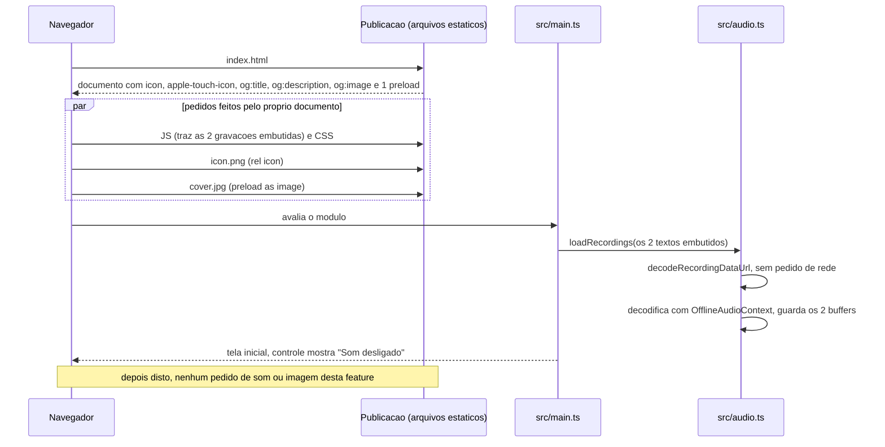
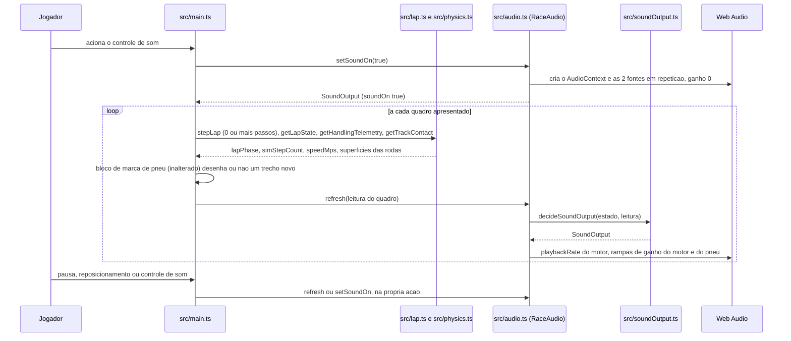

# Arquitetura

Como o Kartle passa a entregar o ícone, a capa, o som do motor gravado e o som de pneu que o F-Spec validado
de `300 Specs/320 F-Specs/Output/apresentacao-e-som/` exige. Tudo é **apresentação** (I2): nenhum módulo da
simulação nem do dado de pista muda, nenhum dado é persistido e nenhuma dependência de execução entra.
Caminhos relativos à raiz do repositório (diretrizes do estágio). Base lida para posicionamento: a árvore do
commit `5a0dfb3`.

## Posicionamento por camada

| Camada (mapa das diretrizes) | Módulo | Mudança | Item |
|---|---|---|---|
| Dado de pista | `src/track.ts`, `src/trackData.ts`, `src/trackGeometry.ts` | nenhuma | — |
| Simulação | `src/physics.ts`, `src/maneuvers.ts`, `src/lap.ts`, `src/lapTiming.ts` | nenhuma; só são lidos | — |
| Adaptadores de controle | em `src/main.ts` | nenhuma | — |
| Aplicação | `index.html` | declarações do documento e referências às 2 imagens | [DES-0001](web/DES-0001-arquivos-entregues-e-declaracoes-da-pagina.md) |
| Aplicação | `src/assets/` (**nova pasta**) | os 4 arquivos na forma entregue e o registro de origem | [DES-0001](web/DES-0001-arquivos-entregues-e-declaracoes-da-pagina.md), [DM-0001](data/DM-0001-registro-de-origem-dos-arquivos-e-estado-do-som.md) |
| Aplicação | `src/soundOutput.ts` (**novo**, puro) | a decisão do estado do som, do motor e do pneu | [DES-0002](web/DES-0002-decisao-do-estado-do-som-motor-e-pneu.md) |
| Aplicação | `src/audio.ts` | decodifica e toca as gravações embutidas, sem rede; `setSoundOn`, `getSoundOutput`; o tom sintetizado do motor sai | [DES-0003](web/DES-0003-saida-de-audio-gravacoes-e-controle-de-som.md) |
| Aplicação | `src/main.ts`, `src/rawImports.d.ts` | importa as duas gravações embutidas (`?inline`), lê a volta e a cena a cada quadro, liga o controle de som | [DES-0003](web/DES-0003-saida-de-audio-gravacoes-e-controle-de-som.md) |
| Aplicação | `scripts/assetBudget.ts`, `scripts/asset-budget.ts` (**novos**, árvore `scripts/`, fora do build do jogo), `package.json` (script `check:assets`) | a medida do build | [DES-0004](web/DES-0004-verificacoes-registros-e-medida-do-build.md) |
| Aplicação | `tests/helpers/soundReport.ts` (**novo**, árvore `tests/helpers/`, etapa de testes) | monta e serializa os três registros de `npm test` | [DES-0004](web/DES-0004-verificacoes-registros-e-medida-do-build.md) |
| Aplicação | `docs/apresentacao-e-som-device-log.md` (**novo**, árvore `docs/`, evidência) | testes registrados em aparelho e inspeção visual | [DES-0004](web/DES-0004-verificacoes-registros-e-medida-do-build.md), [DES-0005](security/DES-0005-privacidade-rede-e-licenca.md) |

Direção das dependências (I2, D-DS-01): `src/soundOutput.ts` importa só o tipo `LapPhase` de `src/lap.ts`;
`src/audio.ts` importa `src/soundOutput.ts`; `src/main.ts` importa os dois. Nenhum módulo da simulação importa
`src/soundOutput.ts`, `src/audio.ts` nem `src/assets/`. Os módulos de verificação de `scripts/` e de
`tests/helpers/` ficam na ponta: nenhum módulo de `src/` os importa. A simulação não tem como ler o som: o tempo da volta e
os setores não dependem dele por construção, e os registros de [DES-0004](web/DES-0004-verificacoes-registros-e-medida-do-build.md)
provam isso.

Não há camada, serviço, banco, fila nem unidade de publicação nova. Não há `<mobile>` nem `<migrations>`
neste projeto (diretrizes do estágio): o celular roda o mesmo cliente.

## Abertura da página

As 2 imagens são pedidas **pelo documento**, antes de qualquer script rodar, e as 2 gravações vêm **dentro
do JS de entrada**, como texto em base 64; por isso os 4 arquivos estão no download inicial por construção, e
a medida do build encontra as imagens a partir de `dist/index.html` e as gravações dentro do JS que ele manda
buscar ([ADR-0001](adr/ADR-0001-arquivos-versionados-e-pedidos-pelo-documento.md)). O código da aplicação não
faz pedido de rede algum: `src/audio.ts` e `src/main.ts` não usam `fetch` nem outra API de rede, e as
verificações de camadas validadas das outras features continuam passando como estão. Nenhum `AudioContext` é criado
antes da ação do Jogador; a decodificação usa `OfflineAudioContext`, que não toca nada
([ADR-0002](adr/ADR-0002-gravacoes-decodificadas-na-abertura-e-tocadas-por-web-audio.md)).

## Som durante a volta

A leitura vai sempre de dentro para fora: `src/main.ts` lê a volta e a telemetria por operações públicas que
já existem e entrega valores a `RaceAudio.refresh`; nada volta para `stepLap`.

## Dependências

| Dependência | Uso | Novo? |
|---|---|---|
| `three`, Vite, TypeScript, `tsx` | como hoje | não |
| Web Audio do navegador (`AudioContext`, `OfflineAudioContext`, `AudioBufferSourceNode`, `GainNode`) | tocar as gravações | não: `AudioContext` já é usado por `src/audio.ts` |
| `atob` do navegador | tirar os bytes de cada gravação do texto embutido | API do navegador, sem pacote; não é rede |
| Tratamento de arquivos do Vite em `index.html` (`link[href]`, `meta[property="og:image"]`) | nomes com resumo em `dist/assets/` para as 2 imagens | comportamento padrão do Vite 8, sem `vite.config` |
| Importação `?inline` do Vite | os bytes das 2 gravações dentro do JS de entrada, como texto `data:` em base 64 | comportamento padrão do Vite 8, sem `vite.config` |

Lista de dependências de execução de `package.json`: continua `three` e mais nada (REQ-FEAT-0005-10). Nenhuma
integração externa entra (D-DS-03 não se aplica): os arquivos saem da mesma publicação estática do jogo. As
gravações chegam com o JS, sem carregamento próprio; uma gravação que não decodifica é tratada como som
ausente e o jogo segue igual ([DES-0003](web/DES-0003-saida-de-audio-gravacoes-e-controle-de-som.md)).

## Efeitos sobre outras features

Este conjunto não escreve em outra feature. O que muda do que elas descrevem:

| Feature | O que ela descreve hoje | O que este projeto muda | Tratamento |
|---|---|---|---|
| `pista-kart-park` (D-Spec, DES-0009) | `ENGINE_SOUND` `{source: 'triangle', peakGain: 0.045}`, `RaceAudio.toggle()`, `RaceAudio.update()`, "o motor soa como hoje" | o motor passa a ser gravação (`source: 'recording'`); `toggle()` e `update()` são retirados | o F-Spec desta feature a torna dona do som do motor; a atualização do texto de DES-0009 é devida por `pista-kart-park` e segue por feedback (conventions §14) |
| `pista-kart-park` (teste CHK-TEST-0008-07) | afirma que o motor é um oscilador do tipo de `ENGINE_SOUND` e usa `toggle()` | essas linhas migram sob o mesmo identificador; o critério da zebra continua verificado | tabela de migração em [test-strategy.md](test-strategy.md) |
| `pista-kart-park` (teste CHK-TEST-0011-02, NFR-0004 dela: nenhum módulo usa a rede nem o armazenamento) | proíbe `fetch`, `XMLHttpRequest`, `WebSocket`, armazenamento do navegador e `EventSource` no texto de `src/audio.ts` e de `src/main.ts`, e `import(` em `src/main.ts` (`tests/pista-kart-park-layering.test.ts:58-66`) | nada: as gravações vêm embutidas no JS e o código não usa a rede; a verificação passa como está | não é migrada nem contornada (decisão do dono do produto, 2026-11-10; [ADR-0001](adr/ADR-0001-arquivos-versionados-e-pedidos-pelo-documento.md)); nenhum feedback é devido |
| `race-lap-validation` (teste CHK-TEST-0013-03) | a mesma proibição no texto de `src/main.ts` (`tests/race-lap-validation-layering.test.ts:43-47`) | nada: `src/main.ts` só ganha duas importações estáticas `?inline` | idem |
| `pista-kart-park` (som da zebra) | `CURB_SOUND`, `RaceAudio.curb()`, `decideCurbFeedback`, leitura `audio.soundOn()` em `src/main.ts:555` | nada: nenhuma linha desses símbolos muda | REQ-FEAT-0005-11, REQ-FEAT-0005-12 |
| `modelo-kart-01` (marca de pneu) | o bloco de marca de pneu de `src/main.ts:586-615`, extraído e executado pelo teste CHK-TEST-0004-06 | nada: o bloco não é editado; o som lê o efeito do bloco de fora dele | [ADR-0003](adr/ADR-0003-lacunas-do-f-spec-resolvidas-no-projeto.md) |
| `race-lap-validation`, `dirigibilidade` | `getLapState`, `repositionKart`, `getHandlingTelemetry`, `Input`, `STEP` | nada: só leitura | — |

## Ordem de entrega

1. `src/assets/` com os 4 arquivos e `feature-assets.json` ([DM-0001](data/DM-0001-registro-de-origem-dos-arquivos-e-estado-do-som.md)); `index.html`.
2. `src/soundOutput.ts`.
3. `src/audio.ts`, depois `src/main.ts` e `src/rawImports.d.ts`.
4. `scripts/assetBudget.ts`, `scripts/asset-budget.ts`, script `check:assets`.
5. Testes e a migração de CHK-TEST-0008-07 (etapa de testes); teste registrado em aparelho e inspeção visual.

Cada passo deixa `npm run build` verde e, em `npm test`, uma única exceção declarada: CHK-TEST-0008-07 de
`pista-kart-park`, que afirma o motor oscilador e chama `toggle()`, falha do passo 3 até ser migrada no passo
5, pela tabela de [test-strategy.md](test-strategy.md). Toda outra verificação existente fica verde em todos
os passos — CHK-TEST-0011-02 e CHK-TEST-0013-03 inclusive, sem mudança nelas. Nenhum passo depende de
configuração nova.
