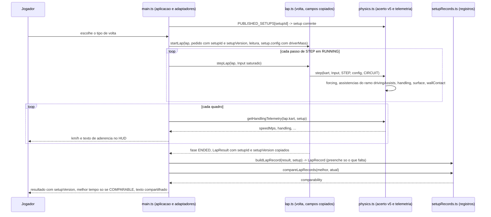
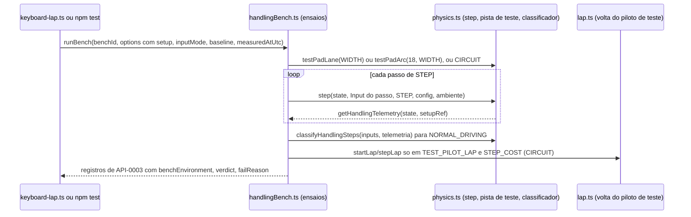

# Arquitetura

Este conjunto projeta como cada `REQ-*` do F-Spec validado de `dirigibilidade` (3.4.0, contra o seed
`revision: 3`; FEAT-0001 a FEAT-0006, API-0001 a API-0003, RULE-0001 a RULE-0003, SCR-0001, SCR-0002,
FLOW-0001 a FLOW-0003) é realizado sobre o código em execução. Os caminhos são relativos à raiz do
repositório (diretriz do estágio: o código vive em `src/`, `tests/`, `scripts/`; `400 Code/Source/` está
vazio). O produto é um cliente de navegador sem servidor, sem conta e sem banco: não existem as pastas
`backend/` e `mobile/` deste estágio. Os itens da simulação ficam em `core/`, os de apresentação em `web/`
(o mesmo cliente serve `web-desktop` e `web-mobile`) e as garantias de privacidade em `security/`.

**Estado do código lido como as-built nesta rodada.** A rodada de código 2 (commit `0068a57`) implementou
por inteiro o projeto validado em `dspec-validation-20261022-1615` (DES-0001 a DES-0008, DM-0001):
`ARCADE_ASSISTIDO_V5` entregue, `testPadLane`, `testPadArc`, `classifyHandlingSteps` e `forcingRampMps` em
`src/physics.ts`; `src/setupRecords.ts`; `src/handlingMessages.ts`; a biblioteca `scripts/handlingBench.ts`
com todos os ensaios, `scripts/keyboard-lap.ts` e `scripts/physics-bench.ts` chamando-a; `src/main.ts` com
`PUBLISHED_SETUPS`, `getHandlingTelemetry`, `LapRecord`, comparabilidade e compartilhar; `index.html` com
`#lap-result-setup` e `#lap-share`; `docs/physics.md` com a entrada datada e o bloco `handling-baseline`
(três entradas); 13 dos 15 registros do acerto entregue eram `PASS`, e os dois que reprovavam
(SPEC-ISSUE-01 e SPEC-ISSUE-02 de `reports/feedback/feedback-20261022-1803.md`) foram decididos pelo dono
do produto (`DOMAIN/DEC-12`, `DOMAIN/DEC-13`, F-Spec 3.3.0) e projetados na rodada 8 deste conjunto. A
rodada de código 3 (commit `767508e`) implementou esse projeto (`dspec-validation-20261027-1531`, versão
5.0.0 de `DES-0004`) sobre a mesma árvore: `ARCADE_ASSISTIDO_V5` e `src/physics.ts` inalterados; a
biblioteca `scripts/handlingBench.ts` com a curva de referência com acelerador 0 percorrendo a janela
inteira, V1 em todo fim natural, a condição de V0 e a linha `#`; `src/lap.ts` com `setupId?`/`setupVersion?`
copiados do pedido (`:23`, `:30-31`, `:54-55`, `:123-124`, `:278-279`); `src/setupRecords.ts` com
`buildLapRecord` preenchendo só o que falta (`:92-93`) e `replayLap` pedindo a volta com os dois campos
(`:109-114`); `src/main.ts:226`, `scripts/handlingBench.ts:499` e `scripts/keyboard-lap.ts:26` informando os
dois campos; `docs/physics.md` com a entrada `arcade-assistido-v5` refeita (`:196-277`; bloco `:279-426`). O
portão passa (`npx tsc --noEmit` 0; `npm test` 170/170; `npm run build` 0; os dois benches 0) e 14 dos 15
registros do acerto entregue são `PASS` — `UNDERSTEER_ONSET` passou a `PASS` (V1 = 17,89 m/s, fim natural).
O que reprova é `REFERENCE_CORNER` com acelerador 0 (633 ms de `understeer`: 15 passos no asfalto e 61 na
grama depois da saída pelo lado interno no passo 240), SPEC-ISSUE-03 do feedback da etapa de código
(`reports/feedback/feedback-20261027-1619.md`), que o dono do produto decidiu (`DOMAIN/DEC-14`, carregado
pelo F-Spec 3.4.0) e esta rodada projeta. Esse código é lido aqui como descrição do que o sistema faz hoje,
e o projeto vence onde diverge (as linhas estão em `98-divergences.md`). Não foram escritos:
`tests/dirigibilidade-*.test.ts`, `tests/fixtures/records.ts` e `docs/handling-device-log.md`.

**O que a revisão 3 do seed e as decisões de 2026-10-22 e 2026-10-27 mudam neste projeto.** A pista sintética
(`src/track.ts:3-6`) não tem curva de raio 18 m: os seus raios discretos mínimos são 24,0 m (índice 0),
25,1 m (índices 53 e 187) e 4,1 m no grampo (índice 120). Os ensaios de resposta do volante, curva de
referência, início do subesterço e recuperação da traseira rodam na **pista de teste** (`benchEnvironment`
`TEST_PAD`): um ambiente da simulação construído por dois geradores em `src/physics.ts`, `testPadLane`
(reta: faixa de largura `WIDTH` ao longo de z) e `testPadArc` (arco: anel de raio 18 m e largura `WIDTH`),
sem paredes, com `surface` `GRASS` fora da faixa ([DES-0001](core/DES-0001-acerto-arcade-assistido-v5-e-assistencias.md),
[ADR-0005](adr/ADR-0005-pista-de-teste-como-ambiente-da-simulacao-e-velocidade-mantida.md)). O ensaio
de resposta do volante mantém a velocidade em 50 km/h com acelerador regulado por passo
(`speedHoldMode` `THROTTLE_REGULATED`, binário por construção) e mede o regime numa janela curta
([DES-0004](core/DES-0004-ensaios-de-dirigibilidade-e-saida.md)). A classe de passo "Recuperação" de
RULE-0001 tem um classificador puro em `src/physics.ts` (`classifyHandlingSteps`), usado pelo agregado
`NORMAL_DRIVING`. Grama, parede, volta do piloto de teste e custo por passo continuam na pista sintética
(`CIRCUIT`). A varredura de início do subesterço é uma execução contínua no arco, em patamares de
velocidade mantida a partir de 50 km/h, que termina no primeiro passo fora da faixa; a velocidade do kart
nesse passo decide o resultado da saída (RULE-0002, "Fim da varredura de início do subesterço") e, no fim
natural, **V1 tem sempre valor** — a menor velocidade de patamar completo com `understeer` acima de 200 ms
consecutivos ou, sem nenhum patamar assim, a velocidade mantida do patamar interrompido pela saída, de modo
que nunca sair de frente até sair da faixa cumpre V1 ≥ 1,15 × V0 (`DOMAIN/DEC-12`). A curva de referência
com acelerador 0 é julgada só pelos 200 ms de `understeer`, medidos só nos passos na faixa de asfalto até a
primeira saída da faixa — a execução percorre a janela inteira e a saída é reportada sem reprovar, mas os
passos depois dela não entram na medição (`DOMAIN/DEC-13`, `DOMAIN/DEC-14`); com acelerador cheio a
permanência na faixa continua exigida. Os dois casos que RULE-0002 deixa sem decisão fazem a biblioteca lançar
em vez de emitir um veredito; todo parâmetro de ensaio, o piloto de teste inclusive, é fixo, e o que o
registro de API-0003 não carrega — a saída da faixa abaixo de 50 km/h nessa varredura, a precondição de
`GRASS_LOSS` e o `oversteer` na curva com acelerador cheio — chega ao veredito pelo segundo argumento de
`judge` ([ADR-0004](adr/ADR-0004-ensaios-como-biblioteca-e-parametros-de-ensaio.md)).

## Contexto primário (I1)

O contexto primário continua sendo o desafio diário e a pista: todo registro desta feature (replay,
resultado gravado, texto compartilhado) é chaveado em `trackId` + `trackVersion` e, quando o desafio o
informa, em `challengeNumber`, exatamente como o resultado de `race-lap-validation`. A versão do acerto
(`setupId`, `setupVersion`) é um **atributo** do registro, usado só para decidir comparabilidade
([RULE-0003](../../../320%20F-Specs/Output/dirigibilidade/rules/RULE-0003-versao-do-acerto-e-comparabilidade.md));
nenhuma chave, regra ou resultado usa a data, o relógio do aparelho ou o nome do acerto como contexto
primário. O tempo é contado em passos de `STEP`, nunca em tempo de parede. A pista de teste não é dado de
pista publicado: não tem `trackId`, não entra em registro algum e nenhuma tela a exibe.

## Posicionamento por camada (I2)

| Camada | Módulo | Situação | Conteúdo desta feature |
|---|---|---|---|
| Dado de pista | `src/track.ts`, `src/trackData.ts` | inalterados | a pista sintética e o seu leitor não mudam (NFR-0008); `WIDTH` (`src/track.ts:2`) é a largura da faixa da pista de teste (`laneWidthM`) |
| Simulação | `src/physics.ts` | existente (as-built, rodadas de código 1 e 2) | preset `ARCADE_ASSISTIDO_V5` (`:73-83`), campos opcionais de `KartConfig` (`:40-46`), `PUBLISHED_SETUPS` (`:92-100`), `SOLVER_SUBSTEPS` (`:84`), `isForcing` (`:118-120`), `forcingRampFraction` (`:192-195`), telemetria por passo (`:17-21`, `:314-316`), `stepCount` (`:341`), `getHandlingTelemetry` (`:351-360`), `testPadLane`/`testPadArc` (`:170-178`), `classifyHandlingSteps`/`RECOVERY_MAX_STEPS` (`:363-385`). `ARCADE_KART`, `RENTAL_KART`, `KART_PRESETS`, `STEP`, `Input`, `step`, `handling()` e a linha 3 ficam como estão |
| Simulação | `src/maneuvers.ts` | inalterado | a manobra de drift de `requirements/11` não muda |
| Simulação | `src/lap.ts`, `src/lapTiming.ts` | `src/lap.ts` existente (as-built, rodada de código 3: campos copiados); `src/lapTiming.ts` inalterado | ciclo da volta, validade e cronometragem não mudam (NFR-0008). `src/lap.ts` tem `setupId?` e `setupVersion?` em `LapRequest` (`:23`), `LapSession` (`:30-31`) e `LapResult` (`:54-55`), copiados do pedido sem interpretação como `challengeNumber` (`:123-124`, `:278-279`) e ausentes quando o pedido não os traz — o contrato API-0001/API-0002 1.1.0 de `race-lap-validation`, projetado no D-Spec daquela feature (DM-0002, DES-0001) e implementado pelo código desta na rodada 3 (FB-01 aceito; [DES-0003](core/DES-0003-versao-do-acerto-registros-e-comparabilidade.md)) |
| Simulação | `src/setupRecords.ts` | existente (rodadas de código 1 a 3) | leitores e construtores dos registros: `getSetupVersion`, `readReplay`, `compareLapRecords`, `buildLapRecord` (preenche só o que o resultado não traz, `:92-93`), `buildReplayRecord`, `replayLap` (o pedido leva os dois campos, `:109-114`) (API-0002, RULE-0003) |
| Simulação (lugar na árvore: `scripts/`) | `scripts/handlingBench.ts` | existente (rodadas de código 1 a 3), **alterado** nesta rodada num ponto | biblioteca dos ensaios de RULE-0002: um registro de API-0003 por ensaio e variante, com `benchEnvironment`; ambientes por ensaio; leitura da linha de base por ensaio, ambiente, geometria e método; serialização; usada pelos benches e, quando escritos, por `npm test`. Muda: a janela de medição de `maxUndersteerMs` em `REFERENCE_CORNER` com acelerador 0 — só os passos na faixa até a primeira saída (`DOMAIN/DEC-14`; `:280-281` em `767508e`) |
| Aplicação (programa de bench em Node; lugar na árvore: `scripts/`) | `scripts/keyboard-lap.ts`, `scripts/physics-bench.ts` | existentes (rodadas de código 2 e 3) | pontos de entrada de `bench:handling` e `bench:physics`, que emitem os registros de API-0003; único lugar que lê o relógio de parede (`new Date()` para `measuredAtUtc` nos dois; `node:perf_hooks` para `STEP_COST` e `node:os` para `runtimeId()` só em `scripts/keyboard-lap.ts`). Em `scripts/keyboard-lap.ts:26` o pedido da volta cronometrada leva os dois campos (rodada de código 3) |
| Adaptadores de controle | em `src/main.ts` | inalterados | teclado binário, inclinação proporcional e toque continuam entregando `Input` saturado na faixa; nenhuma regra |
| Aplicação | `src/main.ts` | existente (rodadas de código 2 e 3) | escolhe o acerto pelo dado publicado, lê o HUD por `getHandlingTelemetry`, constrói o registro da volta, compara só o comparável, compartilha o texto. `beginLap` (`:226`) informa `setupId` e `setupVersion` no pedido de `startLap` (rodada de código 3; [DES-0007](web/DES-0007-integracao-da-aplicacao-e-adaptadores.md)) |
| Aplicação | `src/handlingMessages.ts` | existente (rodada de código 2) | texto compartilhado e rótulo do botão de compartilhar, puros e testáveis sem DOM |
| Aplicação | `index.html` | existente (rodada de código 2) | linha da `setupVersion` e botão de compartilhar na tela de resultado (`index.html:25`) |

Por que módulos próprios (I10): `src/setupRecords.ts` importa `src/lap.ts` (para reproduzir um replay) e
`src/physics.ts`; colocá-lo em `src/physics.ts` faria o modelo do veículo importar a volta, invertendo o
sentido de dependência de `src/lap.ts` → `src/physics.ts`. `scripts/handlingBench.ts` existe porque os ensaios
precisam rodar em `npm test` **e** nos benches com o mesmo código, e `scripts/keyboard-lap.ts` é um
programa, não uma biblioteca. `src/handlingMessages.ts` existe porque `src/main.ts` importa Three.js e o DOM
e não carrega em `npm test`, e `src/lapMessages.ts` (de `race-lap-validation`) só pode importar tipos de
`./lap` (verificado por `tests/race-lap-validation-layering.test.ts`). Os geradores da pista de teste e o
classificador de passo ficam em `src/physics.ts`, e não na biblioteca, porque `Environment`, `CIRCUIT` e
`TEST_PAD` já vivem ali (`src/physics.ts:164-166`) e porque RULE-0001 manda decidir a classe do passo na
simulação (REQ-FEAT-0003-10): a biblioteca só os chama. Os campos de acerto em `src/lap.ts` são cópias sem
interpretação: `src/lap.ts` não importa `src/setupRecords.ts` (o sentido é o inverso) e nunca resolve um
valor ausente ou fora do enum — isso é de `resolveSetupRef`. Dividir `src/main.ts` não faz parte desta
feature.

Sentido das dependências (permitido): `setupRecords.ts` importa `physics.ts`, `lap.ts`, `lapTiming.ts`,
`trackData.ts`; `handlingBench.ts` importa `physics.ts`, `lap.ts`, `lapTiming.ts`, `track.ts`,
`trackData.ts`, `setupRecords.ts` e `node:fs` (ler `docs/physics.md` e o texto de `src/physics.ts`) —
**nunca** `node:perf_hooks`, `node:os`, `Date` ou `performance`; `scripts/keyboard-lap.ts` e
`scripts/physics-bench.ts` (programas de bench, camada Aplicação, que só alteram a simulação por
`step`/`stepLap`) importam `handlingBench.ts` e são os únicos a importar `node:perf_hooks` (custo por
passo) e `node:os` (`runtimeId()`) e a ler `new Date()` (`measuredAtUtc`), entregando esses valores à
biblioteca como argumentos; `handlingMessages.ts` importa `lapMessages.ts` e tipos de `setupRecords.ts`;
`main.ts` importa tudo isso; `lap.ts` importa de `physics.ts` só o tipo `SetupId` a mais (`:3`). Nenhum
módulo de simulação importa `three`, o DOM, `src/audio.ts` ou `src/main.ts`, nem lê `Date`,
`performance.now` ou `Math.random`; o teste de camada de `race-lap-validation` continua valendo para os
módulos que lista e `tests/dirigibilidade-contract.test.ts` o estende a `src/setupRecords.ts` e
`scripts/handlingBench.ts` ([DES-0004](core/DES-0004-ensaios-de-dirigibilidade-e-saida.md)).

## A restrição que molda o projeto: o acerto anterior fica intacto

`tests/race-lap-validation-frozen.test.ts:48-51` afirma, campo a campo, os valores de `ARCADE_KART`, e
`:53-60` que `KART_PRESETS.arcade === ARCADE_KART`, que `PHYSICS_VERSION` e a linha 3 de `src/physics.ts`
não mudam; `tests/race-lap-validation-contract.test.ts:36-41` (`CHK-TEST-0012-02`) afirma que `getLapResult`
devolve exatamente os campos de API-0001 de `race-lap-validation`. O F-Spec exige que o conjunto de
`race-lap-validation` continue 100 % aprovado (REQ-FEAT-0006-07) e que a versão anterior do acerto nunca seja
editada no lugar (REQ-FEAT-0005-09). As duas exigências se realizam juntas por
[ADR-0001](adr/ADR-0001-versao-do-acerto-como-registro-novo-no-codigo.md): o novo acerto é um **registro
novo** (`ARCADE_ASSISTIDO_V5`, `src/physics.ts:73-83`) e `ARCADE_KART` (`src/physics.ts:61-68`) permanece
em código como o registro da versão anterior (`previousSetupVersion`). O resultado gravado é um registro
próprio (`LapRecord`) sobre o `LapResult` ([ADR-0002](adr/ADR-0002-formato-do-replay-e-registro-de-volta-em-memoria.md)):
desde a rodada de 2026-10-22, `race-lap-validation` passou os seus API-0001 e API-0002 a 1.1.0 (FB-01 desta
feature, aceito lá) e o `LapResult` carrega `setupId?` e `setupVersion?` copiados do pedido `startLap`; os
campos são opcionais e ausentes quando o pedido não os traz, de modo que `CHK-TEST-0012-02` — cujas voltas
são iniciadas sem eles — continua verde, e `LapRecord` os torna obrigatórios, preenchendo só o que o
resultado não traz. A implementação em `src/lap.ts` é devida ao código desta feature, por decisão do autor
registrada no D-Spec de `race-lap-validation`; o feedback cruzado
(`reports/feedbacks/race-lap-validation/feedback-20261022-1703.md`) está aceito nesta rodada e nenhum
feedback novo àquela feature é necessário.

## Fluxo alterado

Os ensaios ([FLOW-0002](../../../320%20F-Specs/Output/dirigibilidade/flows/FLOW-0002-ensaio-deterministico-e-piloto-de-teste.md))
seguem o caminho abaixo, sem `main.ts`, com `scripts/handlingBench.ts` no lugar da aplicação:

A leitura de replay ([FLOW-0003](../../../320%20F-Specs/Output/dirigibilidade/flows/FLOW-0003-leitura-de-replay-e-comparacao.md))
é `readReplay` → `getSetupVersion` → `compareLapRecords`, e a reprodução opcional é `replayLap`, que chama
`startLap`/`stepLap` com o acerto corrente, informando os dois campos no pedido.

## Dependências externas

Nenhuma. Não há rede, biblioteca nova, serviço nem armazenamento: o dado publicado é literal em
`src/physics.ts`, os registros vivem na memória da página e nos fixtures, e a linha de base está em
`docs/physics.md`. Não há tempo-limite, política de nova tentativa nem chave de idempotência de rede a
declarar (D-DS-03); a idempotência é a de leituras puras e de funções sobre estado imutável (cada DES nomeia
a sua). A Web Share API é usada pela aplicação quando o navegador a oferece, com recuo para a área de
transferência; a sua falha não altera nenhum registro.

## Estratégia de compatibilidade

| Contrato | Tratamento |
|---|---|
| Presets e `KART_PRESETS` | intactos; o novo acerto é um registro novo; a aplicação lê `PUBLISHED_SETUPS` |
| `LapResult` de `race-lap-validation` | ganha `setupId?` e `setupVersion?` (aditivos, opcionais, copiados do pedido; API-0001/API-0002 1.1.0 daquela feature); um resultado sem os dois continua válido e é resolvido na leitura por `resolveSetupRef`; `LapRecord` = `LapResult` com os dois obrigatórios, construído por esta feature preenchendo só o que falta |
| Replay | formato versão 1 ([DM-0001](data/DM-0001-dado-publicado-registros-e-linha-de-base.md)); a forma anterior à feature (sem `setupVersion`) é lida com `RESOLVED_FROM_ABSENCE`; versão maior é `UNSUPPORTED_FORMAT`, intacta |
| `STEP`, solver de 480 Hz, `Input` | inalterados; `SOLVER_SUBSTEPS` (`src/physics.ts:84`) só nomeia o valor que `step` usa em `:321` |
| Dado de pista | inalterado (`schemaVersion` 2, `trackVersion` 2); a pista de teste não é dado de pista |
| `TEST_PAD` (constante de `src/physics.ts:166`) | intacta: asfalto sem limite, usada por `tests/physics.test.ts` e `scripts/physics-bench.ts`; os geradores `testPadLane`/`testPadArc` são acréscimos |
| Saída dos benches existentes | os campos que `scripts/physics-bench.ts` já imprime continuam (`:9-39`); os registros de API-0003 são acrescentados (`:40-47`) |
| Linha de base em `docs/physics.md` | bloco `handling-baseline` (`docs/physics.md:265-412`); uma entrada só vale para o ensaio, o ambiente, a geometria e o método em que foi medida (`BASELINE_MISSING` fora disso); a entrada `arcade-assistido-v5` foi refeita pela rodada de código 3 e é refeita de novo pela rodada seguinte só no registro `REFERENCE_CORNER` com acelerador 0, cuja janela de medição muda sob este projeto |

## Rastros de decisão

| ADR | Decisão |
|---|---|
| [ADR-0001](adr/ADR-0001-versao-do-acerto-como-registro-novo-no-codigo.md) | a nova versão do acerto é um registro novo em código; a anterior fica intacta; não há chave mestra |
| [ADR-0002](adr/ADR-0002-formato-do-replay-e-registro-de-volta-em-memoria.md) | formato do replay versão 1 e registro de volta sobre o `LapResult`, que carrega os campos de acerto copiados do pedido (API-0001/API-0002 1.1.0 de `race-lap-validation`); `buildLapRecord` preenche só o que falta; sem persistência |
| [ADR-0003](adr/ADR-0003-linha-de-base-legivel-por-maquina-em-docs-physics.md) | linha de base legível por máquina dentro de `docs/physics.md`, resolvida por ensaio, ambiente, geometria e método; V0 só de um patamar completo com subesterço; identidade de máquina e runtime sem dado pessoal |
| [ADR-0004](adr/ADR-0004-ensaios-como-biblioteca-e-parametros-de-ensaio.md) | ensaios como biblioteca em `scripts/` compartilhada por `npm test` e pelos benches; parâmetros de ensaio fixos, o piloto de teste inclusive; o que o registro não carrega pelo segundo argumento de `judge`; varredura de `UNDERSTEER_ONSET` em patamares de velocidade mantida até a primeira saída da faixa, decidida pela velocidade nesse passo, com V1 em todo fim natural (`DOMAIN/DEC-12`); curva de referência com acelerador 0 percorrida inteira e julgada só por `understeer` medido na faixa até a primeira saída (`DOMAIN/DEC-13`, `DOMAIN/DEC-14`); entrada do Realista e registros antigos como opções da biblioteca |
| [ADR-0005](adr/ADR-0005-pista-de-teste-como-ambiente-da-simulacao-e-velocidade-mantida.md) | pista de teste como geradores de `Environment` em `src/physics.ts` (reta e arco de 18 m, largura `WIDTH`); velocidade mantida por acelerador regulado por passo; classificador de passo na simulação; a curva com acelerador 0 continua fora da faixa, reportada mas não medida depois da saída |
