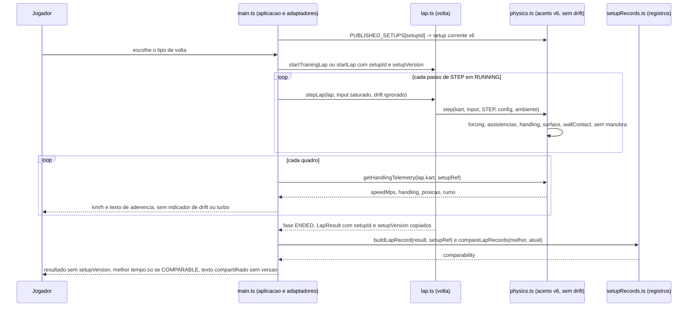
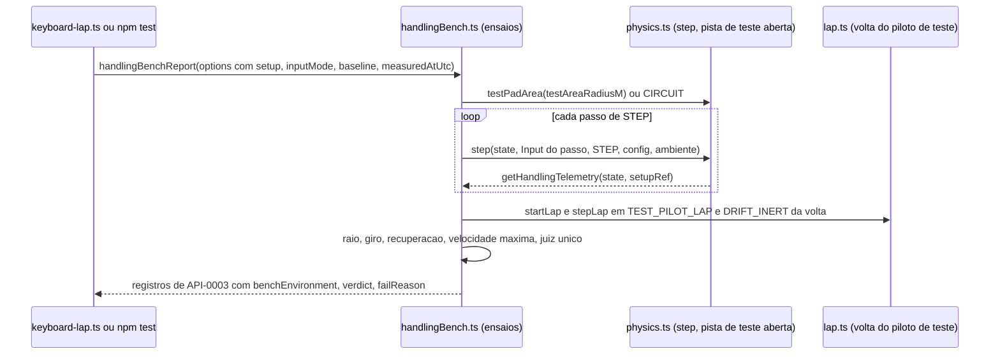

# Arquitetura

Este conjunto projeta como cada `REQ-*` do F-Spec validado de `dirigibilidade` (4.0.1, contra o seed
`revision: 5` e os requisitos 4.3.0; FEAT-0001 a FEAT-0006, API-0001 a API-0003, RULE-0001 a RULE-0003,
SCR-0001, SCR-0002, FLOW-0001 a FLOW-0003) é realizado sobre o código em execução. Os caminhos são relativos à
raiz do repositório (diretriz do estágio: o código vive em `src/`, `tests/`, `scripts/`; `400 Code/Source/`
está vazio). O produto é um cliente de navegador sem servidor, sem conta e sem banco: não existem as pastas
`backend/` e `mobile/` deste estágio. Os itens da simulação ficam em `core/`, os de apresentação em `web/`
(o mesmo cliente serve `web-desktop` e `web-mobile`) e as garantias de privacidade em `security/`.

**O que o F-Spec 4.0.1 muda neste projeto** (seed `revision: 5`; `DOMAIN/DEC-15`, `DOMAIN/DEC-16`):

- **Acerto C.** O Arcade assistido passa à versão `arcade-assistido-v6`, um registro novo
  `ARCADE_ASSISTIDO_V6` igual a `ARCADE_ASSISTIDO_V5` com `governorSpeed` 19,5 m/s, `assistLateralG` 2,4,
  `maxSteer` 0,5 rad, `friction` 2,1 e `frontStiffness` 26 (os valores que o dono do produto escolheu na
  staging, `DOMAIN/DEC-15`); `ARCADE_ASSISTIDO_V5` fica intacto como o registro da rodada substituída e
  `ARCADE_KART` continua sendo a versão anterior à feature (`previousSetupVersion` `arcade-assistido-v4`)
  ([DES-0001](core/DES-0001-acerto-arcade-assistido-v6-e-assistencias.md),
  [ADR-0001](adr/ADR-0001-versao-do-acerto-como-registro-novo-no-codigo.md)).
- **Curva julgada pelo raio e pelo giro na pista de teste aberta.** A pista de teste deixa de ser a faixa
  reta e o anel de 18 m (`testPadLane`, `testPadArc`, retirados) e passa a ser um disco de asfalto sem faixa e
  sem paredes, centrado no ponto de partida, de raio `testAreaRadiusM` declarado por ensaio
  (`testPadArea`); fora dele a telemetria reporta `GRASS` e o ensaio é `FAIL` `TEST_AREA_EXCEEDED`. Os
  ensaios `REFERENCE_CORNER` e `UNDERSTEER_ONSET` saem; entram `CORNER_RADIUS` (acelerador e esterço cheios
  de 50 km/h e de 70 km/h, raio da trajetória ≤ 13 m aos 3 s) e `CORNER_TURN` (acelerador 0 de 50 km/h, giro
  ≥ 180° em até 2 s); `REAR_RECOVERY` roda na pista de teste aberta, cada lado, com `rearReleased` e
  `forcingMs` ([DES-0004](core/DES-0004-ensaios-de-dirigibilidade-e-saida.md),
  [ADR-0004](adr/ADR-0004-ensaios-como-biblioteca-e-parametros-de-ensaio.md),
  [ADR-0005](adr/ADR-0005-pista-de-teste-como-ambiente-da-simulacao-e-velocidade-mantida.md)).
- **Velocidade estabilizada entre 65 km/h e 72 km/h** (`TOP_SPEED`), e a velocidade nunca passa dela
  (`SPEED_CAP`).
- **Sem drift e sem turbo.** O passo da simulação deixa de avançar a manobra de `requirements/11`: os ramos
  `drifting` e `boosting` de `integrate`, a chamada a `advanceManeuvers` e os cancelamentos saem de
  `src/physics.ts`; o campo `drift` de `Input` continua com o mesmo nome e a mesma faixa e é ignorado
  (`DRIFT_INERT` o prova). A telemetria perde `driftActive` e ganha `positionXM`, `positionZM` e `headingRad`
  ([DES-0002](core/DES-0002-telemetria-de-dirigibilidade.md)). O HUD, o resultado e o texto compartilhado
  deixam de mostrar carga, turbo, combo e pontuação, só como remoção de exibição
  ([DES-0005](web/DES-0005-hud-velocidade-e-aderencia.md),
  [DES-0006](web/DES-0006-resultado-melhor-tempo-e-texto-compartilhado.md)). O campo `maneuvers` do `State` e
  o módulo `src/maneuvers.ts` ficam numa janela de compatibilidade, com o valor inicial constante, até que os
  leitores de outras features deixem de os nomear ([ADR-0006](adr/ADR-0006-retirada-do-drift-e-do-turbo-com-janela-de-compatibilidade.md)).
- **Condução normal = a volta do piloto de teste inteira.** `NORMAL_DRIVING` passa a um registro só, em
  `SYNTHETIC_TRACK`, sobre todos os passos da volta; o classificador de passo (`classifyHandlingSteps`) sai
  com as classes de passo que RULE-0001 4.0.0 trocou por contextos de observação.
- **A `setupVersion` não é exibida nem compartilhada.** Continua no dado publicado, no replay e no resultado,
  decidindo a comparabilidade; o elemento `#lap-result-setup` e a cláusula da versão no texto compartilhado
  saem.
- **Linha de base só no veredito de `STEP_COST`** (e na identidade do Realista, `REALISTA_UNCHANGED`); as
  decisões de V0 e da janela de `maxUndersteerMs` saem com os ensaios que as tinham
  ([ADR-0003](adr/ADR-0003-linha-de-base-legivel-por-maquina-em-docs-physics.md)).

**Estado do código lido como as-built nesta rodada.** A árvore corrente implementa o projeto 3.1.0 deste
conjunto (rodadas de código 1 a 4; `dspec-validation-20261027-1803`) e já carrega, além disso, o código de
`pista-kart-park` (ambiente de pista declarada, zebra, barreira, sessão de treino) e de `modelo-kart-01`
(modelo, pose, câmera): `src/physics.ts` (481 linhas) com `ARCADE_ASSISTIDO_V5` (`:79-89`),
`PUBLISHED_SETUPS` em `arcade-assistido-v5` (`:98-106`), a manobra de drift dentro de `step` e `integrate`
(`:2`, `:223-238`, `:280-301`, `:333`, `:352`, `:388-399`, `:414`), `testPadLane`/`testPadArc` (`:192-200`),
`driftActive` na telemetria (`:444`, `:454`) e o classificador de passo (`:459-481`); a biblioteca
`scripts/handlingBench.ts` (853 linhas) com os ensaios da revisão 3; `src/main.ts` (646 linhas) com o HUD do
drift (`:613-624`), as mensagens de prêmio (`:500-506`) e a `setupVersion` no resultado (`:466`);
`src/handlingMessages.ts:9` com a versão no texto compartilhado; `index.html:18`, `:25`, `:30` com os
elementos do drift e da versão; `tests/dirigibilidade-*.test.ts` (dez arquivos) e
`tests/fixtures/records.ts` escritos para o projeto anterior. Esse código é a descrição do que o sistema faz
hoje, e o projeto vence onde diverge (`98-divergences.md`).

## Contexto primário (I1)

O contexto primário continua sendo o desafio diário e a pista: todo registro desta feature (replay,
resultado gravado, texto compartilhado) é chaveado em `trackId` + `trackVersion` e, quando o desafio o
informa, em `challengeNumber`, exatamente como o resultado de `race-lap-validation`. A versão do acerto
(`setupId`, `setupVersion`) é um **atributo** do registro, usado só para decidir comparabilidade
([RULE-0003](../../../320%20F-Specs/Output/dirigibilidade/rules/RULE-0003-versao-do-acerto-e-comparabilidade.md));
nenhuma chave, regra ou resultado usa a data, o relógio do aparelho ou o nome do acerto como contexto
primário. O tempo é contado em passos de `STEP`, nunca em tempo de parede. A pista de teste aberta não é
dado de pista publicado: não tem `trackId`, não entra em registro algum e nenhuma tela a exibe.

## Posicionamento por camada (I2)

| Camada | Módulo | Situação | Conteúdo desta feature |
|---|---|---|---|
| Dado de pista | `src/track.ts`, `src/trackData.ts` | inalterados | a pista sintética e o seu leitor não mudam (NFR-0008) |
| Simulação | `src/physics.ts` | existente, **alterado** | `ARCADE_ASSISTIDO_V6` novo; `PUBLISHED_SETUPS` em `arcade-assistido-v6`; ramos do drift e do turbo retirados do passo; `testPadArea` no lugar de `testPadLane`/`testPadArc`; telemetria com posição e rumo, sem `driftActive`; classificador de passo retirado ([DES-0001](core/DES-0001-acerto-arcade-assistido-v6-e-assistencias.md), [DES-0002](core/DES-0002-telemetria-de-dirigibilidade.md)). `STEP`, `PHYSICS_VERSION`, `Input`, a assinatura de `step`, `RENTAL_KART`, `ARCADE_KART`, `ARCADE_ASSISTIDO_V5`, `KART_PRESETS`, `TEST_PAD` e a linha 3 ficam como estão |
| Simulação | `src/maneuvers.ts` | existente, **sem uso pelo passo** (janela de compatibilidade) | deixa de ser chamado por `step`; `src/physics.ts` só importa `initialManeuvers` e o tipo `Maneuvers` para o valor constante de `State.maneuvers`; retirado com o campo quando os leitores de outras features saírem ([ADR-0006](adr/ADR-0006-retirada-do-drift-e-do-turbo-com-janela-de-compatibilidade.md)) |
| Simulação | `src/lap.ts`, `src/lapTiming.ts` | inalterados | ciclo da volta, validade e cronometragem não mudam (NFR-0008); `src/lap.ts` já copia `setupId?`/`setupVersion?` do pedido (`:24`, `:31-32`, `:55-56`) |
| Simulação | `src/setupRecords.ts` | existente, inalterado | leitores e construtores dos registros ([DES-0003](core/DES-0003-versao-do-acerto-registros-e-comparabilidade.md)); a versão nova chega pelo dado publicado |
| Simulação (lugar na árvore: `scripts/`) | `scripts/handlingBench.ts` | existente, **alterado** | a lista de ensaios de RULE-0002 4.0.1 e o contrato API-0003 4.0.1 ([DES-0004](core/DES-0004-ensaios-de-dirigibilidade-e-saida.md)) |
| Aplicação (programa de bench; lugar: `scripts/`) | `scripts/keyboard-lap.ts`, `scripts/physics-bench.ts` | existentes, inalterados | pontos de entrada de `bench:handling` e `bench:physics`; únicos que leem o relógio de parede e `node:os` |
| Adaptadores de controle | em `src/main.ts` | inalterados | teclado binário, inclinação proporcional e toque entregam o `Input` saturado, inclusive o comando de drift, que a simulação ignora ([DES-0007](web/DES-0007-integracao-da-aplicacao-e-adaptadores.md)) |
| Aplicação | `src/main.ts` | existente, **alterado** | HUD sem indicador de drift, turbo, combo ou pontuação; sem mensagem de prêmio; resultado sem a `setupVersion` ([DES-0005](web/DES-0005-hud-velocidade-e-aderencia.md), [DES-0006](web/DES-0006-resultado-melhor-tempo-e-texto-compartilhado.md)) |
| Aplicação | `src/handlingMessages.ts` | existente, **alterado** | texto compartilhado sem a `setupVersion` |
| Aplicação | `index.html`, `src/style.css` | existentes, **alterados** | saem `.style-score` (com `#style-score` e `#combo`), `#drift-hud` e `#lap-result-setup`, e as regras de estilo só deles (`.style-score`, `.drift-hud`, `.drift-meter`, `.boosting`) |

Nenhum módulo novo nesta rodada. O que já justificava cada módulo próprio (I10) continua: `src/setupRecords.ts`
importa `src/lap.ts` e não pode viver em `src/physics.ts` sem inverter a dependência; a biblioteca de
ensaios é compartilhada por `npm test` e pelos benches e não é código do jogo; `src/handlingMessages.ts` é
puro e testável sem DOM. O gerador da pista de teste aberta fica em `src/physics.ts`, ao lado de
`Environment`, `CIRCUIT` e `TEST_PAD`.

Sentido das dependências (permitido): `setupRecords.ts` importa `physics.ts`, `lap.ts`, `lapTiming.ts`,
`trackData.ts`; `handlingBench.ts` importa `physics.ts`, `lap.ts`, `lapTiming.ts`, `track.ts`,
`trackData.ts`, `setupRecords.ts` e `node:fs` — **nunca** `node:perf_hooks`, `node:os`, `Date` ou
`performance`; os dois programas de bench importam a biblioteca e são os únicos a ler o relógio de parede e
`node:os`; `handlingMessages.ts` importa `lapMessages.ts` e tipos de `setupRecords.ts`; `main.ts` importa
tudo isso e deixa de importar `./maneuvers`; `physics.ts` importa de `./maneuvers` só `initialManeuvers` e o
tipo `Maneuvers`. Nenhum módulo de simulação importa `three`, o DOM, `src/audio.ts` ou `src/main.ts`, nem lê
`Date`, `performance.now` ou `Math.random`.

## A restrição que molda o projeto: o acerto anterior e os contratos congelados ficam intactos

`tests/race-lap-validation-frozen.test.ts` afirma, campo a campo, `RENTAL_KART` e `ARCADE_KART`
(CHK-TEST-0014-03, -04), a linha de `Input` e a assinatura de `step` (CHK-TEST-0014-02), `KART_PRESETS`,
`PHYSICS_VERSION` e a **linha 3** de `src/physics.ts` (CHK-TEST-0014-05, `physicsSource.split('\n')[2]`);
`tests/race-lap-validation-layering.test.ts:9` lê `src/maneuvers.ts` pelo nome. O F-Spec exige esse conjunto
100 % aprovado (REQ-FEAT-0006-07) e que nenhuma versão publicada do acerto seja editada no lugar
(REQ-FEAT-0005-09). Por isso: o acerto C é um literal novo; a linha 2 de `src/physics.ts` continua sendo um
`import` de `./maneuvers` (só com `initialManeuvers` e o tipo), de modo que a linha 3 não se move; e
`src/maneuvers.ts` continua existindo durante a janela de compatibilidade
([ADR-0006](adr/ADR-0006-retirada-do-drift-e-do-turbo-com-janela-de-compatibilidade.md)).

## Fluxo alterado

Os ensaios ([FLOW-0002](../../../320%20F-Specs/Output/dirigibilidade/flows/FLOW-0002-ensaio-deterministico-e-piloto-de-teste.md))
seguem o caminho abaixo, sem `main.ts`, com `scripts/handlingBench.ts` no lugar da aplicação:

A leitura de replay ([FLOW-0003](../../../320%20F-Specs/Output/dirigibilidade/flows/FLOW-0003-leitura-de-replay-e-comparacao.md))
é `readReplay` → `getSetupVersion` → `compareLapRecords`, e a reprodução opcional é `replayLap`, que chama
`startLap`/`stepLap` com o acerto corrente; um comando de drift gravado no replay chega a `step` e não tem
efeito.

## Efeito sobre outras features

Nenhum arquivo de outra feature é alterado por este projeto (conventions §14). O que muda para elas, e que a
validação deste conjunto encaminha como feedback a cada uma:

| Feature | O que encontra depois da entrega desta | Onde |
|---|---|---|
| `modelo-kart-01` | `State.maneuvers` fica no valor inicial constante: o jato do escapamento (`src/main.ts:555`), a entrada `turboActive` da câmera (`:586`) e a condição das marcas de pneu (`:559`, que exige `tricks.drifting`) deixam de ser verdadeiros em qualquer situação — sem drift, o jogo não desenha marcas de pneu. A retirada do jato e da entrada de turbo já está projetada no D-Spec daquela feature (revalidado); a condição das marcas, que aquele D-Spec atribui a esta feature (ADR-0003 de `modelo-kart-01`, decisão 4), perde a sua única situação, e nenhuma condição nova é criada aqui (remoção de exibição, `SEED/RE-01`). A linha de base da simulação de `modelo-kart-01` (`tests/fixtures/kart01-sim-baseline.json`) é chaveada em `arcade-assistido-v5` e passa a `BASELINE_MISSING` com a versão nova | [ADR-0006](adr/ADR-0006-retirada-do-drift-e-do-turbo-com-janela-de-compatibilidade.md), [DES-0001](core/DES-0001-acerto-arcade-assistido-v6-e-assistencias.md) |
| `race-lap-validation` | nada muda no contrato da volta nem nos seus testes: a linha 3 e a linha de `Input` de `src/physics.ts` ficam, e `src/maneuvers.ts` continua presente e puro durante a janela; a retirada final do módulo exige que `tests/race-lap-validation-layering.test.ts:9` deixe de nomeá-lo | ADR-0006 |
| `pista-kart-park` | `tests/pista-kart-park-layering.test.ts:18` nomeia `src/maneuvers.ts` (mesma condição de retirada final); os seus auxiliares que importam `ARCADE_ASSISTIDO_V5` continuam valendo, porque o literal não muda; os seus testes que leem `PUBLISHED_SETUPS.ARCADE_ASSISTIDO` passam a pilotar o acerto C | ADR-0006, DES-0001 |

## Dependências externas

Nenhuma. Não há rede, biblioteca nova, serviço nem armazenamento: o dado publicado é literal em
`src/physics.ts`, os registros vivem na memória da página e nos fixtures, e a linha de base está em
`docs/physics.md`. Não há tempo-limite, política de nova tentativa nem chave de idempotência de rede a
declarar (D-DS-03); a idempotência é a de leituras puras e de funções sobre estado imutável. A Web Share API
é usada pela aplicação quando o navegador a oferece, com recuo para a área de transferência; a sua falha não
altera nenhum registro.

## Estratégia de compatibilidade

| Contrato | Tratamento |
|---|---|
| Presets e `KART_PRESETS` | intactos; o acerto C é o registro novo `ARCADE_ASSISTIDO_V6`; `ARCADE_ASSISTIDO_V5` fica como o registro da rodada substituída (`SUPERSEDED`, RULE-0003), nunca editado |
| `PUBLISHED_SETUPS` | `ARCADE_ASSISTIDO` passa a `arcade-assistido-v6`; `previousSetupVersion` continua `arcade-assistido-v4` (a versão anterior à feature, API-0002) com `previousConfig` `ARCADE_KART`; o Realista não muda |
| `Input` (com `drift?`), `STEP`, solver de 480 Hz | inalterados (NFR-0006); o campo `drift` é aceito e ignorado |
| `State.maneuvers`, `src/maneuvers.ts` | janela de compatibilidade: o campo existe com o valor inicial constante e o módulo existe sem ser chamado pelo passo; retirados juntos quando nenhum leitor de outra feature os nomear (ADR-0006) |
| Telemetria (API-0001 2.0.0) | `driftActive` retirado, sem substituto; `positionXM`, `positionZM`, `headingRad` aditivos; o único leitor fora dos ensaios é o HUD, que nunca leu `driftActive` |
| Saída dos ensaios (API-0003 4.0.1) | `benchId` retirados deixam de ser emitidos (`REFERENCE_CORNER`, `UNDERSTEER_ONSET`, `DRIFT_MANEUVER`); nenhum leitor os lê como linha de base ([DM-0001](data/DM-0001-dado-publicado-registros-e-linha-de-base.md)) |
| `LapResult` de `race-lap-validation` | inalterado (os campos opcionais de acerto já existem) |
| Replay | formato versão 1 inalterado; um replay gravado com drift é legível e reproduzível, e o comando de drift não tem efeito |
| Dado de pista | inalterado; a pista de teste aberta não é dado de pista |
| Linha de base em `docs/physics.md` | uma entrada por (`setupId`, `setupVersion`, `runtimeId`) no bloco; as entradas `arcade-assistido-v4` e `realista-aluguel-4t-v4` são medidas de novo com os ensaios desta versão e substituídas no bloco, `arcade-assistido-v6` é acrescentada e `arcade-assistido-v5` fica como registro histórico, que nenhum ensaio lê; a prosa datada guarda o histórico |
| Texto compartilhado | sem a `setupVersion` e sem conteúdo de drift ou turbo; textos compartilhados antes não são alterados (nenhum leitor os lê) |

## Rastros de decisão

| ADR | Decisão |
|---|---|
| [ADR-0001](adr/ADR-0001-versao-do-acerto-como-registro-novo-no-codigo.md) | cada versão do acerto é um registro novo em código; a anterior à feature fica intacta e é a `previousSetupVersion`; as rodadas substituídas da staging ficam como literais intactos; sem chave mestra |
| [ADR-0002](adr/ADR-0002-formato-do-replay-e-registro-de-volta-em-memoria.md) | formato do replay versão 1 e registro de volta sobre o `LapResult`; sem persistência |
| [ADR-0003](adr/ADR-0003-linha-de-base-legivel-por-maquina-em-docs-physics.md) | linha de base legível por máquina em `docs/physics.md`, uma entrada por versão e máquina; decide só `STEP_COST` e a identidade do Realista |
| [ADR-0004](adr/ADR-0004-ensaios-como-biblioteca-e-parametros-de-ensaio.md) | ensaios como biblioteca compartilhada; parâmetros de ensaio fixos; medidas do raio e do giro; `DRIFT_INERT` e `SPEED_CAP` |
| [ADR-0005](adr/ADR-0005-pista-de-teste-como-ambiente-da-simulacao-e-velocidade-mantida.md) | pista de teste aberta como disco de asfalto declarado por ensaio, gerado em `src/physics.ts`; velocidade mantida por acelerador regulado; classificador de passo retirado |
| [ADR-0006](adr/ADR-0006-retirada-do-drift-e-do-turbo-com-janela-de-compatibilidade.md) | drift e turbo fora do passo agora; `State.maneuvers` e `src/maneuvers.ts` numa janela de compatibilidade até os leitores de outras features saírem |
