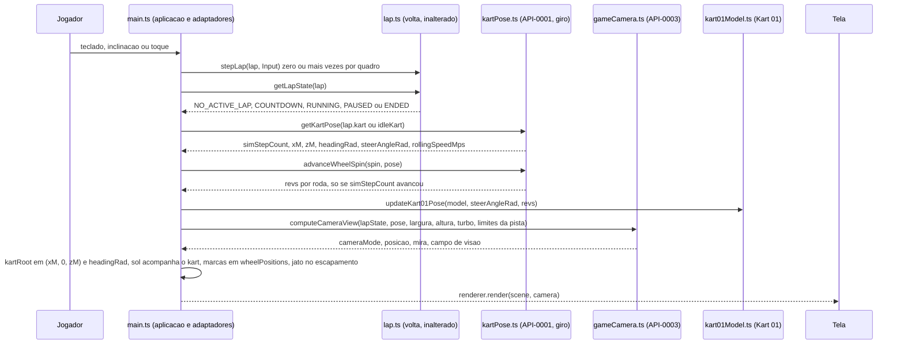

# Arquitetura

Este conjunto projeta como cada `REQ-*` do F-Spec validado de `modelo-kart-01` (1.1.0, validação
`fspec-validation-20261022-1757`; FEAT-0001 a FEAT-0006 com 63 requisitos, API-0001 a API-0003, RULE-0001 a
RULE-0003, FLOW-0001 a FLOW-0003, SCR-0001) é realizado sobre o código em execução. Os caminhos são relativos
à raiz do repositório (diretriz do estágio: o código vive em `src/`, `tests/`, `scripts/`, `docs/`;
`400 Code/Source/` está vazio). O produto é um cliente de navegador sem servidor, sem conta e sem banco: não
existem as pastas `backend/` e `mobile/` deste estágio; a pasta `core/` (simulação) também não existe neste
conjunto, porque a feature é **só de apresentação** (I2; NFR-0005, NFR-0006): todo item de projeto fica em
`web/` (o mesmo cliente serve `web-desktop` e `web-mobile`), as garantias de privacidade em `security/`, e o
único dado novo — a linha de base da simulação que as verificações comparam — em `data/`.

**Decisões do dono do produto carregadas nesta rodada** (recebidas com a invocação; o F-Spec já as traz
como `DOMAIN/DEC-00` a `DOMAIN/DEC-06`): fonte do modelo em `docs/kart-01/kart.js` (código do Cowork), adaptado
à versão de Three.js já usada; no máximo 30 chamadas de desenho do kart com o piloto, agrupando por material
sem mudar a forma, com rodas, volante e braços animáveis; física não alinhada ao modelo; retrato com campo de
visão horizontal de pelo menos 60°; câmera que desce do alto para trás do piloto durante a contagem; kart com
sombra; quando a volta termina (`ENDED`), válida ou invalidada, inclusive por reposicionamento, e o painel
de resultado aparece, a câmera continua na pose de corrida e a visão geral existe só antes da contagem.
Decisões de entrega: a feature é só camada de aplicação (não muda `src/physics.ts`, `src/lap.ts`,
`src/track.ts` nem os presets); o código fica na raiz do repositório; **o código desta feature entra depois
do da `dirigibilidade`, que também altera `src/main.ts`**
([ADR-0003](adr/ADR-0003-ordem-de-entrega-depois-da-dirigibilidade-e-sem-chave.md)).

**Estado do código lido como as-built nesta rodada.** `src/main.ts` (540 linhas, commit `0068a57`) já
carrega as mudanças de aplicação da `dirigibilidade` (acerto publicado `PUBLISHED_SETUPS`, HUD por
`getHandlingTelemetry`, registro `LapRecord`, compartilhar); aquela feature está em "checkpoint de código,
aguarda D-Spec Modo C", sem relatório de validação de código. As linhas citadas neste conjunto são as desse
arquivo; os itens de projeto nomeiam também o **símbolo ou trecho**, de modo que a etapa de código reencontra
cada ponto se a rodada final da `dirigibilidade` mover linhas. O que o sistema exibe hoje: o kart provisório
de caixas (`src/main.ts:113-134`), com rodas cilíndricas de raio 0,31 m nas posições de `wheelPositions`; a
câmera alta de perseguição suavizada (`:478-482`) com campo de visão 48° mais termo de velocidade e de turbo
suavizados (`:483-487`); a câmera inicial fixa em (125, 130, 145) olhando para a origem (`:395-396`); marcas de
pneu em `wheelPositions(config)` (`:451-455`), com cadência de relógio de parede (`:448-449`); dois jatos de
escapamento presos ao kart de caixas (`:143-151`). As linhas que cada requisito ainda não atende estão em
`98-divergences.md`.

## Contexto primário (I1)

Esta feature não cria nem lê tentativa, volta, resultado, replay, desafio ou dado persistido: ela só **lê** o
estado da simulação (`lap.kart`) e o estado da volta (`getLapState`) e desenha. O contexto primário do
domínio continua sendo o desafio diário e a pista (`trackId` + `trackVersion`), chaveados pelas features
`race-lap-validation` e `dirigibilidade`; nada aqui usa a data, o relógio do aparelho ou o nome da pista como
chave, porque nada aqui tem chave. O tempo que a animação e a câmera usam é o tempo simulado
(`simStepCount` × `STEP`, `countdownRemainingMs`), nunca o relógio de parede.

## Posicionamento por camada (I2)

| Camada | Módulo | Situação | Conteúdo desta feature |
|---|---|---|---|
| Dado de pista | `src/track.ts`, `src/trackData.ts` | inalterados | `track` e `WIDTH` são lidos para calcular os limites da pista da visão geral; nenhuma alteração (REQ-FEAT-0006-06) |
| Simulação | `src/physics.ts`, `src/maneuvers.ts`, `src/lap.ts`, `src/lapTiming.ts`, `src/setupRecords.ts` | inalterados | `State`, `wheelPositions`, `bodyVelocity`, `STEP`, `getLapState`, `COUNTDOWN_MS` são **lidos**; 0 linhas alteradas (REQ-FEAT-0006-06, -07) |
| Adaptadores de controle | em `src/main.ts` | inalterados | teclado, inclinação e toque continuam entregando o `Input` saturado; o modelo mostra o estado que a simulação informa a partir dele |
| Aplicação | `src/kart01Model.ts` | **novo** | monta o Kart 01 com o piloto a partir do código do Cowork, com os 16 grupos nomeados, o agrupamento por material e os pontos de ancoragem; pose das rodas, do volante e dos braços ([DES-0001](web/DES-0001-modelo-kart-01-montagem-agrupamento-e-decalques.md)) |
| Aplicação | `src/kart01Decals.ts` | **novo** | pinta os decalques (placa com o número 01, adesivo lateral) em `canvas` e os aplica aos materiais de decalque; único módulo do modelo que usa o DOM ([DES-0001](web/DES-0001-modelo-kart-01-montagem-agrupamento-e-decalques.md)) |
| Aplicação | `src/kartPose.ts` | **novo** | leitura `getKartPose` (API-0001), velocidade de rolamento com sinal, giro acumulado das rodas por `simStepCount`, ponto de referência do kart exibido e posições de roda da simulação no mundo ([DES-0002](web/DES-0002-estado-do-kart-para-exibicao-e-giro-das-rodas.md)) |
| Aplicação | `src/gameCamera.ts` | **novo** | modo da câmera, pose de corrida, visão geral, descida, forma da área de jogo e campo de visão; `computeCameraView` (API-0003) ([DES-0003](web/DES-0003-camera-de-jogo.md)) |
| Aplicação | `src/main.ts` | alterado | retira o kart provisório e a câmera alta de corrida; põe o Kart 01 na cena, a sombra que acompanha o kart, a câmera decidida por `computeCameraView`, os efeitos presos ao modelo ([DES-0004](web/DES-0004-integracao-da-cena-em-main-ts.md), [DES-0005](web/DES-0005-efeitos-presos-ao-kart.md)) |
| Aplicação (programa de teste em Node) | `tests/helpers/kart01Report.ts`, `tests/modelo-kart-01-*.test.ts`, `scripts/kart01-baseline.ts` | **novos** | as verificações de `npm test` e o relatório de API-0002; o gravador da linha de base ([DES-0006](web/DES-0006-verificacoes-de-npm-test-e-relatorio-do-modelo.md), [DM-0001](data/DM-0001-linha-de-base-da-simulacao-e-registro-em-tela.md)) |
| Aplicação (dado) | `tests/fixtures/kart01-sim-baseline.json`, `docs/kart-01/device-log.md` | **novos** | linha de base da simulação anterior à feature e registro dos testes em tela ([DM-0001](data/DM-0001-linha-de-base-da-simulacao-e-registro-em-tela.md)) |
| Aplicação | `index.html`, `src/style.css`, `src/audio.ts` | inalterados | nenhum texto, controle, elemento de HUD ou som é acrescentado (SCR-0001) |

Por que módulos novos (I10): `src/main.ts` importa Three.js e o DOM e não carrega em `npm test`; os critérios
de US-0001, o critério 02 de US-0002 e os NFR 0004 a 0007 nomeiam a saída de `npm test`, logo o modelo
montado, a leitura do estado, o giro das rodas e a regra da câmera precisam viver em módulos que `npm test`
importa sem DOM. `src/kart01Model.ts` importa `three` (geometria e materiais são construídos sem DOM) e fica
separado de `src/kart01Decals.ts`, que precisa de `document.createElement('canvas')` para pintar o número 01:
assim o modelo é montado e medido em Node e os decalques só são pintados no navegador. `src/kartPose.ts` e
`src/gameCamera.ts` são funções puras sobre `State`, `LapStateView` e números, no molde de `src/frameClock.ts`
e `src/lapMessages.ts`. Nenhum deles pode ficar em `src/physics.ts` ou `src/lap.ts`: o F-Spec proíbe mudar
esses arquivos (REQ-FEAT-0006-06), e a leitura de API-0001 é apresentação, não simulação. Dividir
`src/main.ts` além disso não faz parte desta feature.

Sentido das dependências (permitido): `kart01Model.ts` importa `three` e
`three/addons/utils/BufferGeometryUtils.js` (parte do pacote `three` já declarado; nenhuma dependência nova,
REQ-FEAT-0006-02, -03); `kart01Decals.ts` importa `three` e tipos de `kart01Model.ts`; `kartPose.ts` importa
`src/physics.ts` (`wheelPositions`, `bodyVelocity`, `STEP`, tipos) e nada mais; `gameCamera.ts` importa
`src/lapTiming.ts` (`COUNTDOWN_MS`) e tipos de `src/lap.ts` e de `kartPose.ts`; `main.ts` importa todos.
**Nenhum módulo da simulação importa nenhum dos quatro módulos novos** (REQ-FEAT-0006-04, registro
`LAYERING`), e nenhum módulo novo lê `Date`, `performance.now` ou `Math.random`: o relógio de parede continua
só em `src/main.ts`, decidindo quantos passos rodam num quadro (`advanceClock`) e a vigilância do sensor.

## Fluxo alterado

A largada ([FLOW-0002](../../320%20F-Specs/Output/modelo-kart-01/flows/FLOW-0002-largada-visao-geral-descida-e-pose-de-corrida.md))
segue o mesmo laço: com `NO_ACTIVE_LAP` a câmera está em `TRACK_OVERVIEW`; com `COUNTDOWN` (ou `PAUSED` com
`resumePhase` `COUNTDOWN`) em `COUNTDOWN_DESCENT`, função só de `countdownRemainingMs` e da pose do kart; com
`RUNNING`, `PAUSED` com `resumePhase` `RUNNING` ou `ENDED` em `RACE_CHASE`. Nenhum quadro em `ENDED` volta à
visão geral; a próxima visão geral é a pose do primeiro quadro da contagem da volta seguinte, ou
`TRACK_OVERVIEW` depois de uma recarga ([DES-0003](web/DES-0003-camera-de-jogo.md)).

A verificação em `npm test` ([FLOW-0003](../../320%20F-Specs/Output/modelo-kart-01/flows/FLOW-0003-verificacao-do-modelo-montado.md))
monta o modelo com `buildKart01Model()` em Node (sem decalques pintados), mede-o com
`tests/helpers/kart01Report.ts`, avança passos com os mesmos `startLap`/`stepLap` das demais features e
compara com a linha de base de `tests/fixtures/kart01-sim-baseline.json`
([DES-0006](web/DES-0006-verificacoes-de-npm-test-e-relatorio-do-modelo.md)).

## Dependências externas

Nenhuma. Não há rede, serviço, armazenamento nem biblioteca nova: o modelo é montado por código no próprio
jogo, sem arquivo de modelo, textura ou fonte baixados — o número 01 é desenhado num `canvas` com a pilha de
fontes de recuo do sistema. Não há tempo-limite, política de nova tentativa nem chave de idempotência de rede a
declarar (D-DS-03); a idempotência é a de leituras puras e de contadores de sequência por `simStepCount`
(cada DES nomeia a sua). A única dependência de execução continua sendo `three` `^0.186.1` (REQ-FEAT-0006-02,
-03).

## Estratégia de compatibilidade

| Contrato | Tratamento |
|---|---|
| `STEP`, `Input`, `step`, `wheelPositions`, presets | intactos; só lidos; provados por `SIM_CONTRACT`, `WHEEL_POSITIONS`, `DETERMINISM` e `RENDER_NEUTRAL` |
| `getLapState` (`race-lap-validation`) | intacto; lido por quadro para decidir o modo da câmera; `lapPhase`, `resumePhase`, `countdownRemainingMs` nomeados e não redefinidos |
| `getHandlingTelemetry` (`dirigibilidade`) | intacto; `speedMps` mantém o seu significado; a velocidade com sinal é `rollingSpeedMps`, nome novo (API-0001) |
| Kart provisório de caixas e câmera alta de perseguição em corrida | retirados na mesma mudança que introduz o Kart 01 e a câmera de corrida; a câmera alta inicial sobrevive só como `TRACK_OVERVIEW` antes da contagem; nenhum campo publicado os descrevia, então não há campo a rejeitar; o teste de contrato afirma que `src/main.ts` não constrói mais o kart de caixas nem suaviza a câmera (I3) |
| Efeito de turbo no campo de visão | mantido com a mesma magnitude (+4°) a partir da nova base; a suavização temporal e o termo de velocidade são retirados porque o F-Spec exige 62° a qualquer velocidade e a câmera como função só do passo, da forma e do estado de turbo ([ADR-0002](adr/ADR-0002-camera-como-funcao-pura-do-quadro.md)) |
| Linha de base da simulação | arquivo novo, `schemaVersion` 1; versão desconhecida é `BASELINE_MISSING`, nunca lida ([DM-0001](data/DM-0001-linha-de-base-da-simulacao-e-registro-em-tela.md)) |
| Dado de pista | inalterado (`schemaVersion` 2, `trackVersion` 2); os limites da pista para a visão geral são calculados de `track` e `WIDTH` por função que aceita qualquer lista de pontos, de modo que a `pista-kart-park` os forneça do seu arquivo |

## Rastros de decisão

| ADR | Decisão |
|---|---|
| [ADR-0001](adr/ADR-0001-material-unico-com-cores-por-vertice-e-malhas-por-grupo.md) | um material opaco com cores por vértice para todas as peças sólidas e as malhas de cada grupo mescladas numa só; decalques em materiais próprios; 27 chamadas de desenho planejadas, 5.128 triângulos, 16 grupos e peças animáveis preservados |
| [ADR-0002](adr/ADR-0002-camera-como-funcao-pura-do-quadro.md) | a câmera é função pura do estado da volta, da pose do kart, da forma da área de jogo e do estado de turbo; suavização de posição e de campo de visão e termo de velocidade retirados; visão geral com inclinação de 10° ajustada aos limites da pista; descida com retenção de 100 ms e curva monótona; retrato com vertical = max(62°, o que dá 60° na horizontal) |
| [ADR-0003](adr/ADR-0003-ordem-de-entrega-depois-da-dirigibilidade-e-sem-chave.md) | o código desta feature entra depois do da `dirigibilidade`; sem chave mestra, porque o F-Spec proíbe configuração e a mudança é só visual |
| [ADR-0004](adr/ADR-0004-linha-de-base-da-simulacao-como-fixture-versionado.md) | a linha de base anterior à feature é um fixture JSON versionado em `tests/fixtures/`, gravado por `scripts/kart01-baseline.ts` antes de qualquer mudança desta feature e amarrado ao `setupVersion` e à `trackVersion` em vigor |
