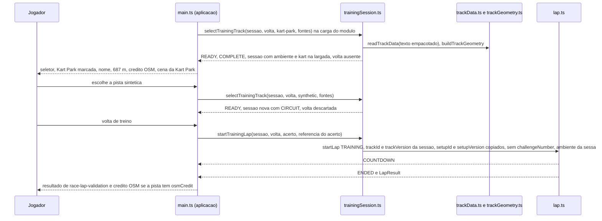
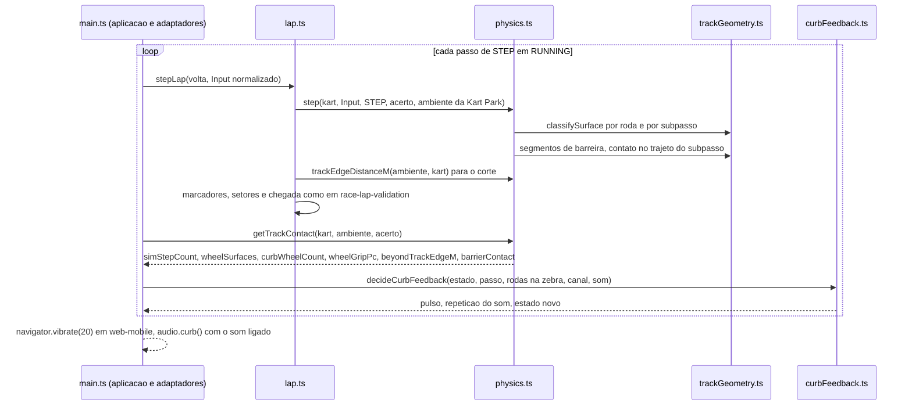
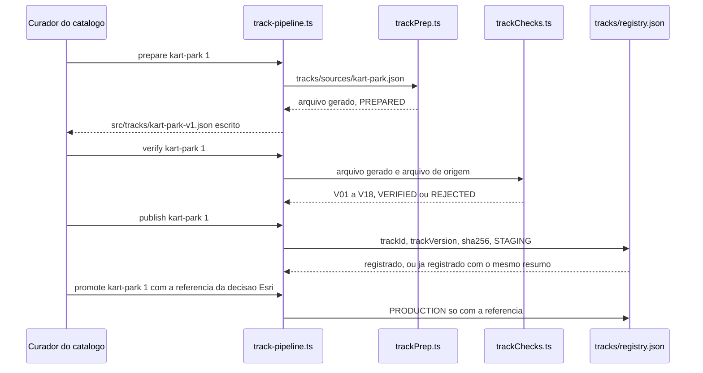

# Arquitetura

Este conjunto projeta como cada `REQ-*` do F-Spec validado de `pista-kart-park` (FEAT-0001 a FEAT-0007,
API-0001 a API-0003, FLOW-0001 a FLOW-0003, SCR-0001 a SCR-0003, RULE-0001 a RULE-0005) é realizado sobre o
código em execução. Os caminhos são relativos à raiz do repositório (diretriz do estágio: o código vive em
`src/`, `tests/`, `scripts/` e `index.html`; `400 Code/Source/` está vazio). O produto é um cliente de
navegador sem servidor, sem conta e sem banco: não existem as pastas `backend/` e `mobile/` deste estágio
(`web-mobile` roda o mesmo cliente). Os itens do dado de pista e da simulação ficam em `core/`, os da
aplicação em `web/`, o preparo offline e a publicação em `pipeline/`, as garantias de privacidade e de
licença em `security/`, os formatos em `data/` e as decisões em `adr/`.

**Estado do código lido como as-built.** A árvore do commit `ac84352` mais a rodada de código 1 de
`dirigibilidade`, ainda não commitada (`src/physics.ts` alterado, `src/setupRecords.ts` e
`scripts/handlingBench.ts` novos). As linhas citadas neste conjunto são as dessa árvore. As mudanças que o
projeto de `dirigibilidade` ainda deve a `src/main.ts`, `index.html` e `src/physics.ts` entram **antes** do
código desta feature (seção "Ordem de entrega"); por isso os itens de aplicação deste conjunto nomeiam as
funções e os elementos que mudam (`renderOffer`, `beginLap`, `renderResult`, `#welcome`, `#lap-result`), e
não só números de linha, que a entrega de `dirigibilidade` vai deslocar.

## Contexto primário (I1)

O contexto primário continua sendo o desafio diário, que ainda não existe e é de outra feature. Esta
feature só abre **sessões de treino**: toda volta é `TRAINING`, sem `challengeNumber`, e o `LapResult` é
chaveado em `trackId` + `trackVersion` exatamente como em `race-lap-validation`. A pista escolhida no seletor
é um atributo da sessão (`selectedTrackId`), nunca uma chave de resultado; nada é chaveado na data, no
relógio do aparelho ou no nome da pista, e nada é gravado no navegador
([DES-0005](core/DES-0005-sessao-de-treino-catalogo-e-selecao-de-pista.md),
[DES-0012](security/DES-0012-privacidade-rede-credito-e-licenca.md)). O tempo é contado em passos de
`STEP`, nunca em tempo de parede; o retorno da zebra também
([DES-0009](web/DES-0009-retorno-da-zebra-vibracao-e-som.md)).

## Posicionamento por camada (I2)

| Camada | Módulo | Situação | Conteúdo desta feature |
|---|---|---|---|
| Dado de pista | `src/track.ts` | inalterado | a pista sintética (`track`, `WIDTH`, `nearest`), as primitivas de linha (`Line`, `sideOf`, `crossLine`) e `SYNTHETIC_TRACK_FILE` (esquema 2) não mudam |
| Dado de pista | `src/trackData.ts` | alterado | leitor das versões de esquema 1, 2 e 3; campos `centerline`, `curbs`, `barriers`, `osmDerived`; verificações de consistência da versão 3 sobre a geometria do próprio arquivo ([DES-0001](core/DES-0001-leitura-do-dado-de-pista-em-esquema-3.md), [DM-0001](data/DM-0001-arquivo-de-pista-versao-de-esquema-3.md)) |
| Dado de pista | `src/trackGeometry.ts` | **novo** | geometria de um arquivo em esquema 3: normais, bordas, asfalto, zebras, borda da pista, distância de volta, barreiras, grade espacial ([DES-0002](core/DES-0002-geometria-da-pista-declarada-no-arquivo.md)) |
| Dado de pista (lugar na árvore: `src/tracks/`) | `src/tracks/kart-park-v1.json` | **novo** | o arquivo de pista publicado da Kart Park, `trackVersion` 1, gerado offline e empacotado no cliente |
| Simulação | `src/physics.ts` | alterado | superfície `curb` com 85 % da aderência por pneu; zebra como pista nas demais regras; colisão com barreira; `trackEnvironment`; `trackEdgeDistanceM`; `getTrackContact` ([DES-0003](core/DES-0003-superficie-por-roda-zebra-e-barreira.md)) |
| Simulação | `src/lap.ts` | alterado | corte medido da borda da pista do ambiente da volta; reposicionamento na linha central do ambiente; `kartAtStart` ([DES-0004](core/DES-0004-volta-na-kart-park-corte-e-reposicionamento.md)) |
| Simulação | `src/trainingSession.ts` | **novo** | catálogo do treino (entradas de API-0002: `trackId`, `displayName`, `displayLengthM`, `osmCredit`), estado `sessionState`, `getTrainingTrackOptions`, `selectTrainingTrack`, `startTrainingLap` (API-0002, RULE-0003) ([DES-0005](core/DES-0005-sessao-de-treino-catalogo-e-selecao-de-pista.md)); nenhum texto de crédito nem regra de tela |
| Simulação | `src/lapTiming.ts`, `src/maneuvers.ts` | inalterados | tempo inteiro em ms e manobra de drift não mudam |
| Adaptadores de controle | em `src/main.ts` | inalterados | teclado, inclinação e toque continuam entregando o `Input` normalizado; nenhum campo novo (NFR-0008) |
| Aplicação | `src/main.ts` | alterado | seletor, crédito, nome da pista, sessões, troca de cena, retorno da zebra ([DES-0007](web/DES-0007-tela-inicial-seletor-credito-e-resultado.md), [DES-0008](web/DES-0008-desenho-da-kart-park-na-tela-de-corrida.md), [DES-0009](web/DES-0009-retorno-da-zebra-vibracao-e-som.md)) |
| Aplicação | `src/trackScene.ts` | **novo** | constrói o grupo Three.js de uma pista em esquema 3 (asfalto, zebras, barreiras, linha de largada) e a transformação do minimapa ([DES-0008](web/DES-0008-desenho-da-kart-park-na-tela-de-corrida.md)) |
| Aplicação | `src/curbFeedback.ts` | **novo** | decisão pura, por passo, de pulso de vibração e de repetição do som da zebra (RULE-0004) ([DES-0009](web/DES-0009-retorno-da-zebra-vibracao-e-som.md)) |
| Aplicação | `src/lapMessages.ts` | alterado | textos do crédito OSM (`OSM_CREDIT`), regra de tela do crédito (`creditFor`) e rótulo da opção (`optionLabel`), fora de `message()` e sem tradução; aplicação pura, testável em `npm test` ([DES-0007](web/DES-0007-tela-inicial-seletor-credito-e-resultado.md)) |
| Aplicação | `src/audio.ts` | alterado | som próprio da zebra e descritores de sinal dos três sons do jogo, dos quais cada som constrói o seu sinal ([DES-0009](web/DES-0009-retorno-da-zebra-vibracao-e-som.md)) |
| Aplicação | `index.html`, `src/style.css`, `src/rawImports.d.ts` (**novo**, só declaração de tipo) | alterados | seletor, linhas de crédito, nome da pista; importação do arquivo de pista como texto |
| Aplicação (programa offline em Node; lugar na árvore: `scripts/`) | `scripts/track-pipeline.ts` | **novo** | comandos `prepare`, `verify`, `publish`, `promote` do preparo offline ([DES-0010](pipeline/DES-0010-preparo-offline-do-arquivo-da-kart-park.md), [DES-0011](pipeline/DES-0011-verificacoes-registro-de-publicacao-e-promocao.md)) |
| Dado de pista (biblioteca pura do preparo; lugar na árvore: `scripts/`) | `scripts/trackPrep.ts`, `scripts/trackChecks.ts` | **novos** | construção do arquivo e verificações V01 a V18 de RULE-0002, usadas pelo programa e por `npm test` |
| Dado do preparo offline (fora do cliente, I2) | `tracks/sources/kart-park.json`, `tracks/registry.json` | **novos** | arquivo de origem copiado byte a byte; registro de publicação ([DM-0002](data/DM-0002-registro-de-publicacao-e-estado-em-memoria.md)) |

Por que módulos novos (I10):

- `src/trackGeometry.ts`: `src/track.ts` guarda **uma** pista constante e é importado por todo teste e
  bench existente; a geometria de um arquivo qualquer em esquema 3 (bordas por ponto, zebras, grade de
  busca) é outra responsabilidade, consultada a cada passo pela simulação e reusada pelo preparo offline.
  Colocá-la em `src/trackData.ts` faria o leitor (classificação de um arquivo) carregar consultas espaciais
  de tempo de passo.
- `src/trainingSession.ts`: a sessão de treino é um modelo de estados da simulação (RULE-0003) que contém a
  volta; `src/lap.ts` é a volta de `race-lap-validation`, cujo modelo não muda, e `src/main.ts` não carrega
  em `npm test` (importa Three.js e o DOM), onde a sessão precisa de prova.
- `src/trackScene.ts`: o desenho da pista em esquema 3 precisa de prova em `npm test` (AC-US-0002-08,
  AC-US-0004-06, AC-US-0005-03) e `src/main.ts` não carrega lá; o módulo importa `three`, que roda em Node
  sem WebGL para construir geometria. A cena da pista sintética continua em `src/main.ts`: dividir
  `src/main.ts` não faz parte desta feature.
- `src/curbFeedback.ts`: o registro dos pulsos e repetições pedidos por passo é a observação dos critérios
  da zebra (F-Spec, "Como a especificação é verificada"); precisa ser puro e testável sem DOM.
- `scripts/trackPrep.ts`, `scripts/trackChecks.ts`, `scripts/track-pipeline.ts`: o preparo offline não
  existe (diretrizes: "has no folder yet"). Bibliotecas puras separadas do programa, como
  `scripts/handlingBench.ts` e `scripts/keyboard-lap.ts` de `dirigibilidade`; as verificações ficam
  separadas da construção para que uma verificação não repita o código que ela julga
  ([ADR-0002](adr/ADR-0002-preparo-offline-em-typescript-e-arquivo-empacotado.md)).
- `tracks/`: dado do preparo offline que não é fonte do cliente nem documentação. O arquivo publicado fica
  em `src/tracks/` porque é empacotado no cliente.

Sentido das dependências (permitido): `trackGeometry.ts` importa só `src/track.ts` (tipos `Point`, `Line` e
`crossLine`); `trackData.ts` importa `track.ts` e `trackGeometry.ts`; `physics.ts` importa `track.ts`,
`maneuvers.ts` e `trackGeometry.ts`; `lap.ts` importa `physics.ts`, `track.ts`, `trackData.ts`,
`lapTiming.ts` e `trackGeometry.ts`; `trainingSession.ts` importa `trackData.ts`, `trackGeometry.ts`,
`physics.ts` e `lap.ts`; `curbFeedback.ts` não importa nada além de tipos de `physics.ts`; `lapMessages.ts`
continua importando só tipos de `lap.ts` (`creditFor` e `optionLabel` recebem a entrada do catálogo por tipo
estrutural); `trackScene.ts` importa `three` e tipos e constantes de `trackGeometry.ts`; `main.ts` importa tudo
isso. `scripts/trackPrep.ts` e `scripts/trackChecks.ts` importam só `src/track.ts`, `src/trackData.ts` e
`src/trackGeometry.ts`; `scripts/track-pipeline.ts` importa as duas bibliotecas, `TRAINING_TRACKS` de
`src/trainingSession.ts` (para validar o argumento `<trackId>`), `node:fs`, `node:path` e `node:crypto` e é o único
lugar do preparo que lê o relógio de parede (`new Date()` para `stagedAtUtc` e `promotedAtUtc`). Nenhum
módulo de dado de pista ou de simulação importa `three`, o DOM, `src/audio.ts` ou `src/main.ts`, nem lê
`Date`, `performance.now` ou `Math.random` ([DES-0006](core/DES-0006-invariantes-ensaios-e-ordem-de-entrega.md)).

## Fluxo alterado — abertura, escolha e troca de pista

## Fluxo alterado — passo na Kart Park e retorno da zebra

## Fluxo alterado — preparo offline e publicação

## Dependências externas

Nenhuma dependência nova de execução nem de desenvolvimento (REQ-FEAT-0007-11). O preparo offline usa só
módulos embutidos do Node (`node:fs`, `node:path`, `node:crypto`) e o `tsx` que o projeto já tem. O arquivo
de pista é empacotado no cliente pelo Vite (importação `?raw`), de modo que nenhuma requisição é feita entre
a escolha da pista e o fim da volta (REQ-FEAT-0007-05). O dado do OpenStreetMap entra só pelo arquivo de
origem, offline: sem rede, sem tempo-limite e sem nova tentativa; a chave de idempotência da publicação é
`trackId` + `trackVersion` + `sha256` ([DES-0011](pipeline/DES-0011-verificacoes-registro-de-publicacao-e-promocao.md),
D-DS-03). O link do crédito é navegação iniciada pelo Jogador, que o jogo nunca espera.

## Estratégia de compatibilidade

| Contrato | Tratamento |
|---|---|
| Arquivo de pista | versão de esquema 3 acrescentada; o leitor lê 1, 2 e 3; o arquivo da pista sintética continua em 2, sem mudança; versão maior que 3 é `UNSUPPORTED_SCHEMA`, intacta ([DM-0001](data/DM-0001-arquivo-de-pista-versao-de-esquema-3.md), [ADR-0001](adr/ADR-0001-esquema-3-do-arquivo-de-pista.md)) |
| `readTrackData`, `TrackReading` | mesma função e mesma forma plana; em esquema 3 a leitura traz também `centerline`, `curbs`, `barriers` e `osmDerived` |
| `checkConsistency` | inalterada (pista sintética, C1 a C7); a versão 3 usa `checkConsistencyV3` sobre a geometria do arquivo |
| `STEP`, `step(state, input, dt, config, environment)`, `Input` | inalterados; `Environment` ganha o campo opcional `track`; objetos `{surfaceAt, walls}` existentes continuam válidos |
| `Surface` | ganha o valor `curb`, que só aparece num ambiente com zebra; na pista sintética as superfícies continuam `asphalt` e `grass` e todo cálculo é idêntico bit a bit ([ADR-0004](adr/ADR-0004-zebra-como-superficie-na-fisica.md)) |
| `getHandlingTelemetry` (`dirigibilidade`) | inalterado: `surface` continua `ASPHALT` ou `GRASS` (o centro do kart sobre a zebra é pista, `ASPHALT`); `wallContact` não é usado pela barreira |
| `LapSession`, `LapResult`, `getLapState` | inalterados; o ambiente da volta já é parâmetro de `startLap` |
| `edgeDistanceM` (`src/lap.ts:218`) | inalterado e ainda exportado; o corte passa a usar `trackEdgeDistanceM`, que na pista sintética é a mesma expressão |
| Dado persistido do jogador | nenhum campo novo, nenhuma leitura ou gravação |
| Telas de `race-lap-validation` | acrescidas do seletor, das linhas de crédito e do nome da pista da sessão; textos existentes inalterados |

## Ordem de entrega — dependência de `dirigibilidade` (REQ-FEAT-0007-12)

O código desta feature começa só depois do commit em que `dirigibilidade` for entregue com `npm test`
passando; o manifesto da etapa de código desta feature registra o hash desse commit, e o primeiro commit de
código desta feature descende dele ([DES-0006](core/DES-0006-invariantes-ensaios-e-ordem-de-entrega.md)).

| Arquivo | `dirigibilidade` | Esta feature |
|---|---|---|
| `src/physics.ts` | altera (acerto v5, assistências, pista de teste, classificador, telemetria) | altera (superfície `curb`, barreira, `trackEnvironment`, `getTrackContact`) |
| `src/main.ts` | altera (acerto publicado, HUD por `getHandlingTelemetry`, registro e compartilhamento) | altera (sessão, seletor, crédito, cena, retorno da zebra) |
| `index.html` | altera (`#lap-result-setup`, `#lap-share`) | altera (seletor, crédito, `#track-name`) |
| `src/lap.ts` | congela (NFR-0008 de `dirigibilidade`) | altera (borda do corte, reposicionamento, `kartAtStart`) |
| `src/trackData.ts` | congela (NFR-0008 de `dirigibilidade`: dado de pista inalterado) | altera (esquema 3) |
| `src/track.ts` | congela (NFR-0008 de `dirigibilidade`) | não altera |
| `src/audio.ts`, `src/style.css`, `src/lapMessages.ts`, `package.json` | não altera | altera |
| `src/setupRecords.ts`, `src/handlingMessages.ts`, `scripts/handlingBench.ts`, `scripts/keyboard-lap.ts`, `scripts/physics-bench.ts`, `docs/physics.md` | escreve | não altera |

Arquivos novos desta feature: `src/trackGeometry.ts`, `src/trainingSession.ts`, `src/trackScene.ts`,
`src/curbFeedback.ts`, `src/rawImports.d.ts`, `src/tracks/kart-park-v1.json`, `scripts/trackPrep.ts`,
`scripts/trackChecks.ts`, `scripts/track-pipeline.ts`, `tracks/sources/kart-park.json`, `tracks/registry.json`;
na etapa de testes, `tests/pista-kart-park-*.test.ts`, `tests/helpers/kartParkPilot.ts`,
`tests/fixtures/kartParkFiles.ts` e `docs/kart-park-device-log.md`.

## Consequências para outras features

- `race-lap-validation`, etapa de testes: `tests/race-lap-validation-track-data.test.ts:20` (dentro de
  CHK-TEST-0009-02) afirma `TRACK_SCHEMA_VERSION` igual a 2 e `:21` que o arquivo sintético declara a versão
  corrente; `:24-30` (CHK-TEST-0009-03) usa `schemaVersion` 3 como "versão posterior" e espera
  `UNSUPPORTED_SCHEMA`. Com o esquema 3 que o F-Spec exige (REQ-FEAT-0002-02, REQ-FEAT-0002-16 e API-0001),
  `TRACK_SCHEMA_VERSION` passa a 3, a pista sintética continua em 2 (REQ-FEAT-0002-15) e um arquivo sintético
  com `schemaVersion` 3 e sem `centerline` é `UNREADABLE`. As duas verificações afirmam literais mais
  estreitos que o requisito delas (NFR-0012 daquela feature: versão maior que a anterior, versão
  desconhecida intacta), que continua satisfeito com 3 e com 4. A mudança desses dois testes é de
  `race-lap-validation` e chega a ela como feedback desta etapa (conventions §14); nenhum arquivo daquela
  feature é editado por este conjunto nem pelas etapas de código e de testes desta feature. Como `npm test`
  roda as duas suítes juntas, o commit de código desta feature que sobe `TRACK_SCHEMA_VERSION` só é integrado
  ao ramo principal junto com a mudança desses dois testes já aplicada pela etapa de testes de
  `race-lap-validation`; até lá ele fica no ramo da feature, e a reprovação desses dois testes, e só deles,
  é registrada pela etapa de testes desta feature como devida a `race-lap-validation`.
- `dirigibilidade`: nenhum campo de API-0001 daquela feature muda; os ensaios dela continuam na pista
  sintética e na pista de teste, cujos cálculos não mudam (ambiente sem `track`); o custo por passo na pista
  sintética não ganha chamada de `surfaceAt` (o bloco de barreira e o cálculo de toque só existem com
  `environment.track`), de modo que `STEP_COST` daquela feature não é afetado.

## Rastros de decisão

| ADR | Decisão |
|---|---|
| [ADR-0001](adr/ADR-0001-esquema-3-do-arquivo-de-pista.md) | esquema 3 com a geometria no arquivo; leitor das versões 1, 2 e 3; consistência da versão 3 sobre a geometria do próprio arquivo |
| [ADR-0002](adr/ADR-0002-preparo-offline-em-typescript-e-arquivo-empacotado.md) | preparo offline em TypeScript sob `scripts/`, verificações em `npm test`; arquivo publicado empacotado no cliente como texto |
| [ADR-0003](adr/ADR-0003-colisao-com-a-barreira.md) | barreira como poligonal com meia espessura de contato; mesma resposta do muro; contato também no trajeto do subpasso |
| [ADR-0004](adr/ADR-0004-zebra-como-superficie-na-fisica.md) | zebra como terceira superfície da física, 85 % da aderência por pneu, pista nas demais regras; caminho da pista sintética bit a bit inalterado |
| [ADR-0005](adr/ADR-0005-kart-park-sem-chave-e-producao-bloqueada.md) | nenhuma chave de configuração; produção com a Kart Park bloqueada na promoção até a decisão Esri |
| [ADR-0006](adr/ADR-0006-lacunas-do-f-spec-resolvidas-no-projeto.md) | largura da zebra, suavização, origem das coordenadas, intervalo e timbre do som, aba do link e aparência |
