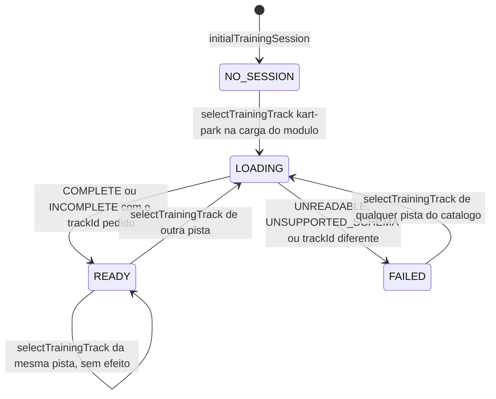

# DES-0005 — Sessão de treino, catálogo do treino e seleção de pista

## Realiza

O contrato API-0002 e o modelo de estados de RULE-0003: o catálogo fixo com as duas pistas
(REQ-FEAT-0001-01), a Kart Park como pista da abertura, sem ler nem gravar escolha anterior
(REQ-FEAT-0001-02, -03, -04); a troca de pista encerra a sessão, descarta a volta não encerrada e abre uma
sessão nova com o kart na largada e sem volta (REQ-FEAT-0001-05, -08, -09, -10); a volta de uma sessão é
sempre `TRAINING`, sem `challengeNumber`, com o `trackId` e o `trackVersion` da sessão (REQ-FEAT-0001-06,
-07, -11), sem registro de desafio diário (REQ-FEAT-0001-12) — e, pelo F-Spec revalidado de
`race-lap-validation` (FEAT-0010, ADR-0006 daquela feature), cada `startTrainingLap` inicia um **treino de voltas
seguidas**: uma `LapSession` `TRAINING` cujas voltas terminam a cada cruzamento da chegada no sentido da pista,
cada uma com um item em `listLapResults`, e que só chega a `ENDED` por `endTraining`; dado ilegível ou de esquema desconhecido deixa
a sessão `FAILED`, com as duas opções selecionáveis (REQ-FEAT-0001-14). E as entradas do catálogo que
FEAT-0006 lê (API-0002): a indicação `osmCredit`, verdadeira só na Kart Park (REQ-FEAT-0006-10), o nome e o
comprimento exibido da Kart Park, literais iguais nos dois idiomas (REQ-FEAT-0006-07, -08, -11), e nenhum
campo de recorde (REQ-FEAT-0006-09). Os textos do crédito, a regra "crédito só para entrada com `osmCredit`"
e a formatação do rótulo da opção são regra de tela e ficam na aplicação, em `src/lapMessages.ts`
([DES-0007](../web/DES-0007-tela-inicial-seletor-credito-e-resultado.md)).

## Posicionamento

`src/trainingSession.ts`, camada **simulação**, **novo**. Motivo de ser novo: RULE-0003 põe a sessão na
simulação, que a muda só por `selectTrainingTrack`; `src/lap.ts` é o modelo da volta de `race-lap-validation`,
que não muda, e `src/main.ts` não carrega em `npm test`. O catálogo fica com a sessão porque
`getTrainingTrackOptions` o devolve e a indicação de crédito tem de valer mesmo com o arquivo ilegível (vem do
catálogo, não do arquivo). O módulo guarda só a sessão e as entradas do catálogo de API-0002 (`trackId`,
`displayName`, `displayLengthM`, `osmCredit`): nenhum texto de crédito, nenhuma regra de exibição e nenhuma
formatação de rótulo. Não importa `three`, o DOM, `src/audio.ts` nem `src/main.ts`; o texto do arquivo da Kart
Park chega como argumento (`sources`), empacotado pela aplicação ([DES-0007](../web/DES-0007-tela-inicial-seletor-credito-e-resultado.md)).

## Interface

| Símbolo | Assinatura | Descrição |
|---|---|---|
| `TrainingTrackId` | `'kart-park' \| 'synthetic'` | |
| `TrainingTrackOption` | `{trackId: TrainingTrackId; displayName: string; displayLengthM?: number; osmCredit: boolean}` | entrada do catálogo, campo a campo de API-0002 (`displayLengthM` em metros) |
| `TRAINING_TRACKS` | `readonly TrainingTrackOption[]`, congelado | `{trackId: 'kart-park', displayName: 'Kart Park — São José dos Pinhais (traçado aproximado)', displayLengthM: 687, osmCredit: true}` e `{trackId: 'synthetic', displayName: 'Pista sintética', osmCredit: false}`; sem campo de recorde |
| `OPENING_TRACK_ID` | `'kart-park'` | a pista da abertura, sempre |
| `SessionState` | `'NO_SESSION' \| 'LOADING' \| 'READY' \| 'FAILED'` | |
| `TrainingSession` | `{sessionState; selectedTrackId; reading?: TrackReading; environment?: Environment; startKart?: State}` | estado de [DM-0002](../data/DM-0002-registro-de-publicacao-e-estado-em-memoria.md), imutável |
| `TrainingTrackSources` | `Readonly<Record<TrainingTrackId, TrackDataSource>>` | o dado de cada pista: texto do arquivo da Kart Park e `SYNTHETIC_TRACK_FILE` |
| `initialTrainingSession()` | `() => TrainingSession` | `{sessionState: 'NO_SESSION', selectedTrackId: OPENING_TRACK_ID}` |
| `getTrainingTrackOptions(session)` | `(TrainingSession) => {options; selectedTrackId; sessionState; trackDataStatus?}` | `options` são sempre as duas entradas; `trackDataStatus` só com `READY` ou `FAILED` (API-0002) |
| `selectTrainingTrack(session, lap, trackId, sources)` | `(TrainingSession, LapSession \| undefined, string, TrainingTrackSources) => SelectTrainingTrackResult` | abaixo |
| `startTrainingLap(session, lap, config, setup?)` | `(TrainingSession, LapSession \| undefined, KartConfig, SetupRef?) => LapCommandResult<StartLapRejection>` | com sessão `READY`: `startLap(lap, {lapKind: 'TRAINING', trackId: reading.trackId, trackVersion: reading.trackVersion, setupId: setup?.setupId, setupVersion: setup?.setupVersion}, reading, config, environment)`, nunca com `challengeNumber`; `setup` (`SetupRef` de `src/physics.ts`, `{setupId, setupVersion}` de `dirigibilidade`) é **copiado ao pedido sem interpretação** — os dois campos só entram quando `setup` é dado, nunca derivados nem preenchidos com padrão — para que `LapResult.setupId`/`setupVersion` (API-0001 1.1.0 de `race-lap-validation`, FB-01 de `dirigibilidade`) e `compareLapRecords` (RULE-0003 de `dirigibilidade`) sigam valendo na volta de treino, como `src/main.ts` já fazia antes desta feature; sem leitura, `{ok: false, code: 'TRACK_DATA_UNREADABLE'}`. A sessão devolvida é o **treino inteiro**: as voltas seguintes começam dentro de `stepLap`, sem nova chamada a `startTrainingLap` (que, com o treino em `COUNTDOWN`, `RUNNING` ou `PAUSED`, recebe a rejeição `LAP_ALREADY_ACTIVE` de `startLap`, sem mudança); todo resultado do treino carrega o mesmo `trackId`, `trackVersion`, `setupId` e `setupVersion` (INV-4 de `race-lap-validation`) |
| `trainingIdleKart(session)` | `(TrainingSession) => State \| undefined` | `startKart` da sessão `READY`; `undefined` sem sessão pronta |

`SelectTrainingTrackResult`, campo a campo de API-0002:

| Caso | Valor |
|---|---|
| `trackId` fora do catálogo | `{ok: false, code: 'UNKNOWN_TRACK', session, lap}` com a sessão e a volta recebidas, inalteradas |
| sessão `READY` com o mesmo `trackId` | `{ok: true, session, lap, response: {sessionState: 'READY', trackId, trackVersion, trackDataStatus}}` com a sessão e a volta recebidas, inalteradas (idempotência) |
| outra pista, ou sem sessão `READY`, dado `COMPLETE` ou `INCOMPLETE` com `trackId` igual ao pedido | `{ok: true, session: nova READY, lap: undefined, response: {sessionState: 'READY', trackId, trackVersion, trackDataStatus}}` |
| dado `UNREADABLE`, ou legível com `trackId` diferente do pedido | `{ok: false, code: 'TRACK_DATA_UNREADABLE', session: nova FAILED, lap: undefined, response: {sessionState: 'FAILED', trackId, trackDataStatus: 'UNREADABLE'}}` |
| dado `UNSUPPORTED_SCHEMA` | `{ok: false, code: 'TRACK_SCHEMA_UNSUPPORTED', session: nova FAILED, lap: undefined, response: {sessionState: 'FAILED', trackId, trackDataStatus: 'UNSUPPORTED_SCHEMA'}}` |

A sessão nova `READY` guarda `reading`, `environment` (`trackEnvironment(buildTrackGeometry(...))` numa leitura
de versão 3, `CIRCUIT` numa de versão 2) e `startKart = kartAtStart(reading.startPosition)`. Em todo caso que
não é `UNKNOWN_TRACK` nem a mesma pista `READY`, `selectedTrackId` passa ao pedido e o treino recebido, em
qualquer fase, deixa de existir: é o treino da sessão encerrada, nunca continua na pista nova, e a volta que
estava em andamento nele nunca produz resultado (REQ-FEAT-0001-10). As voltas desse treino já concluídas na
chegada já tiveram cada uma o seu resultado produzido e exibido no painel do resultado da volta do treino
([DES-0007](../web/DES-0007-tela-inicial-seletor-credito-e-resultado.md)); a troca não lhes acrescenta nem lhes
muda nada, e nada delas é gravado como desafio diário. `LOADING` existe no modelo e
dura a chamada: como o dado vem empacotado, a leitura é síncrona e um pedido nunca encontra outro em
`LOADING`; a ordem dos pedidos é a ordem das chamadas e vale o último (API-0002, idempotência).

## Colaboradores

Chama `readTrackData` (`src/trackData.ts`), `buildTrackGeometry` (`src/trackGeometry.ts`),
`trackEnvironment`, `CIRCUIT` e o tipo `SetupRef` (`src/physics.ts`), `startLap`, `kartAtStart` (`src/lap.ts`);
a referência do acerto vem da aplicação ([DES-0007](../web/DES-0007-tela-inicial-seletor-credito-e-resultado.md)),
que a guarda como hoje, e esta sessão não a interpreta nem a guarda. É chamado pela
aplicação ([DES-0007](../web/DES-0007-tela-inicial-seletor-credito-e-resultado.md)), pelo programa do preparo
offline, que lê só `TRAINING_TRACKS` para validar o argumento `<trackId>`
([DES-0010](../pipeline/DES-0010-preparo-offline-do-arquivo-da-kart-park.md)), e pelos testes.

## Estado e concorrência

Funções puras sobre `TrainingSession` imutável; a aplicação guarda o valor devolvido. Nenhuma transição
grava no navegador (REQ-FEAT-0001-03): nem a escolha, nem a sessão, nem registro de desafio diário. Nenhuma
transição tem contador de sequência exposto: os pedidos são locais e ordenados pela ordem das chamadas
(RULE-0003). Repetir uma seleção leva ao mesmo estado final (kart na largada, sem volta). O treino de uma
sessão tem os contadores de `race-lap-validation` (`stepCount`, que não recomeça a cada volta, e
`lapSequenceCount`); a sessão de treino desta feature não os lê nem os guarda.

## Comportamento em falha

Dado ilegível ou de esquema desconhecido: sessão `FAILED`, nenhuma volta pode começar
(`startTrainingLap` devolve a rejeição de `startLap`), o arquivo fica intacto (só é lido). `trackId` fora do
catálogo: nada muda. A perda do sensor em `web-mobile` não passa por aqui: não muda `sessionState` nem
`selectedTrackId` (RULE-0003). Sem rede, sem tempo-limite, sem escrita.

## Determinismo (D-DS-07)

Puro, sem relógio nem sorteio; a geometria e o ambiente são construídos do arquivo em ordem fixa. Provas em
`tests/pista-kart-park-session.test.ts`: o catálogo tem exatamente as duas entradas de API-0002 e nenhum
campo de recorde; a abertura (`initialTrainingSession` e `selectTrainingTrack` com `OPENING_TRACK_ID`) dá
`READY` com `selectedTrackId` `kart-park` e o kart na `startPosition` do arquivo; trocar para `synthetic` com
um treino em `COUNTDOWN`, em `RUNNING` (antes e depois de uma volta concluída) e em `PAUSED` devolve `lap`
`undefined`, `getLapState` `NO_ACTIVE_LAP` e o kart na largada sintética, e a lista de resultados do treino
descartado (o valor recebido, imutável) continua com os itens das voltas já concluídas, sem item para a volta
que estava em andamento; escolher a mesma pista `READY` devolve a mesma sessão e o mesmo treino; um treino
iniciado por `startTrainingLap` tem `lapKind` `TRAINING`, sem `challengeNumber`, e `trackId` `kart-park` ou
`synthetic` conforme a sessão, e cada item de `listLapResults` dele — de volta válida, de volta inválida por
corte (cujo resultado sai no cruzamento seguinte da chegada) e de volta inválida por marcador pulado — tem
`lapKind` `TRAINING`, nenhum `challengeNumber` e `official` falso, enquanto `endTraining` leva a `ENDED` sem
acrescentar item; com `setup` dado, a volta carrega `setupId` e `setupVersion` iguais aos do
argumento (e o `LapResult` os devolve), e sem `setup` os dois ficam ausentes do pedido; com o texto da Kart Park corrompido, a seleção dá `FAILED`, `startTrainingLap`
rejeita e uma nova seleção da pista sintética dá `READY`; a entrada `kart-park` tem `displayName`
`Kart Park — São José dos Pinhais (traçado aproximado)`, `displayLengthM` 687 e `osmCredit` verdadeiro, e a
entrada `synthetic` tem `displayName` `Pista sintética`, nenhum `displayLengthM` e `osmCredit` falso; o
`osmCredit` de cada entrada é igual ao `osmDerived` do arquivo da pista (ausente vale `false`). O crédito e o
rótulo construídos dessas entradas são provados com `src/lapMessages.ts`
([DES-0007](../web/DES-0007-tela-inicial-seletor-credito-e-resultado.md)).

## Feature flag

Nenhuma: a pista da abertura e as duas opções são fixas no catálogo, e nenhuma configuração existe para
escolher outra pista de abertura, forçar uma volta oficial ou injetar uma sessão (FEAT-0001, Configuração;
[ADR-0005](../adr/ADR-0005-kart-park-sem-chave-e-producao-bloqueada.md)).

## Pontos em aberto

Nenhum.
