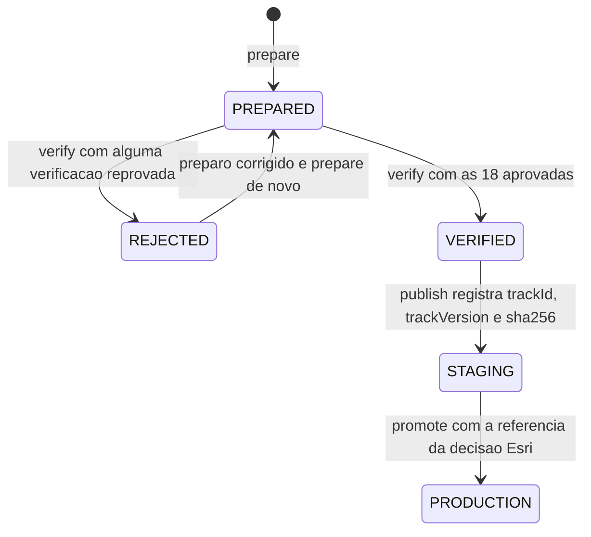

# DES-0011 — Verificações V01 a V18 do arquivo, registro de publicação e promoção

## Realiza

Os passos 9 a 11 de FLOW-0003 e RULE-0005: as 18 verificações de RULE-0002 sobre o arquivo gerado e o de
origem, determinísticas, sem simulação nem renderização, que decidem `VERIFIED` ou `REJECTED` e rodam também
em `npm test` (REQ-FEAT-0002-01 a -11, -14; REQ-FEAT-0003-01 a -07; REQ-FEAT-0004-01 a -03; REQ-FEAT-0005-01 a
-03; REQ-FEAT-0006-09; REQ-FEAT-0007-07); a publicação com o resumo SHA-256 registrado e a imutabilidade de
uma versão publicada (REQ-FEAT-0002-17, -18); a promoção a produção só com a decisão sobre a licença Esri
registrada, e o crédito da Esri na entrega que promover, se a decisão o liberar (REQ-FEAT-0007-13,
REQ-FEAT-0006-14).

## Posicionamento

- `scripts/trackChecks.ts`, **novo**, biblioteca pura; camada **dado de pista** (lugar na árvore:
  `scripts/`): importa só `src/track.ts`, `src/trackData.ts` e `src/trackGeometry.ts`. **Não importa
  `scripts/trackPrep.ts`**: lê a origem com o seu próprio código (os `pontos` e as `zebras` de `kartle-pista`
  e a regra de eixos de RULE-0002) para julgar o preparo em vez de repeti-lo.
- `scripts/track-pipeline.ts`, **novo** ([DES-0010](DES-0010-preparo-offline-do-arquivo-da-kart-park.md)):
  comandos `verify`, `publish`, `promote`.
- `tracks/registry.json`, **novo**: o registro de [DM-0002](../data/DM-0002-registro-de-publicacao-e-estado-em-memoria.md).

## Interface

`scripts/trackChecks.ts`:

| Símbolo | Assinatura | Descrição |
|---|---|---|
| `CheckId` | `'V01'` a `'V18'` | |
| `CheckResult` | `{id: CheckId; pass: boolean; detail: string}` | `detail` só com identificadores e medidas (índice do ponto, `trackId`, metros), nunca o conteúdo do arquivo |
| `verifyTrackFile(text, originJson)` | `(string, unknown) => CheckResult[]` | lê `text` com `readTrackData` (exige `COMPLETE` de versão 3) e executa V01 a V18, todas, sempre na mesma ordem |

O resumo SHA-256 (hexadecimal minúsculo) é calculado pelo programa e pelo teste de publicação com
`createHash('sha256')` de `node:crypto`; a biblioteca não importa módulo `node:*`.

As verificações, com as tolerâncias de RULE-0002 ("igual" num valor arredondado: diferença de no máximo meia
unidade da última casa gravada, 0,0005 m e 0,0005 grau):

| # | Como é calculada |
|---|---|
| V01 | `centerline` tem o mesmo número de pontos que `pontos` da origem (684) e `|P_i − O_i| <= 0,30 m` para todo `i` (ponto `i` gerado é o ponto `i` da origem) |
| V02 | 3 pontos ou mais; o último ponto difere do ponto 0 |
| V03 | `680,625 <= lapLengthM <= 694,375`, com `lapLengthM` medido de novo na `centerline` gravada, depois da suavização (soma dos 684 segmentos, inclusive o do último ponto ao ponto 0), nunca o comprimento da origem nem o declarado por ela |
| V04 | a `finishLine` passa a até 0,002 m de `P_0`, é paralela a `n_0` (seno do ângulo até 0,001) e vai da esquerda para a direita; `startPosition` está a até 0,002 m do segmento do ponto 0 ao ponto 1, com parâmetro de projeção menor que 1, do lado de depois da chegada (`sideOf(finishLine, start) > 0`) e `headingDeg` igual ao rumo do segmento |
| V05 | área com sinal positiva no plano (x, −z) e `direction` `COUNTER_CLOCKWISE` |
| V06 | `widthM_i` igual à largura do ponto `i` da origem; o menor valor arredondado a uma casa é 4,4 e o maior 10,8 |
| V07 | distância de cada `P_i` à poligonal fechada original no máximo 0,30 m |
| V08 | borda esquerda e borda direita fechadas sem autointerseção e sem interseção entre si (teste de segmentos dois a dois, excluídos os vizinhos que compartilham ponta) |
| V09 | 3 `sectorLimits` em ordem; o `k`-ésimo passa a até 0,002 m de `P_i`, paralelo a `n_i`, para o `i` que minimiza `|d_o(i) − D_k|` |
| V10 | cada marcador passa a até 0,002 m de um `P_i`, paralelo a `n_i`; os `i` crescem com `d(i)`; nenhum é o ponto 0 nem um ponto de V09; diferenças de `d` consecutivas, inclusive a do último ao primeiro passando pelo ponto 0, no máximo 25 m |
| V11 | para a chegada, cada limite e cada marcador, amostrando a linha a cada 0,05 m: a linha cruza a pista de borda a borda (as duas pontas na grama e a pista contínua entre elas no ponto); cada ponta está a no máximo `cutDistanceM` (3 m, mais 0,001) além da borda da pista; uma ponta a menos de 2,95 m além da borda tem, nos 0,06 m seguintes da reta, pista ou um cruzamento de barreira, ou está sobre a barreira; as amostras além da borda da pista de origem da linha estão na grama |
| V12 | 34 trechos; para cada zebra da origem que não cruza a largada, um trecho com o mesmo lado e `fromLapM`/`toLapM` iguais às distâncias correspondentes por índice fracionário; para a que cruza, dois trechos do mesmo lado, um do início correspondente a `lapLengthM` e outro de 0 ao fim correspondente; todo trecho com `fromLapM < toLapM` e `widthM > 0` |
| V13 | para cada amostra `p` a cada 0,25 m nas bordas do asfalto do trecho de `d_o` 371 m a 414 m, com `q` o ponto mais próximo nas bordas do asfalto do trecho de 580 m a 615 m: se `|p − q| <= 6`, o segmento `pq` cruza (ou toca) um segmento de barreira; e o mesmo trocando os trechos |
| V14 | em cada vértice e a cada 0,25 m de cada segmento de barreira: a distância ao asfalto dos pontos de 371 m a 414 m mais a distância ao asfalto dos pontos de 580 m a 615 m (`d_o`) no máximo 6 m |
| V15 | nenhum vértice de barreira dentro do asfalto e nenhum segmento de barreira cruza uma borda do asfalto |
| V16 | `schemaVersion` 3, `trackId` `kart-park`, `trackVersion` 1, `osmDerived` `true`; `cutDistanceM` e `cutDurationMs` ausentes |
| V17 | os bytes do arquivo e o comprimento do texto como literal de cadeia no pacote (`JSON.stringify(text)`) abaixo de 200.000 |
| V18 | o conjunto das chaves do objeto e dos objetos aninhados é exatamente o de [DM-0001](../data/DM-0001-arquivo-de-pista-versao-de-esquema-3.md): nenhum campo de recorde, de tempo da pista real, de comprimento oficial ou de nome |

Comandos de `scripts/track-pipeline.ts`. Os argumentos `<trackId>`, `<trackVersion>` e `--esri-decision` são
validados antes de qualquer leitura ou escrita, pela tabela de argumentos de
[DES-0010](DES-0010-preparo-offline-do-arquivo-da-kart-park.md); um valor fora dela encerra com código de
saída 1, sem ler o registro nem escrever nada:

| Comando | Efeito | Saída |
|---|---|---|
| `verify kart-park 1` | `verifyTrackFile` sobre `src/tracks/kart-park-v1.json` e `tracks/sources/kart-park.json` | `VERIFIED` se as 18 passam (código 0); `REJECTED` com os identificadores reprovados (código 1) |
| `publish kart-park 1` | exige `VERIFIED` na mesma execução; calcula o resumo; lê o registro (recusa `registryVersion` desconhecida); par ausente: acrescenta a entrada `STAGING` com `stagedAtUtc` e `prep`; par presente com o mesmo resumo: nada; par presente com outro resumo: recusa | `STAGING` registrado, `já registrado` ou `recusado: trackVersion já publicado com outro conteúdo` |
| `promote kart-park 1 --esri-decision "<referência>"` | exige a entrada em `STAGING` ou `PRODUCTION` e a referência à decisão do dono do produto registrada em `DOMAIN.md`, válida pela regra de `--esri-decision` de DES-0010; `STAGING` passa a `PRODUCTION` com `promotedAtUtc` e `esriDecisionRef`; `PRODUCTION` repetido: nada | `PRODUCTION` registrado ou `já promovido`; referência ausente ou fora da regra: recusa com código 1, a entrada fica em `STAGING` |

A promoção é executada pela etapa de deploy no ato humano de promover a produção; a referência é conferida
pelo validador de deploy contra a decisão registrada. Se a decisão liberar a licença Esri, a entrega que
promover acrescenta, na mesma mudança de código, o texto de crédito da Esri fixado pela decisão ao crédito
que `creditFor` devolve (`src/lapMessages.ts`, [DES-0007](../web/DES-0007-tela-inicial-seletor-credito-e-resultado.md)),
exibido pelos mesmos dois pontos de DES-0007, sem chave de configuração (FEAT-0006, Configuração).

## Colaboradores

`scripts/trackChecks.ts` chama `readTrackData` (`src/trackData.ts`), `buildTrackGeometry`, `classifySurface`,
`beyondTrackEdgeM`, `lapMAtIndex` (`src/trackGeometry.ts`), `crossLine`, `sideOf` (`src/track.ts`). O programa
chama `node:crypto` (`createHash('sha256')`), `node:fs`, `node:path`. Chamados pelo Curador do catálogo, pela
etapa de deploy (`promote`) e por `npm test`.

## Estado e concorrência

As verificações são funções puras dos dois arquivos: repeti-las dá o mesmo resultado, a ordem não importa e
nenhuma altera arquivo. O registro é a única escrita: dedupe por (`trackId`, `trackVersion`), unicidade
garantida pelo programa e verificada em `npm test`, segunda chegada sem efeito (mesmo resumo) ou recusada
(outro resumo), contador de sequência `trackVersion` que só cresce. Escrita atômica (temporário e renomeação).
Dois Curadores ao mesmo tempo não existem no processo; se existissem, a última renomeação vence e o teste de
unicidade reprova um registro com par duplicado. A imutabilidade protege entradas entregues: a entrada
`kart-park` 1 gravada pela rodada de código reprovada em `code-validation-20261027-2125` (`STAGING`,
`smoothingIterations` 0) é retirada pela rodada seguinte, junto com `src/tracks/kart-park-v1.json`, e
`prepare`/`verify`/`publish kart-park 1` são refeitos com a suavização de ADR-0006 1.1.0
([DM-0002](../data/DM-0002-registro-de-publicacao-e-estado-em-memoria.md), "Entrada de rodada reprovada");
`trackVersion` continua 1 e V16 não muda.

## Comportamento em falha

Argumento inválido: recusa antes de ler o registro ou o arquivo, nada escrito ([DES-0010](DES-0010-preparo-offline-do-arquivo-da-kart-park.md)).
`verify` reprovado: nada é publicado; a correção é no preparo, nunca no jogo. Registro ilegível ou de versão
desconhecida: o programa recusa e não reescreve. Falha entre o cálculo do resumo e a renomeação: o registro
anterior fica intacto e `publish` pode ser executado de novo (idempotente). Sem rede, sem tempo-limite.
Saída: identificadores, códigos, medidas.

## Observabilidade

`tests/pista-kart-park-track-file.test.ts` executa `verifyTrackFile` sobre o arquivo publicado e a origem e
afirma cada `V01` a `V18` num teste próprio que nomeia os critérios que verifica (AC-US-0002-01 a -07,
AC-US-0003-01 a -04, AC-US-0004-01 a -03, AC-US-0005-01, -02, AC-US-0006-09). `tests/pista-kart-park-publication.test.ts`
afirma: para cada entrada do registro, o arquivo de `file` existe e o seu SHA-256 é o registrado; não há dois
pares iguais; `trackId`, `trackVersion` e `esriDecisionRef` de cada entrada obedecem às restrições de
[DM-0002](../data/DM-0002-registro-de-publicacao-e-estado-em-memoria.md); toda entrada `PRODUCTION` tem
`esriDecisionRef` e `promotedAtUtc`; o catálogo do treino
aponta para o arquivo registrado de maior `trackVersion`. A métrica de REQ-FEAT-0002-14 é o tamanho de V17.

## Determinismo (D-DS-07)

Puro, sem relógio nem sorteio na biblioteca; o programa lê o relógio só para `stagedAtUtc` e `promotedAtUtc`,
que não entram em verificação alguma. Prova: duas execuções de `verifyTrackFile` dão listas `deepEqual`; cópias
do arquivo publicado com um desvio cada (um ponto a 0,4 m da origem; as coordenadas escaladas para levar o
comprimento para fora da faixa; a ordem dos pontos invertida; um marcador retirado deixando 30 m; uma zebra
trocada de lado; um vértice da barreira movido para dentro do asfalto; um campo `recordeMs`) têm a
verificação correspondente (V01, V03, V05, V10, V12, V15, V18) entre as reprovadas.

## Feature flag

Nenhuma: a promoção é um ato humano registrado, não uma chave ([ADR-0005](../adr/ADR-0005-kart-park-sem-chave-e-producao-bloqueada.md)).

## Pontos em aberto

Nenhum.
