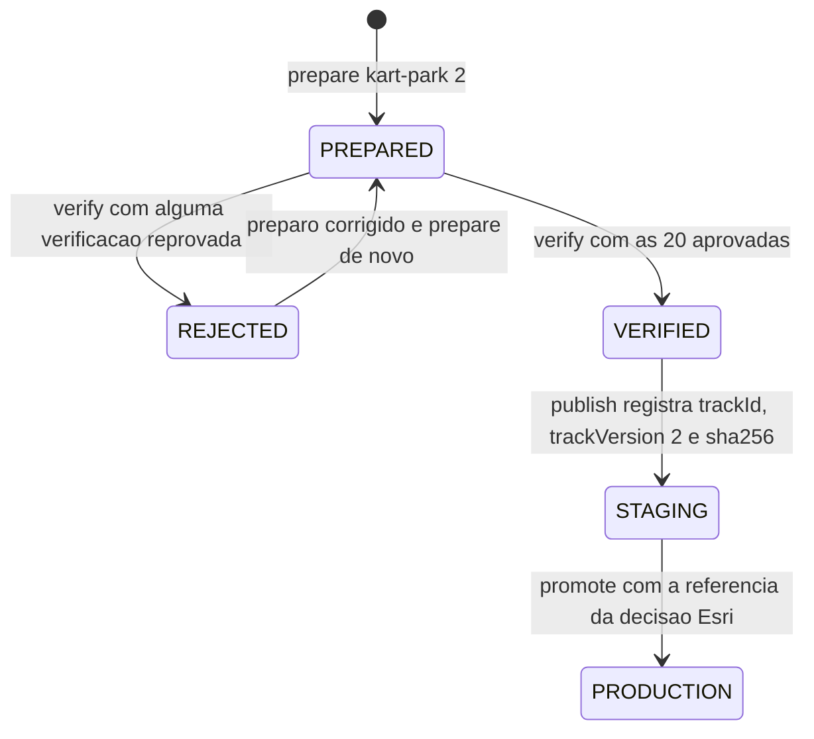

# DES-0011 — Verificações V01 a V20 do arquivo, registro de publicação e promoção

## Realiza

Os passos 9 a 11 de FLOW-0003 e RULE-0005, na revisão 3 do seed: as 20 verificações de RULE-0002 sobre o
arquivo gerado da versão 2 e o arquivo da réplica, determinísticas, sem simulação nem renderização, que decidem
`VERIFIED` ou `REJECTED` e rodam também em `npm test` (REQ-FEAT-0002-01, -02, -04 a -11, -14, -19;
REQ-FEAT-0003-01 a -07, -16; REQ-FEAT-0004-01 a -03; REQ-FEAT-0005-01 a -03, -20; REQ-FEAT-0006-09;
REQ-FEAT-0007-07); a publicação da versão 2 com o resumo SHA-256 registrado, como arquivo novo, e a
imutabilidade de toda versão publicada (REQ-FEAT-0002-17, -18); o arquivo da versão 1 no repositório, com
`trackVersion` 1 e byte a byte o registrado na publicação dela (REQ-FEAT-0002-20, -21); a promoção a produção,
de qualquer versão, só com a decisão sobre a licença Esri registrada, e o crédito da Esri na entrega que
promover, se a decisão o liberar (REQ-FEAT-0007-13, REQ-FEAT-0006-14).

## Posicionamento

- `scripts/trackChecks.ts`, biblioteca pura; camada **dado de pista** (lugar na árvore: `scripts/`), alterado:
  as verificações passam a ser as de RULE-0002 2.0.0, julgadas contra a réplica. Importa só `src/track.ts`,
  `src/trackData.ts` e `src/trackGeometry.ts`. **Não importa `scripts/trackPrep.ts`**: lê a réplica com o seu
  próprio código (`pontos`, `zebras`, `elementos` de `kartle-pista` e a regra de eixos de RULE-0002) para julgar
  o preparo em vez de repeti-lo. As verificações da versão 1 (correspondência por índice, suavização, 34
  trechos, trechos de 371–414 m e 580–615 m) saem do módulo com a mudança de RULE-0002; a versão 1 passa a ser
  julgada só pelo resumo registrado (abaixo).
- `scripts/track-pipeline.ts` ([DES-0010](DES-0010-preparo-offline-do-arquivo-da-kart-park.md)): comandos
  `verify`, `publish`, `promote`, com a origem por par de `TRACK_ORIGINS`.
- `tracks/registry.json`: o registro de [DM-0002](../data/DM-0002-registro-de-publicacao-e-estado-em-memoria.md),
  que ganha a entrada `kart-park` 2; a entrada `kart-park` 1 não muda.

## Interface

`scripts/trackChecks.ts`:

| Símbolo | Assinatura | Descrição |
|---|---|---|
| `CheckId` | `'V01'` a `'V20'` | acrescenta `V19` e `V20` (`scripts/trackChecks.ts:11-13` hoje vai até `V18`) |
| `CheckResult` | `{id: CheckId; pass: boolean; detail: string}` | sem mudança; `detail` só com identificadores e medidas (índice do ponto, `trackId`, metros) |
| `verifyTrackFile(text, replicaJson)` | `(string, unknown) => CheckResult[]` | lê `text` com `readTrackData` (exige `COMPLETE` de versão 3) e executa V01 a V20, todas, sempre na mesma ordem; uma réplica ilegível reprova as verificações que a leem |

O resumo SHA-256 (hexadecimal minúsculo) é calculado pelo programa e pelo teste de publicação com
`createHash('sha256')` de `node:crypto`; a biblioteca não importa módulo `node:*`.

As verificações, com as tolerâncias de RULE-0002 ("igual" num valor arredondado: diferença de no máximo meia
unidade da última casa gravada, 0,0005 m e 0,0005 grau). *R* é a linha central da réplica: os pontos `(x, −y)`
da réplica, em volta fechada; *T*₁ = `d` de 368,5 m a 406,5 m e *T*₂ = `d` de 594,5 m a 624,5 m:

| # | Como é calculada |
|---|---|
| V01 | `|P_0 − R_0| <= 0,10 m` |
| V02 | 3 pontos ou mais; o último ponto difere do ponto 0 |
| V03 | `683,793 <= lapLengthM <= 697,607`, com `lapLengthM` medido na `centerline` gravada (soma de todos os segmentos, inclusive o do último ponto ao ponto 0), nunca o declarado pela réplica |
| V04 | sem mudança: a `finishLine` passa a até 0,002 m de `P_0`, paralela a `n_0` (seno do ângulo até 0,001), da esquerda para a direita; `startPosition` a até 0,002 m do segmento do ponto 0 ao ponto 1, com parâmetro de projeção menor que 1, do lado de depois da chegada (`sideOf(finishLine, start) > 0`) e `headingDeg` igual ao rumo do segmento |
| V05 | sem mudança: área com sinal positiva no plano (x, −z) e `direction` `COUNTER_CLOCKWISE` |
| V06 | `widthM` de todo ponto igual a 7,0 |
| V07 | distância de cada `P_i` à poligonal fechada *R* no máximo 0,10 m |
| V08 | sem mudança: borda esquerda e borda direita fechadas sem autointerseção e sem interseção entre si (segmentos dois a dois, excluídos os vizinhos que compartilham ponta), na volta inteira, o que inclui a curva de raio 8,8 m perto de 216 m |
| V09 | 3 `sectorLimits` em ordem; o `k`-ésimo passa a até 0,002 m de `P_i`, paralelo a `n_i`, para o `i` que minimiza `|d(i) − D_k|`, com `D` = 204,9 m, 354,9 m e 534,7 m |
| V10 | sem mudança: cada marcador passa a até 0,002 m de um `P_i`, paralelo a `n_i`; os `i` crescem com `d(i)`; nenhum é o ponto 0 nem um ponto de V09; diferenças de `d` consecutivas, inclusive a do último ao primeiro passando pelo ponto 0, no máximo 25 m |
| V11 | sem mudança: para a chegada, cada limite e cada marcador, amostrando a linha a cada 0,05 m: a linha cruza a pista de borda a borda; cada ponta a no máximo `cutDistanceM` (3 m, mais 0,001) além da borda da pista; uma ponta a menos de 2,95 m além da borda tem, nos 0,06 m seguintes da reta, pista ou um cruzamento de barreira, ou está sobre a barreira; as amostras além da borda da pista de origem da linha estão na grama |
| V12 | 22 trechos, na ordem das `zebras` da réplica: o `k`-ésimo trecho tem o lado da `k`-ésima zebra (`esquerda` → `LEFT`, `direita` → `RIGHT`), `fromLapM` igual a `de_m` e `toLapM` igual a `ate_m`, e `widthM > 0` |
| V13 | para cada amostra `p` a cada 0,25 m nas bordas do asfalto dos pontos de *T*₁, com `q` o ponto mais próximo nas bordas do asfalto dos pontos de *T*₂: se `|p − q| <= 6`, o segmento `pq` cruza (ou toca) um segmento de barreira; e o mesmo trocando os trechos |
| V14 | em cada vértice e a cada 0,25 m de cada segmento de barreira: a distância ao asfalto dos pontos de *T*₁ mais a distância ao asfalto dos pontos de *T*₂ no máximo 6 m |
| V15 | sem mudança: nenhum vértice de barreira dentro do asfalto e nenhum segmento de barreira cruza uma borda do asfalto |
| V16 | `schemaVersion` 3, `trackId` `kart-park`, `trackVersion` 2, `osmDerived` `true`; `cutDistanceM` e `cutDurationMs` ausentes |
| V17 | sem mudança: os bytes do arquivo e o comprimento do texto como literal de cadeia no pacote (`JSON.stringify(text)`) abaixo de 200.000 |
| V18 | sem mudança: o conjunto das chaves do objeto e dos objetos aninhados é exatamente o de [DM-0001](../data/DM-0001-arquivo-de-pista-versao-de-esquema-3.md) |
| V19 | para cada um dos três pontos `i` de V09, existe um elemento da réplica com `tipo` `reta` e `de_m <= d(i) <= de_m + comprimento_m` |
| V20 | todo trecho de `curbs` tem `0 <= fromLapM < toLapM <= lapLengthM` (o limite superior com a tolerância de meia unidade da última casa) |

Comandos de `scripts/track-pipeline.ts`. Argumentos validados antes de qualquer leitura ou escrita, pela tabela
de [DES-0010](DES-0010-preparo-offline-do-arquivo-da-kart-park.md):

| Comando | Efeito | Saída |
|---|---|---|
| `verify kart-park 2` | `verifyTrackFile` sobre `src/tracks/kart-park-v2.json` e `tracks/sources/kart-park-replica.json` (resumo da réplica conferido antes) | `VERIFIED` se as 20 passam (código 0); `REJECTED` com os identificadores reprovados (código 1) |
| `publish kart-park 2` | exige `VERIFIED` na mesma execução e que `prepareReplicaTrack` reproduza os bytes do arquivo; calcula o resumo; lê o registro (recusa `registryVersion` desconhecida); par ausente: acrescenta a entrada `STAGING` com `stagedAtUtc` e `prep` ao fim de `entries`, sem tocar nas outras; par presente com o mesmo resumo: nada; par presente com outro resumo: recusa | `STAGING` registrado, `já registrado` ou `recusado: trackVersion já publicado com outro conteúdo` |
| `promote <trackId> <trackVersion> --esri-decision "<referência>"` | sem mudança, para qualquer versão registrada: exige a entrada em `STAGING` ou `PRODUCTION` e a referência; `STAGING` passa a `PRODUCTION` com `promotedAtUtc` e `esriDecisionRef`; `PRODUCTION` repetido: nada | `PRODUCTION` registrado ou `já promovido`; sem referência: recusa com código 1, a entrada fica em `STAGING` |
| `verify` ou `publish` com `kart-park 1` | recusados ([DES-0010](DES-0010-preparo-offline-do-arquivo-da-kart-park.md)): as verificações de RULE-0002 são as da versão 2, e a versão 1 é julgada pelo resumo | código 1 |

A promoção é executada pela etapa de deploy no ato humano de promover a produção; a referência é conferida
pelo validador de deploy contra a decisão registrada. Se a decisão liberar a licença Esri, a entrega que
promover acrescenta, na mesma mudança de código, o texto de crédito da Esri fixado pela decisão ao crédito que
`creditFor` devolve (`src/lapMessages.ts`, [DES-0007](../web/DES-0007-tela-inicial-seletor-credito-e-resultado.md)),
exibido pelos mesmos dois pontos de DES-0007, sem chave de configuração (FEAT-0006, Configuração). A regra vale
para qualquer versão da Kart Park (RULE-0005 2.0.0).

A versão 1 fica em `STAGING`, com a entrada registrada em 2026-10-27T21:58:06.132Z, e não passa de novo por
nenhum estado: nada a prepara, verifica ou publica outra vez.

## Colaboradores

`scripts/trackChecks.ts` chama `readTrackData` (`src/trackData.ts`), `buildTrackGeometry`, `classifySurface`,
`beyondTrackEdgeM`, `lapMAtIndex`, `closestOnSegment`, `centerlineCrossings`, `windingSumOf`
(`src/trackGeometry.ts`), `crossLine`, `sideOf` (`src/track.ts`). O programa chama `node:crypto`
(`createHash('sha256')`), `node:fs`, `node:path`. Chamados pelo Curador do catálogo, pela etapa de deploy
(`promote`) e por `npm test`.

## Estado e concorrência

As verificações são funções puras dos dois arquivos: repeti-las dá o mesmo resultado, a ordem não importa e
nenhuma altera arquivo. O registro é a única escrita: dedupe por (`trackId`, `trackVersion`), unicidade
garantida pelo programa e verificada em `npm test`, segunda chegada sem efeito (mesmo resumo) ou recusada (outro
resumo), contador de sequência `trackVersion` que só cresce (a versão 2 é maior que a 1). Escrita atômica
(temporário e renomeação). A entrada `kart-park` 1 é relida e regravada com o mesmo conteúdo quando a entrada 2
é acrescentada: o teste de publicação afirma, campo a campo, que ela continua a de antes.

## Comportamento em falha

Argumento inválido ou par congelado: recusa antes de ler o registro ou o arquivo, nada escrito. `verify`
reprovado: nada é publicado; a correção é no preparo, nunca no jogo nem na réplica (uma réplica nova é decisão do
dono do produto, FLOW-0003). Registro ilegível ou de versão desconhecida: o programa recusa e não reescreve.
Falha entre o cálculo do resumo e a renomeação: o registro anterior fica intacto e `publish` pode ser executado
de novo (idempotente). Sem rede, sem tempo-limite. Saída: identificadores, códigos, medidas.

## Observabilidade

`tests/pista-kart-park-track-file.test.ts` executa `verifyTrackFile` sobre `src/tracks/kart-park-v2.json` e a
réplica e afirma cada `V01` a `V20` num teste próprio que nomeia os critérios que verifica (AC-US-0002-01 a -07,
AC-US-0003-01 a -04, -12, AC-US-0004-01 a -03, AC-US-0005-01, -02, -13, AC-US-0006-09).
`tests/pista-kart-park-publication.test.ts` afirma: para cada entrada do registro, o arquivo de `file` existe e o
seu SHA-256 é o registrado; não há dois pares iguais; `trackId`, `trackVersion` e `esriDecisionRef` de cada
entrada obedecem às restrições de [DM-0002](../data/DM-0002-registro-de-publicacao-e-estado-em-memoria.md); toda
entrada `PRODUCTION` tem `esriDecisionRef` e `promotedAtUtc`; a entrada `kart-park` 2 existe, com
`trackVersion` maior que o da 1, e é o `trackVersion` da entrada `kart-park` do catálogo do treino; e, para a
versão 1 (REQ-FEAT-0002-20, -21), que `src/tracks/kart-park-v1.json` existe, que o seu `trackVersion` lido é 1,
que o seu SHA-256 é `04ce5e510410e297764c047739422b07d46290c70eade1c1fb5bb7d120f057b1` (escrito literalmente no
teste, como hoje em `tests/pista-kart-park-publication.test.ts:167`) e que a entrada `kart-park` 1 do registro
tem esse `sha256`, `fileBytes` 43.013, `stagedAtUtc` 2026-10-27T21:58:06.132Z e o mesmo `prep` de antes. O mesmo
teste lê `.gitattributes` como texto e afirma que cada `file` e cada `prep.originFile` do registro casa com um
padrão marcado `-text` (hoje `tracks/sources/*.json` e `src/tracks/*.json`, `.gitattributes:5-6`): um arquivo de
pista cujo resumo é registrado nunca fica sujeito à conversão de fim de linha. A métrica de REQ-FEAT-0002-14 é o
tamanho de V17.

## Determinismo (D-DS-07)

Puro, sem relógio nem sorteio na biblioteca; o programa lê o relógio só para `stagedAtUtc` e `promotedAtUtc`,
que não entram em verificação alguma. Prova: duas execuções de `verifyTrackFile` dão listas `deepEqual`; cópias
do arquivo publicado da versão 2 com um desvio cada têm a verificação correspondente entre as reprovadas: o
ponto 0 movido 0,2 m (V01), as coordenadas escaladas para levar o comprimento para fora da faixa (V03), a ordem
dos pontos invertida (V05), um `widthM` 6,9 (V06), um ponto do meio movido 0,2 m para fora (V07), um marcador
retirado deixando mais de 25 m (V10), uma zebra trocada de lado (V12), um vértice da barreira movido para dentro
do asfalto (V15), `trackVersion` 1 (V16), um campo `recordeMs` (V18), o primeiro limite de setor movido para o
ponto de um arco (V19) e o `toLapM` do último trecho de zebra passando do comprimento da volta em 0,0008 m (V20).

## Feature flag

Nenhuma: a promoção é um ato humano registrado, não uma chave ([ADR-0005](../adr/ADR-0005-kart-park-sem-chave-e-producao-bloqueada.md)).

## Pontos em aberto

Nenhum.
